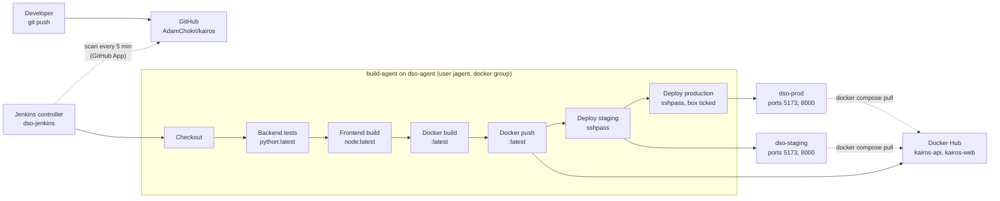

# Pipeline map (as-is)

The job `kairos-as-is` is a Multibranch Pipeline that reads `ci/as-is/Jenkinsfile` from the branch `main` through the GitHub App credential `github-app` and scans the repository every 5 minutes (no webhook, D-06). Every stage runs on the agent labelled `build` (`dso-agent`).

## Stages

| # | Stage | Tool | Inputs | Outputs | Credentials used | Who can trigger it |
|---|---|---|---|---|---|---|
| 1 | Checkout | Git plugin, `checkout scm` | The branch that was scanned | Source in the agent's workspace | `github-app` (GitHub App token, read) | A push to a branch the job watches; any logged-in Jenkins user (*Build Now*) |
| 2 | Backend tests | `docker run python:latest`, uv, pytest | `backend/` and `uv.lock` | Test result in the console (nothing archived) | None | As above |
| 3 | Frontend build | `docker run node:latest`, npm, Vitest, Vite | `frontend/` and `package-lock.json` | `frontend/dist` (not used afterwards) | None | As above |
| 4 | Docker build | `docker build` | The two Dockerfiles | `<user>/kairos-api:latest`, `<user>/kairos-web:latest` on the agent | None | As above |
| 5 | Docker push | `docker login -u … -p …`, `docker push` | The two local images | The same tags on Docker Hub | `dockerhub-rw-as-is`: Docker Hub user name and a Read & Write token, in the command line by Groovy interpolation | As above |
| 6 | Deploy staging | `sshpass`, `scp`, `ssh`, `docker compose pull`, `up -d` | `deploy/compose.yaml`, `deploy/.env` | The stack on `staging.kairos.lab`, ports 5173 and 8000, database volume kept | `deploy-ssh-as-is`: account `deploy` and its password, in the command line | As above |
| 7 | Deploy production | The same, to `prod.kairos.lab` | The same | The stack on production | The same | Only a build started with the parameter `DEPLOY_PRODUCTION` ticked, by a logged-in Jenkins user |
| post | Housekeeping | `docker image prune -f` | — | Dangling layers removed | None | — |

What the map shows, stage by stage, is analysed in [`weaknesses.md`](weaknesses.md): there is no stage that scans, verifies, approves or tests the result of a deployment.
