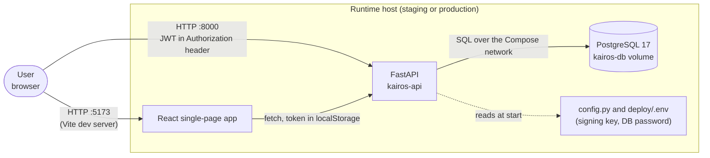
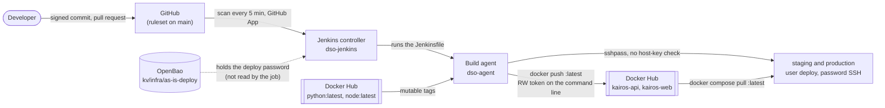

# Threat model (as-is)

STRIDE per element on two data-flow diagrams, as plan section 3.5 asks, then each threat checked against the real as-is flows. The rows T-13 to T-15 belong to Kairos Assist and are added by WP4.7, before any of its code exists.

## Diagram 1: the application

Trust boundaries: the browser and the LAN on one side, the Compose network on the other. Nothing is encrypted in transit (SV-08), and the browser's token is in `localStorage` (not a seeded weakness; looked at again by WP7.2).

## Diagram 2: the delivery pipeline

Trust boundaries: GitHub and Docker Hub are outside the lab; the build agent is where untrusted dependency code runs and also where the deploy secrets are used (W-08).

## STRIDE table, checked

"Present" means the as-is flow has the weakness; the evidence column says where it was read.

| # | Threat (STRIDE) | Element | Present in the as-is flow? | What the check found | Mitigation (plan) | Verified by |
|---|---|---|---|---|---|---|
| T-01 | A malicious dependency or install script runs in CI and steals secrets (T, I) | Build agent | **Partly.** Install scripts do run (`npm ci` without `--ignore-scripts`, `RUN npm install` in the image build), with network access and a writable workspace; the test containers receive no credential, so the tokens are not in their environment, but the agent's account is in the `docker` group (W-03, W-08) | `Jenkinsfile` stages 2 and 3; `frontend/Dockerfile` | `npm ci --ignore-scripts`, lockfiles, Dependabot cooldown, no signing or deploy key on the build agent (D-05) | WP4.2 |
| T-02 | An unsigned or modified image is deployed (T) | Registry → hosts | **Yes.** The hosts pull `:latest`; whoever holds the Docker Hub token decides what runs (W-11) | `deploy/compose.yaml`, stage 5 | Digest-only deploys, signature verified on the host | EV-19 |
| T-03 | A secret is committed (I) | Repository | **Yes, on purpose.** Two fake secrets are committed (SV-01); `ci/tools/commit-scan.sh` accepts exactly those two and nothing else | `security/seeded-secrets.tsv` | Hooks, Gitleaks in CI, push protection | EV-04, EV-09 |
| T-04 | A compromised scanner image (E) | Build agent | **Not applicable yet**: no scanner runs. The same class of risk exists for the mutable `python:latest` and `node:latest` images that run on the agent (W-04) | `Jenkinsfile` stages 2 and 3 | D-12: digests, signatures, denylist, sandbox | WP4.2 |
| T-05 | Another user's task is read or changed, IDOR (E) | API | **Yes, on purpose** (SV-06) | `backend/app/routers/tasks.py` (`get_task`); `PASS SV-06` | Ownership check in a shared dependency, regression test | SV-06 |
| T-06 | Injection: SQL, XSS, deserialization (T, E) | API, SPA | **Yes, on purpose** (SV-02, SV-03, SV-04) | `PASS SV-02`, `PASS SV-04`; the `onerror` comment of the checklist | Bound parameters, React escaping and CSP, `safe_load` and a schema | SV-02 to SV-04 |
| T-07 | The pipeline definition is edited to skip gates (T) | Jenkinsfile | **Partly.** There are no gates to skip, but the Jenkinsfile of a watched branch runs with the Docker Hub token and the deploy password; the ruleset forces a pull request to reach `main` (P0) but requires no check (W-05, W-07) | Job configuration; `Jenkinsfile` | Ruleset (pull request, required check, signed commits); fork pull requests never built | EV-06 |
| T-08 | Host takeover through weak SSH or defaults (E) | Hosts | **Yes.** The `deploy` account logs in with a password on a host with no firewall; Wazuh would show the failed logins but nothing blocks them (W-14) | `sshd -T` output of SV-11; Wazuh SCA 47 % | Hardening, key-only SSH, file integrity monitoring, active response | EV-21, EV-22 |
| T-09 | No record of who approved or deployed (R) | Jenkins, hosts | **Partly.** A build records who started it and the value of `DEPLOY_PRODUCTION`; nothing records an approval, a configuration change or a credential edit (W-13) | Build page of the as-is job | Audit Trail plugin, approver recorded by `input`, deploy log into Wazuh | EV-20 |
| T-10 | A secret leaks through logs or process arguments (I) | Pipeline | **Yes.** The token and the password are interpolated into command lines (`docker login -p`, `sshpass -p`); Docker itself warns about `--password` on the command line, and Jenkins flags the interpolation (W-09). `docker login` also stores the token, unencrypted, in `.docker/config.json` in the agent's workspace (mode 0600, owner `jagent`), where it stays after the build (ASIS-01) | Console of the as-is build (SV-10) | `withVault` and `withCredentials` masking, single-quoted `sh`, tokens through stdin, no secret on pull requests | WP4.2 |
| T-11 | A stolen AppRole credential, or lost unseal shares (S, I, D) | OpenBao | **Not exercised by the as-is flow.** The AppRoles of WP1.3 exist and were proven (30 of 30 checks); the as-is job uses none of them, and the deploy password sits in `kv/infra/as-is-deploy` and, as a second copy, in Jenkins | `docs/runbooks/accounts.md` | AppRoles bound to their VM's address, one least-privilege policy each, short token lifetime, audit log into Wazuh, shares kept as D-24 says plus an offline copy, Raft snapshot before upgrades | EV-27 |
| T-12 | A device on the lab LAN probes the lab (S, I) | LAN | **Yes.** Ports 22, 5173 and 8000 answer on every interface of the runtime hosts, over plain HTTP (W-14) | `deploy/compose.yaml`; `reachability` from the Legion | UFW and `DOCKER-USER` allow-lists, no default passwords, TLS | WP7.1 |

## Kairos Assist (WP4.7, written before any code)

Kairos Assist turns a note into a task suggestion. It is the only part of Kairos that sends user-written text to a third party, so its data flow is drawn first (D-20).

| Step | What moves | Trust boundary crossed | Control |
|---|---|---|---|
| 1 | The user types a note in the browser panel and the browser sends it to `POST /api/assist` with the user's token | Browser to API | Authentication (401 without a token); the note is limited to 1,000 characters |
| 2 | The API reads the caller's own latest tasks | API to database | Query scoped to `owner_id` of the token's user; at most 20 tasks, each cut to 500 characters (SV-13) |
| 3 | The API sends a system message, the tasks as delimited data and the note to the provider, with an opaque `user_id`, `max_tokens` 400, a 20-second timeout and thinking disabled | API to DeepSeek (outside the lab, outside the EU; T-15) | The key is read from a file rendered by the OpenBao Agent; one key per environment; `ASSIST_ENABLED` is off by default; per-user limit of 5 calls a minute (SV-14) |
| 4 | The provider answers with JSON | DeepSeek to API | The answer is parsed and validated against a schema; anything else is refused with 502 (SV-12) |
| 5 | The API returns the validated title and description, and the browser shows them as text | API to browser | React renders text; no HTML (SV-12) |

The assistant has no tool and no way to act: it never writes to the database, calls another service or reads a file. Its worst case is a wrong or hostile suggestion that the user reads and may ignore, which is why the controls sit on what goes in (scope, size, delimiters) and what comes out (schema, text), and why the key is a spending limit and not a data key.

| # | Threat (STRIDE) | Element | Present in the first version? | What the check will find | Mitigation (plan) | Verified by |
|---|---|---|---|---|---|---|
| T-13 | Instructions hidden in a task make the assistant reveal another user's data, or its answer carries script into the page (I, T) | Kairos Assist | **Yes, on purpose** (SV-13: the context query reads every user's tasks; SV-12: the suggestion is inserted as HTML) | `kairos.llm-context-unscoped`, ESLint `react/no-danger` and the SV-03 rule, `sast` red | Context from the caller's own tasks only, untrusted text delimited, JSON validated by a schema and rendered as text | Regression tests with a stub model that echoes its context (SV-12, SV-13) |
| T-14 | Abuse of the assistant runs up the API bill or exhausts the account's capacity (D) | Kairos Assist | **Yes, on purpose** (SV-14: the provider's defaults, no timeout, no limit per user) | `kairos.llm-call-unbounded`, `sast` red | Non-thinking mode, `max_tokens` 400, a 20-second timeout, 5 calls per minute per user, one key per environment in OpenBao | Regression tests: the recorded call arguments, and the sixth call returns 429 (SV-14) |
| T-15 | Task text leaves the lab for a provider in another jurisdiction (I) | Kairos Assist to DeepSeek | **By design, accepted for lab data**: DeepSeek stores what it collects on servers in the People's Republic of China (D-20) | The request body of a call, read in the stub's record | Lab data only (fake users' task text), an opaque `user_id`, never an e-mail address; the feature flag; the report discusses data residency and self-hosting the same open-weights model | `ASSIST_ENABLED` off in production until the report says otherwise; the opaque identifier is asserted by a test |
