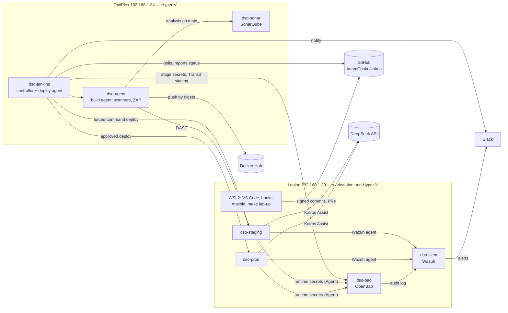
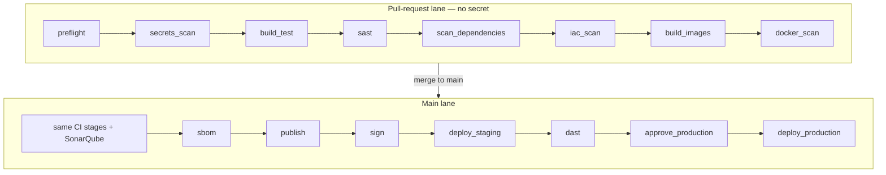

# DevSecOps Project — Master Plan

**Module:** NID-17 · Labs: Cybersecurity and Coding · 5th year NIDS · ESPRIT 2026-2027
**Project:** an end-to-end secured CI/CD pipeline ("shift left" to "shield right") built from scratch around a deliberately small task manager, **Kairos**
**Author:** Adam Chokri (solo) · repository `github.com/AdamChokri/kairos`
**Plan version:** 3.1 · 2026-10-28 · sized for a 50–70 h budget; tool facts checked on this date (Appendix B and F)
**Language:** English for the plan, report, slides and code comments

> **How to read this plan**
> - 🧭 **Decision** — a locked choice, its reason, and the alternative that was considered.
> - 💡 **Notable point** — something worth highlighting in the report and the defense.
> - ✅ **Done when** — acceptance criteria for a work package.
> - 📸 **Evidence** — a screenshot or export to capture (the index is in §12.2).
> - ⏱️ **Budget** — likely hours, with a range for the phase.
> - **[CORE]** inside the 63.5-hour core · **[PLUS]** only when a checkpoint shows you ahead of budget (§11.3).
> - **📌 Commit** steps are in bold and carry the standard disclaimer from §0.4.
> - Placeholder: `<dh-user>` your Docker Hub account.

---

## Table of contents

- [0. Executive summary](#0-executive-summary)
- [1. What the documents require](#1-what-the-documents-require)
- [2. Decision log](#2-decision-log)
- [3. Target architecture](#3-target-architecture)
- [4. Security policy: gates and exemptions](#4-security-policy-gates-and-exemptions)
- [5. Seeded weaknesses](#5-seeded-weaknesses)
- [6. Implementation plan (P0 to P8)](#6-implementation-plan-p0-to-p8)
- [7. Reporting, notifications and history](#7-reporting-notifications-and-history)
- [8. Securing the pipeline itself](#8-securing-the-pipeline-itself)
- [9. Standards and course-concept mapping](#9-standards-and-course-concept-mapping)
- [10. Metrics](#10-metrics)
- [11. Schedule and budget control](#11-schedule-and-budget-control)
- [12. Deliverables, evidence, report and defense](#12-deliverables-evidence-report-and-defense)
- [13. Risk register](#13-risk-register)
- [14. Lab operations](#14-lab-operations)
- [15. Open items](#15-open-items)
- [Appendix A — Repository layout](#appendix-a--repository-layout)
- [Appendix B — Tool and version manifest](#appendix-b--tool-and-version-manifest)
- [Appendix C — Jenkinsfile skeleton](#appendix-c--jenkinsfile-skeleton)
- [Appendix D — Policy file and exception register](#appendix-d--policy-file-and-exception-register)
- [Appendix E — Out of scope: improvement axes](#appendix-e--out-of-scope-improvement-axes)
- [Appendix F — Sources](#appendix-f--sources)
- [Appendix G — Lab power scripts](#appendix-g--lab-power-scripts)

---

## 0. Executive summary

### 0.1 What this project delivers

1. **Kairos**, a deliberately small task manager (FastAPI + React/TypeScript + PostgreSQL) with an AI assistant, **Kairos Assist**, on DeepSeek's API (D-20), and 14 seeded weaknesses — 11 mapped to OWASP Top 10:2025 and 3 to the OWASP Top 10 for LLM Applications. Each one is detected by a named control, fixed through a pull request and kept fixed by a regression test (§5).
2. **An as-is pipeline** (checkout → test → build → push → deploy, no security) that is documented and measured, so every later control has a before/after number (P2).
3. **A to-be DevSecOps pipeline on Jenkins**:
   - developer side: IDE security extensions, pre-commit and pre-push hooks, custom rules whose messages explain the fix;
   - CI: secret scanning (Gitleaks), SAST (Semgrep, Bandit, ESLint) on every pull request, a self-hosted SonarQube as the code hub on `main`, SCA and image scanning (Trivy), where a CVE known to be exploited always blocks, Dockerfile checks (Hadolint, Trivy config), SBOM (Syft);
   - acceptance: authenticated DAST with ZAP on staging;
   - production: manual approval, images and their SBOMs signed with a key that never leaves OpenBao and verified by the host itself, hardened containers, smoke tests, automatic rollback;
   - operations: Wazuh host intrusion detection, compliance scoring and Slack alerts, CIS-based hardening with before/after scores, a scheduled re-scan of what runs in production, a short pentest and two incident drills.
4. **Secrets in OpenBao**: every pipeline and runtime secret lives in OpenBao; Jenkins keeps only bootstrap identities, pull-request builds receive no secret at all, the application hosts get theirs from an OpenBao Agent, and every access lands in Wazuh (D-07).
5. **Quality gates from one policy file** (`security/policy/gates.env`): blocking and reported thresholds justified by CVSS, fix availability and known exploitation, rolled out report → fix → enforce, and an **exemption process** with a register, automatic expiry and full traceability.
6. **Reporting and history**: SonarQube for code findings, Jenkins Warnings NG trends and HTML reports for every scanner, Slack notifications.
7. **The five deliverables the brief asks for** (working pipeline, commented Jenkinsfile, report, tool exports, presentation) plus a recorded backup demo.

### 0.2 Architecture at a glance



The lab spans the Legion and the OptiPlex on one LAN (192.168.1.0/24), on their existing External switches; every VM gets a fixed address from a router reservation. You carry a router with the same reservations, a switch and the cables, so the same lab runs at home and at school: in-class checkpoints and the defense are live, with the recorded demo as a fallback (R-08). One command from WSL2 powers the whole lab up — unsealing OpenBao on the way — and down (§14, Appendix G).

### 0.3 Phases and budget

| Phase | Syllabus link | Outcome | ⏱️ Likely h (range) |
|---|---|---|---|
| P0 Foundations | — | Repository and ruleset, accounts, OptiPlex capacity, LAN reservations, key access to the OptiPlex | 2 (1.75–2.5) |
| P1 Lab | — | Seven VMs on two hosts, power scripts, Ansible baseline, OpenBao, Jenkins with two agents, SonarQube, Wazuh | 11.25 (10–13.25) |
| P2 App + as-is | Brief §2 | Kairos v0 with seeded weaknesses, as-is pipeline, as-is analysis | 9 (8–10.5) |
| P3 Shift-left | Phase 1 (development) | IDE profile, hooks, educational custom rules | 3.5 (3–4) |
| P4 CI controls + gates | Phase 1 (commit and build) | Scan stages rolled out report → fix → enforce with KEV-aware thresholds, OpenBao-backed pipeline secrets, exemptions, reporting, Slack, Kairos Assist through the gates | 14.75 (13.25–17.5) |
| P5 Delivery + DAST | Phase 2 (acceptance) | DAST before/after, images and SBOMs signed through OpenBao Transit, signed-only staging deploy with OpenBao Agent, dynamic fixes | 7.5 (6.5–8.75) |
| P6 Production + HIDS | Phase 3 (production) | Approved production deploy, smoke tests, rollback, Wazuh alerts including the OpenBao audit log | 3.5 (3–4) |
| P7 Operations | Phase 4 (operations) | Hardening before/after, mini pentest, incident drills, scheduled re-scan of production | 4.25 (3.5–5.5) |
| P8 Results + defense | Final phase | Scorecard, detection matrix, report, slides, video, rehearsal | 7.75 (6.75–8.75) |
| **Total core** | | | **63.5 (55.75–74.75)** |

The core is 9.5 h more than plan v2.1: OpenBao (+3.75 h), the self-hosted SonarQube (+1 h), the second host (+0.75 h), Kairos Assist (+3 h), KEV-aware gating, signed SBOMs and the production re-scan (+1.75 h) and hardened containers (+0.25 h), less the measurements you already gave (−1 h). The likely total sits inside your 50–70 h and the worst case does not, so §11.2 keeps about 6 h of cuts in reserve — the three newest extras first — which bring the worst case back to about 68 h; the [PLUS] items wait until you are ahead. The first fully demonstrable increment — every static control gating pull requests, with reports and notifications — arrives at the end of P4, around hour 40.

### 0.4 Conventions

- **Standard commit disclaimer** (repeated on every commit step): ⚠️ *The repository is public: run `git status` and `git diff --staged` first, confirm the pre-commit hooks passed, and never commit real credentials, unseal keys, tokens, `.env` files or evidence that contains them — a pushed commit stays public even if it is reverted.*
- **Commits:** Conventional Commits (`feat:`, `fix:`, `ci:`, `docs:`…), always SSH-signed (`git commit -S`); once the ruleset exists (WP0.1), every change reaches `main` through a squash-merged pull request — the bootstrap commit is the only direct push.
- **IDs:** decisions `D-NN`, seeded weaknesses `SV-NN`, threats `T-NN`, exceptions `EXC-NNNN`, evidence `EV-NN`, risks `R-NN`, open items `OI-NN`, brief requirements `B-NN`, syllabus requirements `S-NN`.
- **Names:** VMs `dso-<role>`, host names `<role>.kairos.lab`, pipeline stages in `snake_case` using the names the brief proposes (`secrets_scan`, `sast`, `scan_dependencies`, `docker_scan`, `dast`).
- **Time log:** one line per session in `docs/time-log.md` (date, work package, hours). It drives the checkpoints in §11.2 and feeds the report's lessons learned.

### 0.5 What changed from plan v1, and why

| Area | Plan v1 | This plan | Why |
|---|---|---|---|
| Budget | 113–152 h | 63.5 h likely (55.75–74.75), with cuts that keep the worst case under 70 h | Your real budget is 50–70 h, and hours tend to overrun |
| Hosts | Legion + OptiPlex, 7 VMs, Tailscale overlay | Legion + OptiPlex on one portable LAN (your router, switch and cables), 7 VMs, existing External switches, router reservations | Both hosts share one LAN that travels with them: no overlay, tunnel or routing to build |
| Triggers | GitHub webhook through Tailscale Funnel + Caddy | Jenkins polls GitHub every 2 minutes | No internet-facing route to build and secure |
| Secrets | OpenBao (KV, Transit, SSH CA, AppRoles, Agent) | OpenBao: KV, Transit signing key, AppRoles bound to their VM, Agent on the runtime hosts, audit into Wazuh | Central, audited secrets; the SSH CA becomes an improvement axis |
| Code hub | Self-hosted SonarQube + custom pull-request comparison | Self-hosted SonarQube Community Build on `main`; pull requests gated by Semgrep, Bandit and ESLint | Community Build analyzes one branch; no comparison code to write |
| Findings hub | DefectDojo | SonarQube + Jenkins Warnings NG trends | The brief asks for SonarQube; DefectDojo was extra |
| Scanners | 15+ tools in two lanes | 9 pipeline scanners, one per job | The slides' "three well-tuned checks beat ten noisy ones" |
| Gate engine | `gates.yaml` + a custom `gate.py` evaluator | `gates.env` + each tool's own thresholds | Same one-policy-file idea, no parser to write and test |
| DAST | Ephemeral PR environments, staging, nightly full scans | Staging: passive baseline + authenticated API scan; production: a passive baseline in the hourly re-scan | The brief asks for DAST in staging |
| Signing | OpenBao Transit key, SBOM and provenance attestations | The same Transit key through cosign's `openbao://` KMS, verified on the host; signed SBOM attestations, no provenance | Keeps the strongest demo and a verifiable SBOM, drops the provenance plumbing |
| Operations | Self-audit timers, drift checks, nightly and weekly jobs, Grafana, backups, four drills | Hardening before/after, Wazuh, production re-scan, mini pentest, two drills | Covers syllabus Phase 4 at lab scale |
| AI | — | Kairos Assist on DeepSeek's API, with three LLM weaknesses and two rules that catch them | Brings the OWASP Top 10 for LLM Applications into the same pipeline |
| Seeded weaknesses | 17 | 14, three of them in the AI feature | Each one maps to a control the brief names |
| Evidence | 42 items | 29 items | One capture per claim |

Nothing was dropped silently: every item cut from v1 is listed in Appendix E as an improvement axis for the report.

---

## 1. What the documents require

### 1.1 The four source documents

| # | Document | Role in the project |
|---|---|---|
| 1 | Course slides *Introducing DevSecOps* (ESPRIT, 2026-2027) | Concepts and vocabulary the jury expects: 100:10:1, shift left / shield right, cost of late fixes, six DevSecOps components, controls per pipeline stage, supply chain, OWASP Top 10:2025, AI-assisted development risks, EU CRA, four review questions |
| 2 | Lab welcome page | Spirit: design and customize your own pipeline, security from writing code to deploying and monitoring |
| 3 | Project brief e-mail (T. Bessrour, 2026-10-16) | **The assignment**: §1 objectives · §2 as-is analysis · §3 developer-side shift-left · §4 automated controls · §5 integration and gates · §6 reporting and alerting · §7 documentation · §8 five deliverables · §9 evaluation criteria |
| 4 | Syllabus NID-17 (rev. 2026-09-04) | Grading frame: 100 % project (pipeline, presentation, documentation); Phases 0–4 + final phase; learning outcomes AA1–AA6 |

### 1.2 Requirement traceability

**From the brief (B)**

| ID | Requirement (condensed) | Brief | Satisfied in | Evidence |
|---|---|---|---|---|
| B-01 | Understand DevSecOps and shift-left security | §1 | P3, report ch. 2, §12.5 | EV-04, EV-05 |
| B-02 | SAST, SCA, DAST, secret and image scanning in a real pipeline | §1, §4 | P4, P5 | EV-07…EV-16 |
| B-03 | Gates that block a build on a critical vulnerability | §1, §5 | §4.2, WP4.5 | EV-06 |
| B-04 | Clear, reproducible documentation usable by a third party | §1 | README, runbooks, Ansible, WP8.4 | repository |
| B-05 | Map the current stages, the tools in place and their weak points; document before changing | §2 | WP2.2, WP2.3 | EV-01, EV-02 |
| B-06 | Secured IDE with security extensions; local real-time SAST (SonarQube for IDE, ESLint security rules, Bandit, Semgrep) | §3 | WP3.1 | EV-05 |
| B-07 | pre-commit hooks that block an obvious flaw or a secret | §3 | WP3.2 | EV-04 |
| B-08 | Detect XSS, SQL/NoSQL injection, insecure deserialization, exposed secrets, vulnerable dependencies — and explain the fix | §3 | §5, WP3.3 (NoSQL through a rule fixture) | EV-04 |
| B-09 | Awareness of OWASP Top 10 and ASVS | §3 | §4.4, `docs/secure-coding.md` | guide |
| B-10 | SAST in the pipeline (SonarQube, Semgrep) | §4 | WP4.2 | EV-10, EV-11 |
| B-11 | SCA and Docker image scanning (Trivy) | §4 | WP4.2 | EV-13 |
| B-12 | DAST in staging (ZAP) | §4 | WP5.1, WP5.4 | EV-16 |
| B-13 | Secret scanning (Gitleaks) | §4 | WP4.2 | EV-09 |
| B-14 | IaC scanning — optional (Hadolint and Trivy config on the Dockerfiles) | §4 | WP4.2 | EV-14 |
| B-15 | SBOM — optional (Syft, CycloneDX) | §4 | WP5.2 | EV-15 |
| B-16 | Dedicated, clearly named stages | §5 | §3.4, Appendix C | EV-07 |
| B-17 | Severity thresholds (CVSS) that fail the build; blocking vs non-blocking | §5 | §4.1, §4.2 | EV-06 |
| B-18 | Secure handling of the pipeline's own secrets | §5 | D-07, §3.3, §8, WP4.1 | EV-25, EV-27 |
| B-19 | Automatic runs on every push and pull request; targeted local runs before push | §5 | D-06, WP3.2, `make sec-*` (WP4.2) | EV-07 |
| B-20 | HTML or JSON report per scan type | §6 | §7.1 | EV-09…EV-16 |
| B-21 | Centralisation in SonarQube | §6 | D-09 | EV-11, EV-12 |
| B-22 | Automatic notification, especially on a blocked pipeline | §6 | D-15, WP4.3 | EV-17 |
| B-23 | Historization of the security trend | §6 | §7.2 | EV-08, EV-12 |
| B-24 | Report: approach, tools, integration steps, results with screenshots, vulnerabilities detected and fixed | §7, §8 | WP8.2 | report |
| B-25 | Pipeline diagram before and after | §7 | WP2.3, WP8.1 | EV-02 |
| B-26 | Exemption procedure for a blocking false positive, with decision traceability | §7 | §4.3, WP4.4 | EV-18 |
| B-27 | Five deliverables; evaluation criteria | §8, §9 | §12.1, §1.3 | — |

**From the syllabus (S)**

| ID | Requirement | Satisfied in |
|---|---|---|
| S-01 | Phase 0 — DevSecOps definition, shift-left, DevOps vs DevSecOps, security per lifecycle phase | Report ch. 2, §12.5 |
| S-02 | Phase 1 Development — security during development, pre-commit and commit practices, SAST, hooks | P3, P4 |
| S-03 | Phase 2 Acceptance — automated security testing, DAST, compliance verification before deployment, evaluation of results | P5 (regression tests, DAST, and production approval offered only after every gate and signature check passes) |
| S-04 | Phase 3 Production — production requirements, security smoke tests, configuration safety checks, secrets across servers and cloud, host intrusion monitoring | WP5.3, P6 (OpenBao for secrets across servers; cloud equivalents as design text in the report) |
| S-05 | Phase 4 Operations — continuous monitoring, server hardening, regular penetration testing, log monitoring, automated compliance and threat detection | WP1.6, WP6.2, P7 |
| S-06 | Final phase — reports, presentation, tool justification, lessons learned | P8 |
| S-07 | AA1–AA6, notably AA3 (security *and performance* issues), AA5 (evaluate tools), AA6 (one integrated pipeline) | AA3: pipeline durations + smoke-test response times (WP6.1); AA5: detection matrix (WP8.1); AA6: P3–P7 as one pipeline |

**Course concepts** applied: 100:10:1 and Security Champion role (D-18) · shift left and shield right with a feedback loop (P3–P7, drills in WP7.3) · cost of late fixes (§4.1) · security injection points per stage (§3.4) · supply-chain defenses: SBOM, pinning, signing (D-12, D-14) · "three well-tuned checks beat ten noisy ones" (D-10) · OWASP Top 10:2025 (§9.1) · six DevSecOps components and "culture before tools" (§9.2) · AI-assisted development risks (§4.4) and LLM application risks (D-20, §5) · EU CRA (§9.3) · review questions Q1–Q4 (§12.5).

### 1.3 Evaluation criteria and how the plan scores them

| Brief §9 criterion | What demonstrates it |
|---|---|
| Relevance and completeness of the as-is analysis | A real as-is pipeline you run, a stage map, a tools inventory, a weakness table mapped to the brief's categories and to the OWASP CI/CD Top 10, and measured numbers (P2, WP4.2, WP5.1) |
| Quality and coherence of tool integration | One stage per control with the brief's names, reports in every stage, one policy file, sandboxed and pinned tools (P4, D-11, D-12) |
| Relevance of blocking thresholds and their justification | §4.1 severity model — CVSS, fix availability and known exploitation (CISA KEV) — and §4.2 gate matrix with a reason per row; exemption process §4.3 |
| Clarity and detail of documentation and reporting | Report §12.3, evidence index §12.2, runbooks, decision log §2 |
| Demonstrated understanding of DevSecOps stakes | Threat model (§3.5), securing the pipeline itself (§8), report → fix → enforce rollout (D-11), detection matrix with what no scanner sees (WP8.1), an AI feature caught by the gates (WP4.7), production re-scanned after release (WP7.4), drills feeding fixes back (WP7.3) |

### 1.4 Constraints and context

- **Solo project.** Controls that normally need a second person are designed as *roles* (Developer, Security Champion, Release Manager, Platform Admin), so they work with one operator and scale to a team without changing the pipeline (D-18).
- **Budget: 50–70 h in total.** The core is planned at 63.5 h likely (55.75–74.75 h); the cut order keeps the worst case under 70 h. Hours are logged per session and compared with the plan at four checkpoints (§11.2).
- **Hardware.** Two Hyper-V hosts on one LAN (192.168.1.0/24): the Legion 5 Pro (192.168.1.30; 32 GB RAM, 19 GB available with your usual apps open, about 200 GB free) is the workstation and runs four VMs (10 GB); the OptiPlex 5090 (192.168.1.34; i5-10500T, 32 GB RAM, 238 GB SSD) runs the three CI VMs (14 GB) — its available memory and free disk are measured in WP0.2. `make lab-up` starts nothing when either host lacks the memory, so the lab never comes up half-started.
- **Network.** Both hosts keep their current network setup: their External switches on 192.168.1.0/24 and their own addresses. The lab VMs take .70–.76 from router reservations, and the Legion stays on wired Ethernet while the lab runs (§3.1). The LAN is portable — you carry a router with the same reservations, a switch and the cables — so the lab has the same addresses at home and at school; the lab is reachable only from that LAN and reaches the internet through the router's uplink. Your ISP historically had trouble reaching quay.io; the plan prefers docker.io images and checks reachability in WP0.2, then once from school (§14).
- **Public GitHub repository** `AdamChokri/kairos` (D-02) — anything committed is public forever.
- **2026 tooling facts, checked on 2026-10-28** (sources in Appendix F):
  - Jenkins LTS from 2.555.1 (April 2026) requires Java 21 or 25 → Java 21 everywhere.
  - Trivy's distribution was compromised in March 2026 (malicious v0.69.4 binary, v0.69.4–0.69.6 images, poisoned `trivy-action`/`setup-trivy` tags; CVE-2026-33634, in CISA KEV); the Trivy VS Code extension and Checkmarx's Open VSX extensions were also compromised in early 2026 → pinned digests, verified signatures, a denylist and extension hygiene (D-12, WP3.1).
  - The KICS Docker Hub tags were overwritten in April 2026, Checkov had an OS command-injection CVE in September 2026 (CVE-2026-0302) and Terrascan was archived in November 2025 → none of them is used.
  - OpenBao 2.7.2 (26 October 2026) is current, and only the latest minor line is supported, so the project plans one minor upgrade path (§14); the file storage backend was deprecated in 2.6 for removal in 2.7, so the lab uses integrated Raft storage; cosign signs with an OpenBao Transit key through its `openbao://` KMS scheme.
  - SonarQube Community Build 26.10 (14 October 2026) is the free self-hosted edition: monthly releases, Java 21, PostgreSQL 15–18, analysis always authenticated by a token; it analyzes a single branch — branch and pull-request analysis need a commercial edition (D-09).
  - Microsoft retired Office 365 connectors in Teams in May 2026 → Slack is the notification channel.
  - Docker Hub pull limits: 200 pulls per 6 h authenticated, 100 per 6 h per IP anonymously.
  - Dependabot applies a 3-day cooldown to version updates by default since 14 July 2026; this plan sets 7 days.
  - Node.js 26 became the Active LTS line on 28 October 2026.
  - Cosign v3 uses the Sigstore bundle format by default.
  - OWASP Top 10:2025 is final (January 2026); OWASP ASVS 5.0.0 has 17 chapters; the OWASP Top 10 for LLM Applications 2025 covers Kairos Assist.
  - DeepSeek's API speaks the OpenAI format at `https://api.deepseek.com`: `deepseek-flash` is served by DeepSeek-V4.1-Flash-1017 (17 October 2026, open weights) and `deepseek-v4-pro` by V4 Pro. Thinking mode is on by default, and `max_tokens` then defaults to 64K — an unconfigured call is exactly the unbounded consumption SV-14 seeds. DeepSeek's privacy policy stores the data it collects on servers in the People's Republic of China.
  - CISA publishes its Known Exploited Vulnerabilities (KEV) catalog as a JSON feed — the list of CVEs attackers are already using.
  - Wazuh 4.14.7 is the latest final release seen; Wazuh 5.0 is still in pre-release.
- **Lab practices applied from the start:**
  - VMs are always shut down gracefully, never saved: a restored saved state brings clock skew that silently breaks TLS, JWT, OpenBao tokens and Wazuh (`make lab-down` never saves).
  - The golden image has no custom SSH host-key unit ordered against `ssh.socket` (such an ordering cycle makes SSH start at random): `ssh.service` enabled, `ssh.socket` disabled, host keys regenerated by cloud-init.
  - Ansible ignores `ansible.cfg` in a world-writable DrvFs directory → the repository lives in the WSL2 ext4 filesystem.
  - Line endings drift between Windows and WSL2 tools → `.gitattributes` in the very first commit and one shell for git.
  - Never print key material to a terminal; pass tokens through stdin, never as arguments.
  - A green build is not proof of health → every "done when" checks the actual behaviour.

---

## 2. Decision log

Each decision states the choice, why, and the alternative considered. A decision changes only through a new dated entry in `docs/decisions.md`.

🧭 **D-01 — CI/CD engine: Jenkins with a declarative `Jenkinsfile` and a Multibranch Pipeline.**
*Why:* the brief names the Jenkinsfile; ESPRIT's DevOps module and your experience are Jenkins; Warnings NG gives free per-tool trend charts; hardening Jenkins itself is DevSecOps content (§8).
*Alternative:* GitLab CI — its security dashboards are Ultimate-tier, and hosting would move to GitLab.

🧭 **D-02 — Code hosting: the public GitHub repository `AdamChokri/kairos` (Apache-2.0), protected by a ruleset on `main`.**
*Ruleset:* pull request required (approvals 0, D-18), squash merge only, required Jenkins status check (added in WP4.6), linear history, signed commits, no force push or deletion. Secret scanning with push protection, Dependabot alerts and security updates, and private vulnerability reporting are on.
*Why public:* free rulesets, push protection and Dependabot, easy access for the jury.
*Consequence:* only fake seeded secrets ever enter the repository; pull requests from forks are never built.

🧭 **D-03 — Application: Kairos, kept deliberately small — FastAPI on Python 3.13, React 19 + TypeScript (Vite), PostgreSQL 17.**
*Scope:* register and log in (JWT), tasks with search, comments, YAML import, health and version endpoints — nothing else. Every feature carries a seeded weakness or a control.
*Why:* it exercises every local tool the brief names (Bandit, ESLint security rules, Semgrep, SonarQube for IDE) and FastAPI publishes the OpenAPI document that authenticated DAST needs.

🧭 **D-04 — Lab: seven Ubuntu 24.04 VMs on two Hyper-V hosts on one portable LAN — your router and switch — on their existing External switches.**
*Why:* OpenBao and SonarQube bring the lab to 24 GB of VM memory, more than the Legion's 19 GB available; the Legion and the OptiPlex already share 192.168.1.0/24, so bridged VMs talk directly — no overlay, tunnel or routing to build, and nothing changes in either host's network setup.
*Placement:* the CI tier on the OptiPlex (`dso-jenkins`, `dso-agent`, `dso-sonar`, 14 GB); secrets, monitoring and the runtime tier on the Legion (`dso-bao`, `dso-siem`, `dso-staging`, `dso-prod`, 10 GB), which leaves 9 GB for your own work.
*Addresses:* each VM has a fixed MAC (`00:15:5D:7A:00:70`–`76`) and a router reservation (.70–.76); cloud-init asks with `dhcp-identifier: mac` so the router recognises it.
*Consequence:* the lab runs wherever its LAN goes — router, switch, cables and both hosts travel together, the Legion on wired Ethernet — so in-class sessions and the defense are live; the router's internet uplink is the one thing a venue must provide (R-08).
*Alternative:* plan v1's Tailscale overlay — the lab reachable from anywhere while it stays at home, about 10 h more.

🧭 **D-05 — Agents: builds run on `dso-agent`; signing and deployment run on a deploy agent on `dso-jenkins`, which has no Docker.**
*Why:* membership of the `docker` group is root-equivalent, so the machine that executes untrusted build code (dependencies, scanners) must hold neither `JENKINS_HOME` nor any signing or deploy credential; it cannot even reach OpenBao (D-07).
💡 **The VM that runs pull-request code never holds a credential that can sign an image or deploy it — and pull-request builds receive no secret at all.**

🧭 **D-06 — Triggers: Jenkins polls GitHub (Multibranch scan every 2 minutes); there is no inbound webhook.**
*Why:* nothing in the lab is exposed to the internet; pushes and pull requests still build within minutes, and commit statuses go back to GitHub outbound.
*Alternative:* a webhook through a tunnel — faster feedback, but an internet-facing route to secure.

🧭 **D-07 — Secrets: OpenBao is the single store for pipeline and runtime secrets.**
- **Server:** OpenBao 2.7 on `dso-bao` — single node, integrated Raft storage, TLS from the lab CA, file audit device shipped to Wazuh; port 8200 open only to the Legion, `dso-jenkins` and the two runtime hosts.
- **Pipeline:** Jenkins keeps only bootstrap identities — the GitHub App key, the Slack bot token (the Slack plugin reads Jenkins credentials only) and three AppRole credentials — `bao-build`, `bao-deploy` and `bao-signer`, for the AppRoles `jenkins-build`, `jenkins-deploy` and `jenkins-signer` — each bound to `dso-jenkins`'s address. `withVault` fetches a stage's secrets on the controller when that stage runs, and masks them in logs.
- **Runtime:** an OpenBao Agent on staging and production (AppRole bound to that host) renders the database password and JWT key into files the containers read through `*_FILE` paths.
- **Signing:** the cosign key is a non-exportable Transit key (D-14).
- **Operations:** Shamir unseal with 3 key shares and a threshold of 2, kept in your password manager; `make lab-up` asks for them (D-19); the root token is revoked after setup and you administer through a `userpass` account.
*Alternative:* Jenkins credentials and host-generated secrets (plan v2) — less to run, but no central audit, no rotation in one place and no key that cannot leave its store.

🧭 **D-08 — Registry: Docker Hub public repositories; images referenced by digest only.**
Every pull is authenticated with a *read-only* token kept in OpenBao and logged in by Ansible, through stdin, on the build agent and both runtime hosts: anonymous pulls share one per-IP limit with everyone behind the same NAT. The token can only read public images, so on a runtime host it exposes nothing but pull quota.

🧭 **D-09 — Code hub: a self-hosted SonarQube Community Build on `dso-sonar` (PostgreSQL 17), with the quality gate "Kairos Secure".**
*Scope:* Community Build analyzes a single branch, so SonarQube runs in the `main` lane: its gate blocks the release (publish, sign, deploy) and it keeps the history; pull requests are gated by Semgrep, Bandit and ESLint, which carry the blocking SAST rules anyway.
*Why self-hosted:* code and findings stay in the lab, and running the server is part of the work.
*Rejected:* the community branch plugin — it adds pull-request analysis by patching SonarQube with a Java agent, is unsupported by SonarSource and must match every SonarQube release, which a pinned toolchain cannot afford; a commercial edition — cost.

🧭 **D-10 — Toolchain: one well-tuned tool per job.**

| Job | Tool | Not used, and why |
|---|---|---|
| Secrets | Gitleaks | TruffleHog — overlaps ([PLUS] for verified-secret checks) |
| SAST | Semgrep CE (registry + custom rules), Bandit, ESLint security plugins on every pull request; SonarQube Community Build on `main` | CodeQL — a second deep engine the budget cannot absorb |
| SCA, image, Dockerfile configuration | Trivy (fs, image, config), with the CISA KEV catalog for exploitation-aware blocking | Grype, OWASP Dependency-Check — overlap; Snyk, Docker Scout — SaaS accounts |
| Dockerfile lint | Hadolint | — |
| SBOM | Syft (CycloneDX), signed and attached to each image with cosign | — |
| DAST | ZAP (baseline + API scan) | Nikto — legacy and noisy; Nuclei — overlap |
| Infrastructure as code beyond Dockerfiles | none in the core; Conftest for Compose is [PLUS] | Checkov (CVE-2026-0302), KICS (2026 distribution compromise), Terrascan (archived) |
| Secrets management | OpenBao | HashiCorp Vault — BSL licence; Jenkins credentials alone — no audit or Transit |
| Model behind Kairos Assist | DeepSeek `deepseek-flash` through its OpenAI-compatible API (D-20) | `deepseek-v4-pro` — pricier, with a lower concurrency limit, for a task this simple; a self-hosted model — a GPU service to run |
| Host | Wazuh (HIDS, FIM, SCA), Lynis | — |

💡 **The slides' "three well-tuned checks beat ten noisy ones" is applied literally. Trivy covers three jobs from one pinned, signature-verified tool — a conscious trade-off given its 2026 compromise, mitigated by D-12.**

🧭 **D-11 — Gates: thresholds and rollout modes in one policy file, `security/policy/gates.env`; fail-closed.**
Each control script runs its tool with the tool's own fail switch off, writes the full JSON/SARIF report, applies the threshold from `gates.env` and exits 0 (pass), 1 (blocked), 2 (would block, but the control is still in report mode) or any other code on a tool error. The Jenkinsfile turns 2 into a yellow stage and every other non-zero code into a red stage and a failed build, so a broken tool never passes.
💡 **Report → fix → enforce: every control lands reporting, the findings it reveals are fixed, and only then does it block — a new control never stalls on an untriaged backlog, and a fix is never stuck behind the very problem it fixes.**

🧭 **D-12 — Security tools are part of the supply chain.**
Every tool image is pinned by digest in `ci/tools/tools.lock`; vendor signatures are verified where published (Trivy images and the OpenBao package, keylessly); a denylist records known-compromised versions; every tool runs through `ci/scripts/run-tool.sh` (read-only source, non-root, no capabilities, memory limit, no network unless needed, never the Docker socket); tool updates arrive only through pull requests after a 7-day cooldown.
💡 **The 2026 Trivy, KICS and Checkov incidents make "the scanner is part of the supply chain" a concrete, citable lesson.**

🧭 **D-13 — Exemptions: a register with expiry, the tools' own suppression markers tied to an `EXC-` ID, and an automatic validator** (§4.3).

🧭 **D-14 — Delivery: images and their SBOMs signed with an OpenBao-held key, verified by the host through a forced-command deploy script, with automatic rollback.**
- The signing key is the Transit key `kairos-images` (ECDSA P-256, not exportable). The deploy agent's `sign` stage gets a short-lived token through the `jenkins-signer` AppRole and runs `cosign sign --key openbao://kairos-images`, then attaches each image's CycloneDX SBOM as a signed attestation with the same key (`cosign attest --type cyclonedx`); the public key is in the repository and on the hosts; signatures are recorded in the public Rekor log, which suits a public repository.
- Deployment uses SSH with one key per environment, kept in OpenBao and fetched only by the deploy stages, restricted in `authorized_keys` by `restrict`, `from=` and `command=`. The script accepts only `deploy <api@digest> <web@digest>`, `rollback` and `status`; it verifies both signatures, deploys by digest, checks health and rolls back on failure.
💡 **Even a fully bypassed pipeline cannot run an unsigned image: the host checks the signature itself.**
💡 **The signing key cannot be stolen from Jenkins, an agent or a backup: it never leaves OpenBao, and every signature is an audited Transit call.**

🧭 **D-15 — Monitoring and alerts: Wazuh 4.14.x single-node (Docker) and Slack.**
Wazuh covers host intrusion detection (file integrity, SSH brute force with active response), log analysis including the OpenBao audit log, and automated compliance (CIS Ubuntu 24.04 SCA policy) in one tool. Slack is the single notification channel for Jenkins and Wazuh; Teams' Office 365 connectors were retired in May 2026, and the brief asks for one channel.

🧭 **D-16 — TLS: a small lab CA for OpenBao, staging and production; Jenkins and SonarQube UIs stay on HTTP behind allow-lists.**
The CA is created once with `openssl` in WSL2 — its key never enters the repository, its certificate does (`infra/pki/kairos-lab-ca.crt`) — and is trusted by every VM (Ansible), the Jenkins JVM and the Legion. OpenBao, staging and production serve TLS 1.2+; the Wazuh dashboard has its own certificates. Jenkins and SonarQube stay on HTTP inside the LAN, reachable only from the addresses that need them — an accepted lab risk (R-10), with TLS for tool UIs as an improvement axis.

🧭 **D-17 — Provisioning: golden image + cloud-init NoCloud seeds + PowerShell on each host + Ansible from WSL2; no Terraform.**
*Why:* a golden image with cloud-init seeds builds a VM in minutes, and Ansible keeps every VM reproducible for a third party. `infra/lab/vms.csv` is the single description of the VMs — read by `New-LabVM.ps1` on each host and by the power scripts.

🧭 **D-18 — Solo-proof roles and repository hygiene.**
Jenkins accounts `admin` (Platform Admin, break-glass only), `adam` (Developer and Security Champion) and `release-manager` (production approval). GitHub required approvals stay at 0 because GitHub does not let authors approve their own pull requests; raising them to 1 is the only change a team needs. From commit #1: `.gitattributes` (LF everywhere, CRLF for PowerShell scripts, `*.ps1`), the repository in WSL2 ext4, SSH commit signing.

🧭 **D-19 — Lab power: one command from WSL2 on the Legion drives both hosts, and unseals OpenBao on the way up.**
`make lab-up`, `make lab-down` and `make lab-status` run the scripts of Appendix G: the Legion's Hyper-V through Windows PowerShell (WSL interop), the OptiPlex's over SSH with a dedicated key. Nothing starts unless every host has the rights, the wired link and the memory; VMs start and stop one at a time in a fixed order; nothing is ever saved or powered off hard.
💡 **Unseal key shares are typed, never stored: they reach OpenBao through stdin and HTTPS — never a file, a command-line argument or the screen.**

🧭 **D-20 — AI: Kairos Assist, an LLM feature on DeepSeek's API, is part of the core and arrives as a new feature through the gates (WP4.7).**
*Why:* it brings the OWASP Top 10 for LLM Applications into the same pipeline. Its three LLM weaknesses (SV-12–SV-14), written the way a developer under pressure would write them, must be caught by the existing gates and two new Semgrep rules, then fixed test-first.
*Provider:* DeepSeek's OpenAI-compatible API (`https://api.deepseek.com`) with `deepseek-flash` (DeepSeek-V4.1-Flash-1017) in non-thinking mode — turning a note into a task needs no reasoning, and Flash is the cheaper model with the higher concurrency limit; `deepseek-v4-pro` is one configuration value away. One API key per environment lives in OpenBao, rendered by the OpenBao Agent; CI uses a stub model (no key, no cost, deterministic tests); `ASSIST_ENABLED` switches the feature off without a release.
*Data:* DeepSeek's privacy policy stores the data it collects on servers in the People's Republic of China, so Kairos sends it only lab data — fake users' task text — with an opaque `user_id`, never an e-mail address; the report discusses data residency and the open-weights alternative of hosting the same model yourself (T-15).
*Alternative:* a local model on the Legion's GPU — free and offline, but one more always-on service on the workstation, and no key to protect.
💡 **DeepSeek's defaults — thinking mode on, up to 64K output tokens per call — are the unbounded-consumption weakness (LLM10) in its real-world form; the fix is three call settings and a per-user rate limit, and a Semgrep rule keeps them.**

---

## 3. Target architecture

### 3.1 Lab layout

| Host | Address | Hardware | Role | Lab share |
|---|---|---|---|---|
| Legion 5 Pro | 192.168.1.30 | Ryzen 5 5600H, 32 GB RAM (19 GB available with your usual apps), about 200 GB free | Workstation (WSL2, VS Code, Ansible, `make lab-*`) and Hyper-V host | 4 VMs · 10 GB RAM · 90 GB of VHDX maxima |
| OptiPlex 5090 | 192.168.1.34 | i5-10500T, 32 GB RAM, 238 GB SSD | Hyper-V host, driven over SSH | 3 VMs · 14 GB RAM · 105 GB of VHDX maxima |

| VM | Host | Address | vCPU | RAM | Disk max (dynamic VHDX) | Runs | Host names |
|---|---|---|---|---|---|---|---|
| `dso-bao` | Legion | 192.168.1.70 | 2 | 1 GB | 10 GB | OpenBao 2.7 (native package, Raft storage, TLS), Wazuh agent | `openbao.kairos.lab` |
| `dso-jenkins` | OptiPlex | 192.168.1.71 | 2 | 3 GB | 25 GB | Jenkins controller (Docker, 0 executors), deploy agent (systemd service, user `jdeploy`, no Docker) | `jenkins.kairos.lab`, `jenkins-res.kairos.lab` |
| `dso-agent` | OptiPlex | 192.168.1.72 | 4 | 7 GB | 60 GB | Build agent (systemd service, user `jagent` in `docker`), pinned scanner images, ZAP | `agent.kairos.lab` |
| `dso-sonar` | OptiPlex | 192.168.1.73 | 2 | 4 GB | 20 GB | SonarQube Community Build + PostgreSQL 17 (Docker Compose) | `sonar.kairos.lab` |
| `dso-siem` | Legion | 192.168.1.74 | 2 | 5 GB | 40 GB | Wazuh single-node (manager, indexer, dashboard) | `wazuh.kairos.lab` |
| `dso-staging` | Legion | 192.168.1.75 | 2 | 2 GB | 20 GB | Kairos staging (Compose), OpenBao Agent, Wazuh agent | `staging.kairos.lab` |
| `dso-prod` | Legion | 192.168.1.76 | 2 | 2 GB | 20 GB | Kairos production (Compose), OpenBao Agent, Wazuh agent | `prod.kairos.lab` |
| **Total** | | | **16** | **24 GB** | **195 GB** | | |

**Network.** Both hosts keep their current setup — the External switch named `External`, bound to their wired NIC on 192.168.1.0/24, and their own addresses. Every VM has a fixed MAC set by `New-LabVM.ps1` (`00:15:5D:7A:00:70`–`76`, the last byte matching the address) and gets its address from a router reservation; cloud-init's network config sets `dhcp-identifier: mac` so the router recognises each VM. Names come from an Ansible-managed `/etc/hosts` on the VMs, `--add-host` entries for the containers that call a lab name (they do not read the VM's `/etc/hosts`), and one edit of the Legion's `hosts` file, which WSL2 copies when it starts. The Legion stays on wired Ethernet while the lab runs: an External switch over Wi-Fi translates the VMs' MAC addresses, which breaks the reservations — `make lab-up` checks it. You carry a router with the same reservations, a switch and the cables, so the lab keeps its addresses at home and at school. The VMs reach the internet through the router's uplink; the router translates their addresses and forwards no port to them, so nothing outside the lab LAN reaches them.

**Who talks to whom.**

| From | To | Port | Purpose |
|---|---|---|---|
| Legion (you, WSL2 included) | every VM | 22 | Administration and Ansible (key only) |
| Legion | `dso-jenkins` · `dso-sonar` · `dso-siem` · `dso-bao` · staging, prod | 8080 · 9000 · 443 · 8200 · 443 | Jenkins, SonarQube, Wazuh, OpenBao (administration, unseal), the application |
| Legion | OptiPlex host | 22 | Power scripts: Hyper-V commands over SSH (key only) |
| `dso-agent` | `dso-jenkins` | 8080 | Build agent connection to the controller |
| `dso-agent` | `dso-sonar` | 9000 | SonarQube analysis (`main` lane) |
| `dso-agent` | `dso-staging`, `dso-prod` | 443 | DAST on staging; the passive ZAP baseline of the production re-scan (WP7.4) |
| `dso-jenkins` | `dso-bao` | 8200 | Stage secrets (`withVault`), Transit signing |
| `dso-jenkins` (deploy agent) | `dso-staging`, `dso-prod` | 22, 443 | Forced-command deploy, smoke tests |
| `dso-staging`, `dso-prod` | `dso-bao` | 8200 | OpenBao Agent (runtime secrets) |
| `dso-bao`, `dso-staging`, `dso-prod` | `dso-siem` | 1514, 1515 | Wazuh agent events and enrollment |
| Every VM | internet (router) | 443 | GitHub, Docker Hub, Slack, package registries, Sigstore; the CISA KEV feed (build agent); DeepSeek's API (staging and production) |

**Allow-lists.** OpenBao runs as a native service, so UFW on `dso-bao` admits port 8200 only from the Legion, `dso-jenkins` and the two runtime hosts from WP1.3 on — the build agent cannot reach it. Docker bypasses UFW, so the published ports of the tool VMs (`dso-jenkins`, `dso-sonar`, `dso-siem`) are restricted to the addresses in the table above in Docker's `DOCKER-USER` chain from P1; the runtime hosts get the same with the hardening of WP7.1, measured before and after. The build agent never gets SSH to staging or production; the only exception is the as-is pipeline (P2), which deploys from the build agent with a password until WP4.1 stops it and revokes its token; WP5.3 (staging) and WP6.1 (production) then disable password SSH.

**Capacity rules** (checked in WP0.2): on each host, at least 4 GB of RAM free with the lab running and your usual apps open — the Legion keeps 9 GB; if the OptiPlex falls short, `dso-agent` drops to 6 GB and SonarQube's heaps shrink, or `dso-sonar` moves to the Legion (14 GB there, 5 GB left); per host, the sum of VHDX maxima at most *free disk minus 25 GB* (Legion: 90 of 175 GB; OptiPlex: 105 GB needs 130 GB free); static memory, `AutomaticStartAction Nothing`, `AutomaticStopAction ShutDown`, checkpoints disabled. `infra/lab/vms.csv` records the final sizes.

### 3.2 Application design (Kairos)

| Component | Technology | Responsibilities |
|---|---|---|
| `web` | to-be: `nginxinc/nginx-unprivileged` serving the React build · as-is: the Vite dev server (SV-09) | SPA, `/api/` proxy to `api`, TLS, security headers |
| `api` | FastAPI on Python 3.13 (uvicorn), SQLAlchemy 2, Pydantic v2, PyJWT, PyYAML, the `openai` client | REST API, JWT auth, Kairos Assist, structured JSON logs |
| `db` | PostgreSQL 17 | Data; password from a secret file (`POSTGRES_PASSWORD_FILE`) |

| Feature | Endpoints | Seeded weakness (§5) |
|---|---|---|
| Register and log in | `POST /api/auth/register`, `POST /api/auth/login` | SV-01, SV-05 |
| Tasks and search | `GET /api/tasks?search=…`, `POST /api/tasks`, `GET`/`PUT`/`DELETE /api/tasks/{id}` | SV-02, SV-06 |
| Comments (rendered in the SPA) | `GET`/`POST /api/tasks/{id}/comments` | SV-03 |
| Import | `POST /api/tasks/import` (YAML) | SV-04 |
| AI assistant (WP4.7) | `POST /api/assist` | SV-12, SV-13, SV-14 |
| Operations | `GET /healthz`, `GET /api/version` (returns the git SHA) | — |

The schema is created at start-up (`create_all`); the frontend has three screens (log in or register, task list with search, task page with comments), and Kairos Assist adds a panel to the task list (WP4.7).

**Environments:** **dev** — local Compose in WSL2 with throwaway secret files and the stub model; **staging** — TLS, OpenAPI document enabled for DAST, database recreated at every deployment, secrets rendered by the OpenBao Agent; **production** — TLS, `/docs` and `/openapi.json` disabled, strict CORS, persistent database, secrets rendered by the OpenBao Agent.
**Tests:** pytest (unit tests and `tests/security/` regression tests) and Vitest, with coverage reports for SonarQube; model calls go to a stub, so no test needs a key.

**Kairos Assist** (D-20, WP4.7): `POST /api/assist` turns a free-text note into a structured task (title, due date, priority) and suggests what to do next, with the caller's own tasks as context. It calls DeepSeek's API (`deepseek-flash`, non-thinking, JSON output mode), validates the answer against a Pydantic schema, and sits behind the feature flag `ASSIST_ENABLED`.

### 3.3 Secrets inventory

| Secret | Purpose | Stored in | Reaches | Rotation |
|---|---|---|---|---|
| GitHub App private key | Checkout, commit statuses | Jenkins credentials (bootstrap) | Controller | Yearly or on incident |
| AppRole `jenkins-build` (role ID + secret ID; Jenkins credential `bao-build`) | Read `kv/ci/sonarqube` and `kv/ci/dockerhub` | Jenkins credentials (bootstrap); bound to 192.168.1.71 | Controller (`withVault`) | 90 days |
| AppRole `jenkins-deploy` (Jenkins credential `bao-deploy`) | Read `kv/ci/deploy-staging` and `kv/ci/deploy-prod` | Jenkins credentials (bootstrap); bound to 192.168.1.71 | Controller (`withVault`) | 90 days |
| AppRole `jenkins-signer` (Jenkins credential `bao-signer`) | Sign with the Transit key `kairos-images` | Jenkins credentials (bootstrap); bound to 192.168.1.71 | Deploy agent (`sign`), as a short-lived token | 90 days |
| Slack bot token (`chat:write` only) | Jenkins notifications | Jenkins credentials (the Slack plugin reads Jenkins credentials only) | Controller | Yearly |
| Slack incoming webhook | Wazuh alerts | Wazuh manager configuration | `dso-siem` | Yearly |
| Docker Hub token, read & write | Push images, their signatures and SBOM attestations | OpenBao `kv/ci/dockerhub` | Build agent (`publish`), deploy agent (`sign`) | 90 days |
| SonarQube analysis token | Analysis on `main` | OpenBao `kv/ci/sonarqube` | Build agent (`sast` on `main`) | 90 days |
| SSH deploy keys (staging, production) | Forced-command deploy | OpenBao `kv/ci/deploy-staging`, `kv/ci/deploy-prod` | Deploy agent (`deploy_*`), as a 0600 file deleted on exit | 90 days |
| Image-signing key | cosign signatures and SBOM attestations | OpenBao Transit `kairos-images` (not exportable) | Never leaves OpenBao | Yearly, as a new key version |
| Docker Hub token, read-only | Authenticated pulls (rate limits) | OpenBao `kv/infra/dockerhub-ro` | Docker login of `jagent` and of root on staging and production, by Ansible through stdin | 90 days |
| Database password, JWT signing key (per environment) | Application runtime | OpenBao `kv/kairos/staging`, `kv/kairos/prod` | Rendered by the OpenBao Agent into `/etc/kairos/secrets/` (0400, owned by the reading container's UID) | Runbook: `bao kv put`, the Agent re-renders, restart |
| AppRoles `kairos-staging`, `kairos-prod` | OpenBao Agent auto-auth | Role ID and secret ID on the host (0400, delivered by Ansible); bound to the host's address | OpenBao Agent | 90 days |
| SonarQube database password | SonarQube ↔ PostgreSQL | Generated on `dso-sonar` (0400) and never leaves it | SonarQube containers | Runbook |
| OpenBao unseal key shares (3, threshold 2) | Unseal | Your password manager, plus one offline copy | Typed into `make lab-up` | `bao operator rekey` on suspicion |
| OpenBao administrator (`userpass` account `adam`) | Administration | Password manager | You | Set at install; the root token is revoked |
| Lab CA private key | Issue the OpenBao, staging and production certificates | Your WSL2 home directory, outside the repository | You | At project end |
| Jenkins, SonarQube and Wazuh admin passwords | Administration | Password manager | You | Changed at install |
| DeepSeek API key (one per environment) | Kairos Assist | OpenBao `kv/kairos/staging/llm`, `kv/kairos/prod/llm` | Rendered by the OpenBao Agent into `/etc/kairos/secrets/` | 90 days, and at once on a leak |

Pull-request builds receive no secret at all; on `main`, a secret reaches a stage only while that stage runs. As-is only (SV-10): the Docker Hub token interpolated by Groovy — revoked in WP4.1 — and the deploy password used by `sshpass` — useless once password SSH is disabled (WP5.3 on staging, WP6.1 on production).

### 3.4 Pipeline design

- **Pull-request lane** (pull requests and any branch other than `main`): `preflight`, `secrets_scan`, `build_test`, `sast` (Semgrep, Bandit, ESLint), `scan_dependencies`, `iac_scan`, `build_images`, `docker_scan` — with no secret available. Target: ≤ 12 minutes.
- **Main lane:** the same stages, with SonarQube added to `sast`, then `sbom`, `publish`, `sign`, `deploy_staging`, `dast`, `approve_production`, `deploy_production`. Target: ≤ 25 minutes excluding the approval wait.

| # | Stage | PR | main | Agent | What runs |
|---|---|---|---|---|---|
| 1 | `preflight` | ✓ | ✓ | build | Tool lock file present; exception register valid (`check_exceptions.py`) |
| 2 | `secrets_scan` | ✓ | ✓ | build | Gitleaks: commits since `main` on PRs, full history on `main` |
| 3 | `build_test` | ✓ | ✓ | build | `uv sync --frozen`, pytest with coverage; `npm ci --ignore-scripts`, `npm audit signatures`, Vitest with coverage, `vite build` |
| 4 | `sast` | ✓ | ✓ | build | Semgrep (registry packs + `security/semgrep/`), Bandit, ESLint; on `main` only, SonarQube analysis with quality-gate wait (token from OpenBao) |
| 5 | `scan_dependencies` | ✓ | ✓ | build | Trivy fs on the lockfiles; KEV check (`kev_check.py`) |
| 6 | `iac_scan` | ✓ | ✓ | build | Hadolint, Trivy config on the Dockerfiles |
| 7 | `build_images` | ✓ | ✓ | build | `docker build` of `api` and `web` with OCI labels, tagged with the commit SHA |
| 8 | `docker_scan` | ✓ | ✓ | build | Trivy image: vulnerabilities, secrets, misconfigurations; KEV check |
| 9 | `sbom` | — | ✓ | build | Syft CycloneDX JSON per image, archived and stashed for `sign` |
| 10 | `publish` | — | ✓ | build | Push both images (token from OpenBao); record `name@sha256:digest` in `release.env` (stashed) |
| 11 | `sign` | — | ✓ | deploy | `cosign sign` both digests and `cosign attest --type cyclonedx` their SBOMs with `openbao://kairos-images` (the Transit key never leaves OpenBao), then `cosign verify` and `cosign verify-attestation` |
| 12 | `deploy_staging` | — | ✓ | deploy | Forced-command deploy with the staging key from OpenBao (the host verifies signatures, recreates the staging database) → smoke tests → rollback on failure |
| 13 | `dast` | — | ✓ | build | ZAP baseline + authenticated ZAP API scan against staging |
| 14 | `approve_production` | — | ✓ | none | `input` for `release-manager`, 2-hour timeout |
| 15 | `deploy_production` | — | ✓ | deploy | Forced-command deploy → smoke tests → automatic rollback |
| post | always | ✓ | ✓ | build | Archive reports, Warnings NG, HTML Publisher, JUnit; Slack on failure and back-to-normal |

**How a stage reports its result** (one helper in the Jenkinsfile, Appendix C):
- exit 0 — the control passes;
- exit 1 — a blocking finding of an enforced control: the stage and the build turn red, but the remaining controls still run, so one build shows every blocking finding;
- exit 2 — findings above the threshold while the control is still in report mode: only the stage turns yellow, the build result is untouched;
- any other code — a tool error: red, always (fail-closed);
- on `main`, `sbom` and every later stage run only while the build is still SUCCESS, and `dast` only after a successful `deploy_staging`.

**Scheduled job `kairos-prod-rescan`** (WP7.4): every hour while the lab runs, it verifies the SBOM attestations of the two digests running in production, re-scans those SBOMs with Trivy (KEV check included) and runs a passive ZAP baseline against production; Slack hears about it only when the result changes.

**Compliance check before deployment** (syllabus Phase 2): `approve_production` is reachable only when every gate passed, both signatures verified on staging and the exception register is valid — the stage conditions enforce it.



### 3.5 Threat model summary

STRIDE per element on two data-flow diagrams (the application and the delivery pipeline), drawn in WP2.3 and kept in `docs/as-is/threat-model.md`.

| # | Threat (STRIDE) | Element | Mitigation | Verified by |
|---|---|---|---|---|
| T-01 | A malicious dependency or install script runs in CI and steals secrets (T, I) | Build agent | `npm ci --ignore-scripts`, lockfiles, Dependabot cooldown, no signing or deploy key on the build agent (D-05) | WP4.2 |
| T-02 | An unsigned or modified image is deployed (T) | Registry → hosts | Digest-only deploys, signature verified on the host | EV-19 |
| T-03 | A secret is committed (I) | Repository | Hooks, Gitleaks in CI, push protection | EV-04, EV-09 |
| T-04 | A compromised scanner image (E) | Build agent | D-12: digests, signatures, denylist, sandbox | WP4.2 |
| T-05 | Another user's task is read or changed — IDOR (E) | API | Ownership check in a shared dependency, regression test | SV-06 |
| T-06 | Injection: SQL, XSS, deserialization (T, E) | API, SPA | Bound parameters, React escaping + CSP, `safe_load` + schema | SV-02…SV-04 |
| T-07 | The pipeline definition is edited to skip gates (T) | Jenkinsfile | Ruleset (PR, required check, signed commits); fork PRs never built | EV-06 |
| T-08 | Host takeover through weak SSH or defaults (E) | Hosts | Hardening, key-only SSH, file integrity monitoring, active response | EV-21, EV-22 |
| T-09 | No record of who approved or deployed (R) | Jenkins, hosts | Audit Trail plugin, approver recorded by `input`, deploy log → Wazuh | EV-20 |
| T-10 | A secret leaks through logs or process arguments (I) | Pipeline | `withVault` and `withCredentials` masking, single-quoted `sh`, tokens through stdin, no secret on pull requests | §8 |
| T-11 | A stolen AppRole credential, or lost unseal shares (S, I, D) | OpenBao | AppRoles bound to their VM's address, one least-privilege policy each, token TTL ≤ 15 min for Jenkins, audit into Wazuh, shares in a password manager plus an offline copy, Raft snapshot before every upgrade | EV-27 |
| T-12 | A device on the lab LAN probes the lab (S, I) | LAN | UFW and `DOCKER-USER` allow-lists, no default passwords, TLS for OpenBao and the application | WP7.1 |
| T-13 | Instructions hidden in a task make the assistant reveal another user's data, or its answer carries script into the page (I, T) | Kairos Assist | Context from the caller's own tasks only, untrusted text delimited, JSON output validated by a schema and rendered as text (SV-12, SV-13) | WP4.7 |
| T-14 | Abuse of the assistant runs up the API bill or exhausts the account's capacity (D) | Kairos Assist | Non-thinking mode, `max_tokens` and a timeout on every call, 5 calls per minute per user, one key per environment in OpenBao (SV-14) | WP4.7 |
| T-15 | Task text leaves the lab for a provider in another jurisdiction (I) | Kairos Assist → DeepSeek | Lab data only, an opaque `user_id`, the feature flag; data residency and self-hosting discussed in the report | D-20 |

---

## 4. Security policy: gates and exemptions

### 4.1 Severity model and threshold justification

- **Severity bands** (CVSS v3.1 base score; CVSS v4.0 when the advisory provides it — same bands): Critical ≥ 9.0, High 7.0–8.9, Medium 4.0–6.9, Low < 4.0.
- **Block what is dangerous and fixable now:** a Critical vulnerability always blocks; a High one blocks when a fixed version exists; a High one without a fix is tracked with a time-boxed exception and a compensating control.
- **Known exploitation overrides the score:** any CVE in CISA's Known Exploited Vulnerabilities catalog blocks, whatever its CVSS score — attackers already use it. Without a fixed version, only a time-boxed exception with a compensating control lets it through (§4.3). The feed is fetched once a day; when CISA cannot be reached, a copy up to 7 days old is used, and an older one is a tool error (fail-closed).
- **Tool confidence:** only high-confidence rule sets block (Semgrep `ERROR`, Bandit HIGH severity with MEDIUM or HIGH confidence, ESLint `error`).
- **Secrets** have no severity scale: any finding is treated as an incident.
- **DAST** uses ZAP rule levels: rules set to `FAIL` in `rules.tsv` block, `WARN` is reported.
- **Why this matches the course:** blocking the critical and fixable early costs a fraction of finding it in production (the slides' cost curve), while "guardrails, not gates" lets everything else flow — always with an owner and a trend line (§7).

### 4.2 Gate matrix

All thresholds live in `security/policy/gates.env` (Appendix D) and change only through pull requests.

| Control | Tool | PR | main | Blocks when | Reported, not blocking | Why |
|---|---|---|---|---|---|---|
| Secrets | Gitleaks | ✓ | ✓ | Any finding without a valid exception | — | A committed secret is already an incident |
| SAST patterns | Semgrep CE | ✓ | ✓ | Rule severity `ERROR` | `WARNING`, `INFO` | `ERROR` rules are high-confidence |
| SAST Python | Bandit | ✓ | ✓ | HIGH severity with ≥ MEDIUM confidence | Everything else | The confidence filter keeps false positives low |
| SAST TypeScript/React | ESLint security plugins | ✓ | ✓ | Any `error` | Warnings | Only reliable rules are set to `error` |
| Code hub | SonarQube Community Build, gate "Kairos Secure" | — | ✓ | Quality gate failed | Code smells | "Clean as you code" on `main`: blocks the release, not the merge — Community Build analyzes one branch |
| Dependencies | Trivy fs + KEV check | ✓ | ✓ | Critical; High with a fixed version; any CVE in the KEV catalog | High without a fix (exception ≤ 30 days), Medium, Low | Block what can be fixed now, and anything already exploited |
| Dockerfile lint | Hadolint | ✓ | ✓ | Level `error` | Warning, info | Best-practice baseline |
| Dockerfile security | Trivy config | ✓ | ✓ | High, Critical | Medium, Low | Root user, secrets, unpinned bases |
| Image | Trivy image + KEV check | ✓ | ✓ | Critical; High with a fix; any CVE in the KEV catalog; any secret in a layer | High without a fix (exception), Medium, Low | Adds OS packages to the dependency view |
| Tests | pytest, Vitest | ✓ | ✓ | Any failure | — | Fixed weaknesses must stay fixed |
| Governance | `check_exceptions.py` | ✓ | ✓ | Expired or unknown exception; a marker without a register entry | Expiring within 7 days | Keeps exemptions honest |
| DAST passive | ZAP baseline | — | ✓ | Any rule set to `FAIL` | `WARN` | Headers, cookies, information disclosure |
| DAST active | ZAP API scan (authenticated) | — | ✓ | Any rule set to `FAIL` | `WARN` | Real attacks, against staging only |
| Supply chain | `cosign verify` on the host; `cosign verify-attestation` in `sign` | — | ✓ | Missing or invalid signature or SBOM attestation | — | Only pipeline-signed images, with their signed SBOMs, run |
| Release health | Smoke tests | — | ✓ | Any failure → automatic rollback | Response time above 500 ms | Production must stay healthy |
| Production re-scan (scheduled, WP7.4) | Trivy on the attested SBOMs + KEV check, ZAP baseline | — | — | Never blocks: alerts in Slack when a blocking-class finding appears in what runs | The full report | A release that was clean when it shipped can become vulnerable later |

**Quality gate "Kairos Secure"** (custom gate; conditions on new code, the new-code period starting at the baseline analysis of WP4.2): no new vulnerabilities, Security Hotspots reviewed = 100 %, Reliability rating A, coverage ≥ 60 %, duplicated lines ≤ 3 %. Condition names differ between the Standard Experience and MQR modes; WP1.5 records which one the server uses.

### 4.3 Exemption process

**When it applies:** a blocking finding is a false positive, is not exploitable here, or must be accepted for a limited time with a compensating control.
**When it never applies:** a live secret (rotate it); a Critical or KEV-listed vulnerability with a fixed version (upgrade).

**Procedure**

1. Open a GitHub issue from the *Security exception request* template: finding, tool, evidence, reasoning, proposed expiry, compensating controls.
2. As Security Champion, reproduce and classify it: `false_positive`, `not_affected` or `accepted_risk`. A true positive goes back for a fix — no exception.
3. If approved, one pull request adds the register entry (`security/exceptions.yaml`) and the tool's suppression marker carrying the `EXC-NNNN` ID.
4. `check_exceptions.py` (in `preflight`) checks the entry: schema, approver role, maximum duration, expiry, and that every marker has an entry and every entry its marker; SonarQube entries are checked on `main`, where the analysis token is available.
5. On expiry, the validator fails every build until the exception is renewed (new review, new expiry) or the finding is fixed.
6. A Critical exception also needs a compensating control and the Release Manager's approval, and lasts at most 7 days.

**Maximum durations:** Critical 7 days, High 30, Medium 90, Low 180.

**Register fields:** `id`, `status` (proposed, approved, expired, revoked), `tool`, `finding`, `scope`, `classification`, `severity`, `justification`, `compensating_controls`, `requested_by` (role), `approved_by` (role and name), `created`, `expires`, `issue`, `pull_request`. Sketch in Appendix D.

**Suppression markers** — each one tied to an `EXC-` ID without altering the tool's own syntax (extra tokens inside a `nosemgrep` or `nosec` comment could be read as rule IDs). Where a tool's comment has no room for free text, the ID goes on a `# EXC-NNNN: <reason>` line directly above.

| Tool | Marker |
|---|---|
| Gitleaks | Fingerprint line in `.gitleaksignore`, preceded by a `# EXC-NNNN: <reason>` line |
| Semgrep | `# EXC-NNNN: <reason>` line above, then the standard `# nosemgrep: <rule-id>` at the end of the finding's line |
| Bandit | `# EXC-NNNN: <reason>` line above, then the standard `# nosec B<id>` on the finding's line |
| ESLint | `// eslint-disable-next-line <rule> -- EXC-NNNN <reason>` (ESLint's own description syntax) |
| Hadolint | `# EXC-NNNN: <reason>` line, then `# hadolint ignore=DLxxxx` directly above the instruction |
| Trivy | `.trivyignore.yaml` entry with `expired_at` and a `statement` naming `EXC-NNNN` (Trivy honours the expiry itself) |
| ZAP | `IGNORE` line in `rules.tsv` whose comment names `EXC-NNNN` |
| SonarQube | Issue resolved as *Accepted* or *False positive* with a comment naming `EXC-NNNN`; the register entry records the issue key, and `check_exceptions.py --sonar` confirms the resolution through SonarQube's Web API in the `main` lane's `sast` stage, which holds the token |

**Traceability chain:** issue → pull request → register entry → marker → the build log listing the exceptions applied → expiry failure or renewal.

### 4.4 Security requirements and secure-coding standard

OWASP ASVS 5.0.0, Level 1 as the target for Kairos:

| ASVS 5.0 chapter | Focus for Kairos | Verified by |
|---|---|---|
| V1 Encoding and Sanitization | Bound parameters, output encoding, no unsafe deserialization | Semgrep, Bandit, SonarQube, tests |
| V3 Web Frontend Security | CSP, no raw HTML rendering, security headers | ESLint, ZAP, smoke tests |
| V6 Authentication | Argon2id, generic error messages | Bandit, tests |
| V8 Authorization | Object-level checks (IDOR) | Regression test, pentest |
| V9 Self-contained Tokens | Algorithm allow-list, signature and `exp` checks, key from a secret file | Tests, pentest |
| V12 Secure Communication | TLS 1.2+ only, HSTS | Smoke tests |
| V13 Configuration | Debug off, no secrets in code or config, docs disabled in production | Gitleaks, smoke tests |
| V15 Secure Coding and Architecture | Managed, pinned, inventoried dependencies | Trivy, Syft |

`docs/secure-coding.md` has one section per custom rule — the flaw, why it matters, how to fix it, with OWASP Top 10:2025, CWE and ASVS references — and every custom Semgrep message links to its section, which is how a blocked commit explains itself (B-08).

**AI-assisted code policy** (slides): AI-written code passes the same gates as human code; a dependency suggested by an assistant is checked for existence, maintenance and age before it is added (slopsquatting); secrets never go into prompts.

---

## 5. Seeded weaknesses

Kairos v0 deliberately contains these weaknesses, written the way they commonly appear in real code. "Expected detectors" are hypotheses — WP8.1 records what each tool actually found. Seeded secrets are **fake** values shaped like generic API keys rather than provider formats, so GitHub push protection does not silently block the demo; no real credential ever enters the repository.

🧭 **Fix as soon as detected.** Each weakness is fixed right after the control that reveals it goes live — static findings in WP4.5, the AI feature's in WP4.7, dynamic ones in WP5.4, the hosts in WP7.1 — so `main` is clean before the to-be pipeline deploys anything, and every control shows its red → green. The vulnerable version stays available as the tag `v0.1-as-is`, and the AI feature's vulnerable first version in its pull request and red build.

| ID | Weakness and location | OWASP 2025 | CWE | Expected detectors | Fix | Regression test | Fixed in |
|---|---|---|---|---|---|---|---|
| SV-01 | Hard-coded JWT signing key in `backend/app/config.py`; `deploy/.env` committed with the database password | A04, A07 | 798 | Gitleaks, Semgrep (custom rule), SonarQube | Secrets read from `*_FILE` paths (rendered by the OpenBao Agent in staging and production, throwaway in dev and CI); fake values rotated; history decision documented | The API refuses to start without a ≥ 32-byte key | WP4.5 |
| SV-02 | SQL injection in task search (`text(f"... ILIKE '%{q}%'")`) | A05 | 89 | Semgrep (custom rule), SonarQube, Bandit B608 (reported), ZAP API scan | Bound parameters | An injection payload returns only the caller's tasks | WP4.5 |
| SV-03 | Stored XSS: comments rendered with `dangerouslySetInnerHTML` | A05 | 79 | ESLint (`react/no-danger`), Semgrep (custom rule), SonarQube | Render as plain text (React escapes it) + CSP | Vitest: an `` payload is rendered inert | WP4.5 |
| SV-04 | Insecure deserialization: `yaml.load(..., Loader=yaml.Loader)` in task import | A08 | 502 | Bandit B506, Semgrep (custom rule), SonarQube | `yaml.safe_load` + Pydantic schema | A `!!python/object` payload is rejected | WP4.5 |
| SV-05 | Passwords hashed with unsalted MD5 | A04 | 916, 328 | Bandit B324, Semgrep, SonarQube | Argon2id | The stored hash starts with `$argon2id$` | WP4.5 |
| SV-06 | IDOR on `GET`/`PUT`/`DELETE /api/tasks/{id}` | A01 | 639 | None expected from scanners — regression test and pentest | Ownership check in a shared dependency | User B gets 404 on user A's task | WP5.4 |
| SV-07 | Vulnerable dependencies: one Python package (High, fix available) and one npm package (Critical) | A03 | 1395 | Trivy fs, Dependabot | Dependabot security-update pull requests | SCA gate green | WP4.5 |
| SV-08 | Misconfiguration: stack traces in error responses, CORS `*` with credentials, missing security headers, server version disclosed, no TLS | A02, A10 | 209, 942, 693, 319 | ZAP baseline, Semgrep (CORS), smoke tests | Production settings, generic error handler, explicit origins, nginx headers + TLS | Smoke tests: headers, TLS, no traceback | WP5.3 (TLS), WP5.4 |
| SV-09 | Insecure Dockerfiles: `python:latest` and `node:latest` bases, root user, secret in `ENV`, the Vite dev server shipped; Compose publishing on `0.0.0.0` with Docker's default runtime settings | A02, A08 | 250, 494, 798 | Hadolint, Trivy config, Trivy image (secret in a layer); the Compose half only by review (Conftest is [PLUS]) | Multi-stage builds, slim bases pinned by digest, non-root with a fixed UID, no secrets, static build served by nginx-unprivileged, ports published only where needed; containers with a read-only root filesystem, all capabilities dropped, `no-new-privileges`, memory and PID limits | Hadolint and Trivy config green; the deploy script refuses a container that lost its runtime hardening | WP4.5 |
| SV-10 | As-is pipeline: Docker Hub token injected through Groovy string interpolation, password SSH with `sshpass`, mutable `latest` tags, no scans, no pull-request builds, permissive out-of-the-box Jenkins | A03, A08 | 214, 494, 284 | Jenkins' own interpolation warning; review against the OWASP CI/CD Top 10 (no scanner covers pipeline design) | The to-be pipeline (P4–P6): secrets from OpenBao per stage, none on pull requests | The as-is job fails on the hardened platform (WP8.1) | P4–P6 |
| SV-11 | As-is hosts: password SSH, no firewall, default sysctls, no auditd | A02, A09 | 1188 | Lynis, Wazuh SCA (CIS Ubuntu 24.04) | Ansible `hardening` role | Lynis and SCA scores improve; a second run reports `changed=0` | WP7.1 |

**Kairos Assist weaknesses** (D-20, WP4.7) — they arrive with the feature's pull request once every gate enforces, so the pipeline catches them the way a team would meet them.

| ID | Weakness and location | OWASP LLM 2025 | CWE | Expected detectors | Fix | Regression test | Fixed in |
|---|---|---|---|---|---|---|---|
| SV-12 | The assistant's suggestion rendered as HTML (`dangerouslySetInnerHTML`) | LLM05 Improper Output Handling | 79 | ESLint (`react/no-danger`), the SV-03 Semgrep rule | Rendered as plain text; model output treated as untrusted input — JSON output mode, validated by a Pydantic schema | Vitest: a suggestion carrying `` stays inert | WP4.7 |
| SV-13 | The prompt context comes from an unscoped query — every user's tasks — so an injected instruction in one task can make the model reveal another user's data | LLM01 Prompt Injection, LLM02 Sensitive Information Disclosure | 639, 1427 | Custom Semgrep rule `kairos.llm-context-unscoped`, regression test | Context built only from the caller's own tasks, untrusted text delimited, output length capped, an opaque `user_id` sent to the provider | With a stub model that echoes its context, no foreign task text ever appears | WP4.7 |
| SV-14 | Model calls left at the provider's defaults — thinking mode, up to 64K output tokens — with no timeout and no per-user rate limit | LLM10 Unbounded Consumption | 770 | Custom Semgrep rule `kairos.llm-call-unbounded`, regression test | Non-thinking mode, `max_tokens` 400, a 20-second timeout, 5 calls per minute per user | The sixth call in a minute returns 429 | WP4.7 |

**NoSQL injection (B-08):** Kairos has no NoSQL store, so it cannot honestly contain one. A custom Semgrep rule (`kairos.nosql-operator-injection`, PyMongo `$where`/operator injection) ships with an annotated fixture in `security/semgrep/tests/`, validated by `semgrep --test`. The report states the capability and the N/A clearly.

---

## 6. Implementation plan (P0 to P8)

Each phase opens with *what we're doing and why*, then work packages (WP) with tasks, ⏱️ likely hours, ✅ *done when*, 📸 evidence and the commit step. Phases run in order; inside a phase, WPs run in the listed order. Log your hours per session in `docs/time-log.md`.

### P0 — Foundations [CORE] · ⏱️ 2 h (1.75–2.5)

**What we're doing and why:** create the repository with its protections and the external accounts once, confirm the OptiPlex's capacity and the LAN addresses, and give the Legion key-only access to the OptiPlex — so later phases build on verified ground. The Legion's figures are already recorded (19 GB available, about 200 GB free) and are not measured again.

**WP0.1 — Repository and accounts** · ⏱️ 1.25 h
- GitHub: create `AdamChokri/kairos` **empty** — no generated README, licence or `.gitignore` — so the first commit is your own signed one. Enable secret scanning with push protection, Dependabot alerts and security updates, and private vulnerability reporting; allow squash merging only.
- SSH commit signing: `gpg.format ssh`, `user.signingkey`, `commit.gpgsign true`; register the key on GitHub as a *signing* key.
- Bootstrap commit, in `~/projects/kairos` inside WSL2 (ext4): `.gitattributes` (`* text=auto eol=lf`, then `*.ps1 text eol=crlf`), `.gitignore` (`.env`, `*.key`, private `*.pem`, `reports/`, `images/`, `**/secrets/`, IDE files), `LICENSE` (Apache-2.0), `README.md` skeleton, `SECURITY.md` (pointing at private vulnerability reporting), this plan as `docs/plan/PROJECT-PLAN.md`, `docs/decisions.md` (D-01…D-20), `docs/time-log.md`.
- Ruleset on `main`, created right after the bootstrap push (D-02).
- Docker Hub: public repositories `<dh-user>/kairos-api` and `<dh-user>/kairos-web`; a *Read-only* token, stored in OpenBao in WP1.3. The *Read & Write* tokens are created where they are used: WP2.2 for the as-is job, WP4.1 for the to-be pipeline.
- Slack: a free workspace with `#kairos-ci` and `#kairos-secops`; an app whose bot token has only `chat:write` (Jenkins); an incoming webhook to `#kairos-secops` (Wazuh).
- `docs/runbooks/accounts.md` lists every account and token by *name*, scope, storage place and rotation date — never values.

✅ Done when: the ruleset is active; a test commit shows *Verified*; push protection is on; a Slack test message arrives.
📸 EV-24.
**📌 Commit — `git commit -S -m "chore: bootstrap repository hygiene, license and security policy"` then `git push -u origin main` (the only direct push; create the ruleset right after)** — ⚠️ *The repository is public: run `git status` and `git diff --staged` first, confirm the pre-commit hooks passed, and never commit real credentials, unseal keys, tokens, `.env` files or evidence that contains them — a pushed commit stays public even if it is reverted.*

**WP0.2 — OptiPlex capacity, LAN addresses and host access** · ⏱️ 0.75 h
- OptiPlex, with its usual load: available RAM (`(Get-CimInstance Win32_PerfFormattedData_PerfOS_Memory).AvailableMBytes`, which works whatever the Windows display language, unlike `Get-Counter` paths), free space on the volume that will hold the VHDX files (`Get-Volume`), its External switch name and its existing VM names (`Get-VMSwitch`, `Get-VM`). Record them in `docs/lab/capacity.md` and apply §3.1's capacity rules to `infra/lab/vms.csv` and `hosts.csv` (OI-08) — the files of Appendix G, copied into the repository now and committed with P1.
- Addresses: the lab's addresses come from DHCP reservations on every router the lab sits behind — the one you carry, and your home router if it is a different one — so the lab has the same addresses at home and at school. Confirm .70–.76 are unused (`ping` and `arp -a` from the Legion, plus each router's lease list); create the seven reservations for the MACs `00:15:5D:7A:00:70`–`76` on each router, and check that the hosts' .30 and .34 are reserved there too (or outside the DHCP pool). `docs/lab/network.md` lists all nine as the one reference for every router (OI-09).
- Key-only access to the OptiPlex: in WSL2, `ssh-keygen -t ed25519 -f ~/.ssh/kairos_lab`; append the public key to the OptiPlex's `C:\ProgramData\ssh\administrators_authorized_keys` and restrict that file to Administrators and SYSTEM with `icacls … /inheritance:r /grant *S-1-5-32-544:F /grant *S-1-5-18:F` (SIDs, so it works in any Windows language); accept the host key once. Then `ssh -i ~/.ssh/kairos_lab -o BatchMode=yes user@192.168.1.34 hostname` must answer without a password.
- Hyper-V rights on the Legion for WSL interop: membership of *Hyper-V Administrators* (§14 — nothing to do if you already are).
- From WSL2, check reachability of the endpoints the plan depends on: `archive.ubuntu.com`, `security.ubuntu.com`, `download.docker.com`, `registry-1.docker.io`, `ghcr.io`, `quay.io`, `mirror.gcr.io`, `pypi.org`, `files.pythonhosted.org`, `registry.npmjs.org`, `github.com`, `api.github.com`, `updates.jenkins.io`, `get.jenkins.io`, `packages.wazuh.com`, `semgrep.dev`, `rekor.sigstore.dev`, `tuf-repo-cdn.sigstore.dev`, `slack.com`, `hooks.slack.com`, `www.cisa.gov` (KEV feed) and `api.deepseek.com` — plus one real download of a GitHub release file (`curl -sSLo /dev/null -w '%{url_effective}\n' <release URL>`), because release files are served from a separate host, `release-assets.githubusercontent.com`. The same check runs once from school before the first in-class session (§14).

✅ Done when: the OptiPlex's figures are recorded and `vms.csv` fits both hosts; the seven reservations exist on every router the lab sits behind; key-only SSH to the OptiPlex works in batch mode; every endpoint is reachable or has a recorded alternative.

### P1 — Lab [CORE] · ⏱️ 11.25 h (10–13.25)

**What we're doing and why:** build the seven VMs on both hosts, then OpenBao, Jenkins, SonarQube and Wazuh once, as code — a stable, reproducible platform that one command powers up and down.

**WP1.1 — Golden image, VMs on both hosts, lab CA and power scripts** · ⏱️ 2.75 h
- Golden image: Ubuntu Server 24.04.x LTS, Gen 2, minimal install + OpenSSH + `linux-cloud-tools-virtual`; `ssh.service` enabled and `ssh.socket` disabled; host keys regenerated by cloud-init on first boot (its default), so no custom key-regeneration unit. Generalize with `cloud-init clean --logs --machine-id --seed`, shut down, keep the VHDX read-only; copy it once to the OptiPlex and compare SHA-256 on both ends.
- `infra/lab/hosts.csv` and `vms.csv`: the single description of the hosts and VMs (Appendix G).
- `infra/lab/New-LabVM.ps1` (idempotent; run on each host for its own VMs): VMs with the `vms.csv` sizes and fixed MACs on the host's External switch, static memory, `AutomaticStartAction Nothing`, `AutomaticStopAction ShutDown`, checkpoints disabled, and a NoCloud seed ISO built in WSL2 with `cloud-localds` (hostname, admin user with your SSH key and no password, network config with `dhcp4: true` and `dhcp-identifier: mac`). For the OptiPlex, the script, `vms.csv` and its three seed ISOs go over with `scp` and the `kairos_lab` key.
- Lab CA (D-16): created with `openssl` in WSL2 — key outside the repository, certificate committed as `infra/pki/kairos-lab-ca.crt` — and trusted on the Legion, in Windows and in WSL2 (`update-ca-certificates`).
- Power scripts `infra/lab/lab-up.sh`, `lab-down.sh` and `lab-status.sh`, behind `make lab-up`, `lab-down` and `lab-status` in a first `Makefile` — ready to use in Appendix G.
- The §3.1 host names in the Legion's `hosts` file; WSL2 copies that file into its `/etc/hosts` when it starts, so run `wsl --shutdown` once afterwards. (The power scripts need no names: they use the addresses in `vms.csv`.)

✅ Done when: all seven VMs boot with the right hostname, their reserved address, a unique `machine-id` and host keys; SSH by key works; `journalctl -b | grep -i "ordering cycle"` is empty everywhere; a `make lab-down` / `make lab-up` cycle comes back clean — every VM *Off*, then every VM running with SSH up, both commands exiting with code 0.

**WP1.2 — Ansible baseline** · ⏱️ 1.5 h
- Run Ansible from the WSL2 repository, so `ansible.cfg` is honoured; inventory by address.
- Roles: `base` on every VM (admin user and key, time sync, unattended-upgrades, persistent journald, `/etc/hosts` with the lab names, the lab CA in the system trust store) and `docker` on every VM except `dso-bao` (Docker Engine from Docker's apt repository, log rotation, `live-restore`; on the tool VMs, the `DOCKER-USER` allow-list of §3.1).
- Staging and production otherwise keep Ubuntu defaults — they are measured before hardening (WP7.1).

✅ Done when: a second run reports `changed=0`; `docker run --rm hello-world` works on every Docker VM; a published tool port refuses a LAN address outside its allow-list.

**WP1.3 — OpenBao** · ⏱️ 1.75 h
- Ansible role `openbao` on `dso-bao`: the official 2.7.x Linux package, installed only after its `checksums.txt` signature is verified with cosign (keyless bundle); integrated Raft storage; TLS for `openbao.kairos.lab` from the lab CA; the file audit device; UFW admitting 22 from the Legion and 8200 from the Legion, `dso-jenkins` and the two runtime hosts only.
- The `bao` CLI from the same verified release in WSL2, with `BAO_ADDR=https://openbao.kairos.lab:8200` in your shell profile (the lab CA is already trusted there, WP1.1).
- Initialize once with 3 key shares and a threshold of 2, writing the output to `/dev/shm` in WSL2; move the shares and the root token into your password manager, then `shred` the file — nothing displayed, nothing left on disk.
- Configure with the root token, then revoke it: a `userpass` administrator `adam`; KV v2 at `kv/`; Transit with the non-exportable ECDSA P-256 key `kairos-images`; AppRoles `jenkins-build`, `jenkins-deploy`, `jenkins-signer`, `kairos-staging` and `kairos-prod`, each with one least-privilege policy and `secret_id_bound_cidrs` and `token_bound_cidrs` set to its VM's address (token TTL ≤ 15 minutes for the Jenkins roles); seed `kv/infra/dockerhub-ro`. Policies and role definitions live in `infra/openbao/` and are applied by one script — no secret in the repository.
- From now on, `make lab-up` asks for two shares whenever OpenBao is sealed.

✅ Done when: `make lab-up` unseals OpenBao; each AppRole logs in from its own VM and is refused from any other address; a read outside a role's policy is denied; the audit log records all of it.
📸 EV-27.

**WP1.4 — Jenkins controller and two agents** · ⏱️ 2 h
- Controller: `ci/jenkins/Dockerfile` — `FROM jenkins/jenkins:lts-jdk21@sha256:…` + `jenkins-plugin-cli --plugin-file plugins.txt` with pinned versions: Pipeline, Pipeline Graph View, Git, GitHub Branch Source, Credentials Binding, Matrix Authorization Strategy, Audit Trail, Warnings, HTML Publisher, JUnit, Slack Notification, Timestamper, Workspace Cleanup, Copy Artifact (WP7.4), HashiCorp Vault (it speaks OpenBao's Vault-compatible API; R-18); the lab CA imported into the JVM truststore at build time; the container gets an `--add-host` entry for `openbao.kairos.lab` (from the Ansible inventory), because containers do not read the VM's `/etc/hosts`. Volume `jenkins_home`, port 8080, heap 1 GB, built-in node with 0 executors.
- **First boot through the setup wizard on purpose:** this out-of-the-box state is the as-is controller; screenshot its security settings for WP2.3. Hardening comes in WP4.1.
- Build agent on `dso-agent`: Java 21, user `jagent` in `docker`, systemd unit running `agent.jar -webSocket` against `http://jenkins.kairos.lab:8080/`, label `build`, 2 executors, secret file `0400`; Docker login as `jagent` with the read-only Docker Hub token read from OpenBao by Ansible and passed through stdin (`no_log`).
- Deploy agent on `dso-jenkins`: Java 21, user `jdeploy` without Docker, label `deploy`, 1 executor, with cosign and the `bao` CLI (both pinned, checksums verified), OpenSSH client, curl, jq and testssl.sh (pinned release, checksum verified) — everything the signing and smoke tests need; Ansible pre-fills its `known_hosts` for staging and production.
- GitHub App installed on this repository only — Contents read, Metadata read, Pull requests read, Commit statuses read/write — with its private key as a Jenkins credential.

✅ Done when: both agents are online; the controller runs no builds; a test pipeline runs on each label.

**WP1.5 — SonarQube** · ⏱️ 1.25 h
- Ansible role `sonarqube` on `dso-sonar`: Docker Compose with `sonarqube:26.10.x-community` and `postgres:17`, both pinned by digest; `vm.max_map_count = 524288`, `fs.file-max = 131072`, `nofile` 131072 and `nproc` 8192; web, compute-engine and search heaps sized for the 4 GB VM; volumes for data, logs and extensions; the database password generated on the VM (0400).
- First login: change the admin password, keep forced authentication, create the project `kairos` (main branch `main`), an analysis token for CI — stored at `kv/ci/sonarqube` in OpenBao, never in Jenkins — and the quality gate "Kairos Secure" (§4.2) as the project's gate; record whether the server runs in Standard Experience or MQR mode.

✅ Done when: SonarQube answers on `http://sonar.kairos.lab:9000`; a manual scan of the repository with the CI token appears in SonarQube and is judged by "Kairos Secure".

**WP1.6 — Wazuh on `dso-siem`** · ⏱️ 2 h
- `wazuh-docker` single-node at the latest 4.14.x tag, images pinned by digest; `vm.max_map_count = 262144`; generate the certificates; change every default password before first use; indexer heap 1 GB; index retention of 14 days.
- Wazuh agents (4.14.x) on `dso-bao`, staging and production with password-protected enrollment; SCA (CIS Ubuntu 24.04) and file integrity monitoring on.
- Slack integration (incoming webhook) for alerts of level 10 and above.

✅ Done when: the three agents are active; a failed SSH login shows on the dashboard; repeated failures raise an alert in `#kairos-secops`; SCA scores exist for both runtime hosts — the "before" of WP7.1.
**📌 Commit — `git commit -S -m "feat(infra): lab VMs on two hosts, power scripts, OpenBao, Jenkins, SonarQube and Wazuh"`** — ⚠️ *The repository is public: run `git status` and `git diff --staged` first, confirm the pre-commit hooks passed, and never commit real credentials, unseal keys, tokens, `.env` files or evidence that contains them — a pushed commit stays public even if it is reverted.*

### P2 — Application, as-is pipeline and analysis [CORE] · ⏱️ 9 h (8–10.5)

**What we're doing and why:** the brief's first technical task is analysing an existing pipeline. Since everything starts from scratch, we first build what a typical team would have — a small application and a working but naive pipeline — then document it, so every later control has a before/after.

**WP2.1 — Kairos v0 with the seeded weaknesses** · ⏱️ 6 h
- Backend (`backend/`): FastAPI app, SQLAlchemy models (users, tasks, comments), JWT auth, the endpoints of §3.2, pytest unit tests; SV-01, SV-02, SV-04, SV-05, SV-06 and SV-08 written in as §5 describes.
- Frontend (`frontend/`): Vite + React + TypeScript — log in or register, task list with search and create, task page with comments (SV-03).
- SV-07: try candidate vulnerable versions; keep one Python package (High, fixed version exists) and one npm package (Critical) that install cleanly, and record versions and CVE IDs in `security/seeded-vulns.md` (OI-06). Dependabot will open security pull requests for them — leave those open until WP4.5.
- SV-09: naive Dockerfiles and a Compose file publishing the API on 8000 and the Vite dev server on 5173, both on `0.0.0.0`; `deploy/.env` committed with fake values (SV-01) — force-added with `git add -f deploy/.env`, since the bootstrap `.gitignore` rightly excludes `.env`.

✅ Done when: the app runs locally with Compose, the tests pass, and the checklist in `security/seeded-vulns.md` is fully ticked.

**WP2.2 — As-is deployment and pipeline** · ⏱️ 1.5 h
- Staging and production get a `deploy` user that logs in with a password (`PasswordAuthentication yes`) — the as-is practice (SV-11).
- Jenkins job `kairos-as-is`, with its own *Read & Write* Docker Hub token and the deploy password as Jenkins credentials: a Pipeline from `ci/as-is/Jenkinsfile` with SCM polling every 5 minutes, on label `build`: checkout → backend tests → frontend build → `docker build` with `:latest` → `docker push :latest` (Docker Hub token injected through Groovy string interpolation, which Jenkins flags) → `sshpass` deploy to staging → deploy to production behind a boolean parameter.

✅ Done when: the as-is pipeline runs green end to end and the vulnerable app answers on staging and production (HTTP, ports 5173 and 8000); the signed tag `v0.1-as-is` exists; the job is kept for WP8.1.
📸 EV-01.
**📌 Commit — `git commit -S -m "feat: Kairos v0 with seeded weaknesses and the as-is pipeline"`; once merged, `git fetch`, `git tag -s v0.1-as-is -m "as-is state" origin/main` and `git push origin v0.1-as-is`** — ⚠️ *The repository is public: run `git status` and `git diff --staged` first, confirm the pre-commit hooks passed, and never commit real credentials, unseal keys, tokens, `.env` files or evidence that contains them — a pushed commit stays public even if it is reverted.* *The seeded `deploy/.env` (SV-01) is the one deliberate exception — fake values only — and the hooks only arrive in P3, so read the diff line by line.*

**WP2.3 — As-is analysis** · ⏱️ 1.5 h
- **Pipeline map:** Mermaid diagram plus a stage table (tool, inputs, outputs, credentials used, who can trigger it).
- **Tools inventory:** Git/GitHub, Jenkins and its plugins, Docker, Docker Hub, Compose, SSH/`sshpass`, pytest, Vitest, Vite.
- **Weakness table:** the brief's categories (no scan of any kind, secrets in clear, unverified dependencies, unscanned images), the OWASP CI/CD Top 10 rows, host and network findings — each with an ID and the planned control.
- **Threat model:** the §3.5 STRIDE table, checked against the real as-is flows.
- **Numbers measurable now:** as-is pipeline duration, image sizes, the wizard's security settings. Scanner counts come from the first report-mode run on this same code (WP4.2), DAST from WP5.1, host scores from Wazuh SCA (WP1.6) and Lynis (WP7.1, before hardening).

✅ Done when: `docs/as-is/` is complete and every weakness has an ID and a planned control.
📸 EV-02.
**📌 Commit — `git commit -S -m "docs(as-is): pipeline map, weakness analysis and threat model"`** — ⚠️ *The repository is public: run `git status` and `git diff --staged` first, confirm the pre-commit hooks passed, and never commit real credentials, unseal keys, tokens, `.env` files or evidence that contains them — a pushed commit stays public even if it is reverted.*

### P3 — Shift-left: the developer workstation (Syllabus Phase 1) [CORE] · ⏱️ 3.5 h (3–4)

**What we're doing and why:** the cheapest place to fix a flaw is the editor, before it is committed. The developer gets real-time findings, hooks that stop secrets and obvious flaws before they leave the machine, and messages that explain *why* — the brief's §3.

**WP3.1 — IDE security profile** · ⏱️ 0.5 h
- `.vscode/extensions.json` recommendations: **SonarQube for IDE** in Connected Mode to your SonarQube server (user token in VS Code's secret storage), **Ruff** (its `S` rules re-implement Bandit's checks in real time), Python + Pylance, **ESLint** with the repository's flat config and security plugins, **Hadolint**, YAML.
- Extension hygiene: verified publishers only, the list kept in the repository, no automatic updates for security extensions without review — the Trivy VS Code extension and Checkmarx's Open VSX extensions were compromised in early 2026.

✅ Done when: opening the SV-02, SV-04 and SV-05 code shows inline findings, and SV-03 is flagged by ESLint.
📸 EV-05.

**WP3.2 — Git hooks with the pre-commit framework** · ⏱️ 1.25 h
- `.pre-commit-config.yaml` with every `rev` frozen to a commit SHA (`pre-commit autoupdate --freeze`):
  - *commit stage* (seconds): `pre-commit-hooks` (private keys, large files, merge conflicts, YAML/JSON syntax), **Gitleaks**, **Ruff** (lint + format), **Bandit**, **ESLint** (local hook calling `npm --prefix frontend run lint`), **Hadolint**;
  - *push stage* (under two minutes): **Semgrep** (registry packs + `security/semgrep/`), **Trivy fs**.
- `pre-commit install --hook-type pre-commit --hook-type pre-push`.

✅ Done when: committing a fake secret is blocked with a clear message, and pushing an f-string SQL query is blocked at pre-push with the educational message.
📸 EV-04.

**WP3.3 — Educational custom rules and secure-coding guide** · ⏱️ 1.75 h
- `security/semgrep/`: rules for SV-01 (hard-coded JWT key), SV-02 (f-string SQL in `text()`), SV-03 (`dangerouslySetInnerHTML`), SV-04 (unsafe YAML load of request data) and the NoSQL operator-injection rule with its fixture. Each rule has a `message` (what, why, how to fix), `metadata` (OWASP 2025, CWE, ASVS, link to `docs/secure-coding.md#…`) and annotated tests run by `semgrep --test`.
- `docs/secure-coding.md` (§4.4) and `.github/pull_request_template.md` with a security checklist (new dependency? authorization on new endpoints? input validation? secrets? exceptions referenced?).

✅ Done when: `semgrep --test security/semgrep/` passes, and every rule message links to its guide section.
**📌 Commit — `git commit -S -m "feat(shift-left): IDE profile, hooks and educational rules"`** — ⚠️ *The repository is public: run `git status` and `git diff --staged` first, confirm the pre-commit hooks passed, and never commit real credentials, unseal keys, tokens, `.env` files or evidence that contains them — a pushed commit stays public even if it is reverted.*

### P4 — CI controls, gates and reporting (Syllabus Phase 1: commit and build) [CORE] · ⏱️ 14.75 h (13.25–17.5)

**What we're doing and why:** hooks can be bypassed, so the pipeline is the authority. This phase hardens Jenkins and connects it to OpenBao, adds every static control as a stage, rolls each one out report → fix → enforce, wires the exemption process, makes the results visible and historized — and then lets a new AI feature meet the finished gates.

**WP4.1 — Platform hardening, OpenBao wiring and the Multibranch job** · ⏱️ 2 h
- Jenkins security: Jenkins' own user database with signup off; accounts `admin`, `adam` and `release-manager` (D-18); Matrix Authorization (anonymous: nothing; `adam`: build and read; `release-manager`: read and answer the production input; `admin`: everything); Audit Trail to a file; markup formatter left at *Plain text* (never raw HTML); CSRF protection and agent → controller security left on.
- **Resource Root URL** `http://jenkins-res.kairos.lab:8080/` — a second host name for the same VM, because Jenkins requires a different host name — so HTML reports render without relaxing Jenkins' Content-Security-Policy.
- Remove the as-is job's SCM polling; the job itself is kept, because WP8.1 runs it on purpose to show the platform refusing it.
- Revoke the as-is job's Docker Hub token — Groovy interpolation exposed it (SV-10) — and store a fresh *Read & Write* token at `kv/ci/dockerhub` in OpenBao; delete the as-is credentials from Jenkins.
- OpenBao wiring: the HashiCorp Vault plugin's global configuration points at `https://openbao.kairos.lab:8200` with KV engine version 2; three *Vault App Role Credential* entries — `bao-build`, `bao-deploy`, `bao-signer` — hold the AppRoles of WP1.3; the deploy keys are generated and stored at `kv/ci/deploy-staging` and `kv/ci/deploy-prod`. A throwaway pipeline proves that each credential reads only its own paths, and that a pull-request build has none bound.
- Multibranch job `kairos` with the GitHub App: discover branches (excluding branches that are also pull requests), pull requests from origin merged with their target, **no pull requests from forks**, periodic scan every 2 minutes (D-06).
- `docs/runbooks/jenkins.md`: the configuration with screenshots — the rebuild guide for a third party.

✅ Done when: a non-admin account cannot reach the script console; a push and a pull request each start a build within about 2 minutes; commit statuses appear on GitHub; the OpenBao test pipeline passes and the OpenBao audit log shows its reads coming from `dso-jenkins` only.
📸 EV-25.

**WP4.2 — Control scripts and stages in report mode, and the baseline** · ⏱️ 4.5 h
- Toolkit: `ci/tools/tools.lock` (every tool image by digest; the Trivy image signature verified keylessly against the aquasecurity release-workflow identity), `ci/tools/denylist.txt` (Trivy 0.69.4–0.69.6; the KICS Docker tags overwritten in April 2026), `ci/scripts/run-tool.sh` (`docker run --rm --read-only --tmpfs /tmp --cap-drop ALL --security-opt no-new-privileges --user <uid>:<gid> --memory 2g -e HOME=/tmp`, source mounted read-only, a writable `reports/` mount, `--network none` unless the tool needs the network, database caches as named volumes, and an `--add-host` entry for each lab name in the agent's Ansible-managed `/etc/hosts`, which containers do not read). Only `build_test.sh` mounts the workspace read-write, because it installs dependencies and builds. `build_images.sh` also writes each image to `images/<name>.tar` with `docker save`, and Trivy (`trivy image --input`) and later Syft (`docker-archive:`) read those files — no scanner container ever gets the Docker socket, which would mean root on the agent. The `ci` stage's `post` removes the build's own images and image files (`build_images.sh --cleanup`), so the agent's disk does not fill up.
- `security/policy/gates.env` (Appendix D) with every control in `report` mode.
- One script per control in `ci/scripts/` — `preflight.sh`, `secrets_scan.sh`, `build_test.sh`, `sast.sh`, `sca.sh`, `iac.sh`, `build_images.sh`, `image_scan.sh`. Each writes JSON or SARIF (and HTML where available) under `reports/`, applies its threshold from `gates.env` and exits 0, 1, 2 or other (D-11). Exit codes are normalized per tool — for example Gitleaks runs with `--exit-code 2`, so a leak and a crash cannot be confused. The `Makefile` from WP1.1 gains the same scripts for local runs (`make sec-secrets`, `sec-sast`, `sec-sca`, `sec-iac`, `sec-image`, `sec-all`).
- `ci/scripts/kev_check.py`, called by `sca.sh` and `image_scan.sh`: it downloads CISA's KEV feed (`https://www.cisa.gov/sites/default/files/feeds/known_exploited_vulnerabilities.json`) at most once a day into a cache volume and makes every Trivy finding whose CVE is in the catalog blocking, whatever its severity (§4.1); with no copy younger than 7 days it exits as a tool error. Trivy's `.trivyignore.yaml` applies first, so an approved exception covers a KEV finding too.
- SonarQube inside `sast.sh`, on `main` only: the official scanner CLI image with `sonar.host.url=http://sonar.kairos.lab:9000`, the project key, coverage report paths, `sonar.qualitygate.wait=true`, the token from OpenBao, and `sonar.working.directory` and `SONAR_USER_HOME` on writable paths (the source mount is read-only). Community Build analyzes one branch and rejects branch or pull-request parameters, so other branches and pull requests skip SonarQube — Semgrep, Bandit and ESLint gate them. The new-code period is set to the baseline analysis below. The script tells a failed gate from a scanner error.
- The Jenkinsfile (Appendix C) with every stage; the delivery stages stay stubs until P5–P6.
- **Baseline:** the first `main` builds still carry the as-is application code, so the yellow stages and their counts are the **baseline scorecard** (`docs/as-is/baseline-scorecard.md`) and the first column of the detection matrix (WP8.1).

✅ Done when: every stage writes its reports, every control reports in yellow on the seeded code, and the baseline scorecard is recorded.
📸 EV-03, EV-07, EV-09, EV-10, EV-11, EV-13, EV-14.

**WP4.3 — Reporting and notifications** · ⏱️ 1 h
- `recordIssues` once per tool, all through SARIF (ESLint via `@microsoft/eslint-formatter-sarif`), so each tool gets its own trend chart; `publishHTML` for Trivy (and ZAP in P5); JUnit; `archiveArtifacts reports/**`.
- Slack `#kairos-ci`: failure and back-to-normal for pull requests and `main`, with the failing stages and a link to the reports; approvals and deployments are added in P5–P6.

✅ Done when: one blocked build produces one Slack message naming its failing controls, and the trend charts show at least two data points.
📸 EV-08, EV-17.

**WP4.4 — Exemption process** · ⏱️ 1 h
- `security/exceptions.yaml` (register) and `ci/scripts/check_exceptions.py`, run in `preflight`: schema, approver role, maximum duration, expiry, marker ↔ entry consistency (§4.3).
- `.github/ISSUE_TEMPLATE/security-exception.yml` (*Security exception request*).
- Worked example — for instance a High OS-package CVE without a fix in a base image: a `.trivyignore.yaml` entry with `expired_at` and `statement: EXC-0001 …` plus its register entry; then a copy with a past expiry on a test branch, to show the build failing.

✅ Done when: the exception passes with full traceability and the expired copy fails `preflight`.
📸 EV-18.

**WP4.5 — Fix, then enforce** · ⏱️ 2.75 h
- One pull request per seeded weakness (or small related group), test first: the §5 regression test is committed red, the fix turns it green. Expected here: SV-01, SV-02, SV-03, SV-04, SV-05, SV-07 and SV-09, plus anything else a P4 control reports.
- SV-07 is fixed by merging the Dependabot security pull requests. SV-01's fix reads every secret from a `*_FILE` path (throwaway files in dev and CI, files rendered by the OpenBao Agent in staging and production from WP5.3); the fake values are rotated anyway, and the report explains why public history is not rewritten.
- SV-09's fix also hardens the containers in `deploy/compose.yaml`: `read_only: true` with `tmpfs` mounts where a service must write (`/tmp`, PostgreSQL's socket directory), `cap_drop: [ALL]` (the database container adds back only the few its entrypoint needs), `security_opt: [no-new-privileges:true]`, and memory and PID limits.
- Then one pull request per control switches its mode to `enforce` in `gates.env`, once its findings are fixed or covered by an exception (WP4.4).

✅ Done when: every P4 control is in `enforce` mode and `main` passes all of them.
**📌 Commit (one per fix pull request) — `git commit -S -m "fix(sec): SV-NN <weakness> with its regression test"`** — ⚠️ *The repository is public: run `git status` and `git diff --staged` first, confirm the pre-commit hooks passed, and never commit real credentials, unseal keys, tokens, `.env` files or evidence that contains them — a pushed commit stays public even if it is reverted.*

**WP4.6 — Required check and dependency automation** · ⏱️ 0.5 h
- Add the Jenkins pull-request status context observed on the first pull-request build (`continuous-integration/jenkins/pr-merge`) as a required check in the ruleset.
- `.github/dependabot.yml`: ecosystems `uv` (backend), `npm` (frontend), `docker` (Dockerfiles); `cooldown.default-days: 7` for version updates (security updates bypass it); grouped minor and patch updates. `.npmrc` `min-release-age=7` if the bundled npm is ≥ 11.10 (checked, not assumed).

✅ Done when: a pull request with a red check cannot be merged, and Dependabot's pull requests run the pull-request lane.
📸 EV-06.
**📌 Commit — `git commit -S -m "feat(ci): security stages, policy gates, exemptions, reporting and notifications"`** — ⚠️ *The repository is public: run `git status` and `git diff --staged` first, confirm the pre-commit hooks passed, and never commit real credentials, unseal keys, tokens, `.env` files or evidence that contains them — a pushed commit stays public even if it is reverted.*

**WP4.7 — Kairos Assist through the gates** · ⏱️ 3 h
- Threat model first: the assistant's data flow and T-13–T-15 go into `docs/as-is/threat-model.md` before any code.
- A DeepSeek API account with one key per environment, written from WSL2 as `adam` straight into OpenBao (`bao kv put kv/kairos/staging/llm api_key=-` reads it from stdin; the same for `kv/kairos/prod/llm`); the `kairos-staging` and `kairos-prod` policies in `infra/openbao/` gain read access to their path; `docs/runbooks/accounts.md` records the keys by name.
- First pull request: the two Semgrep rules `kairos.llm-context-unscoped` and `kairos.llm-call-unbounded`, with their `semgrep --test` fixtures and their sections in `docs/secure-coding.md`.
- Second pull request — the feature written the way a developer under pressure would write it: `POST /api/assist` with the `openai` client pointed at `https://api.deepseek.com` (`deepseek-flash`), the frontend panel, a stub model for the tests and `ASSIST_ENABLED` off by default. It carries SV-12, SV-13 and SV-14 (§5, added to `security/seeded-vulns.md`) and must go red at `sast`.
- Fixes on the same pull request, test first: plain-text rendering and JSON output validated by a Pydantic schema (SV-12); context from the caller's own tasks, the untrusted text delimited, an opaque `user_id` (SV-13); non-thinking mode, `max_tokens` 400, a 20-second timeout and 5 calls per minute per user (SV-14). The regression tests run against the stub, so CI needs no key and costs nothing.
- Staging and production read their key through the OpenBao Agent (WP5.3, WP6.1); the authenticated DAST scan covers `/api/assist`, and the per-user limit caps what a scan can spend.

✅ Done when: the feature's first build is red at `sast` on all three weaknesses; after the fixes it is green and merged; with a stub model that echoes its context, no other user's task text appears; the sixth call in a minute returns 429.
📸 EV-28.
**📌 Commit — `git commit -S -m "feat(rules): Semgrep rules for unscoped LLM context and unbounded model calls"` for the first pull request; on the feature branch, `git commit -S -m "feat(assist): Kairos Assist on DeepSeek's API"`, then one `git commit -S -m "fix(sec): SV-NN <weakness> with its regression test"` per fix — each pull request squash-merged once green** — ⚠️ *The repository is public: run `git status` and `git diff --staged` first, confirm the pre-commit hooks passed, and never commit real credentials, unseal keys, tokens, `.env` files or evidence that contains them — a pushed commit stays public even if it is reverted.*

### P5 — Delivery and DAST (Syllabus Phase 2: acceptance) [CORE] · ⏱️ 7.5 h (6.5–8.75)

**What we're doing and why:** static analysis cannot see a running system. This phase measures the as-is app with DAST, signs what will be deployed — images and their SBOMs — with a key that never leaves OpenBao, moves staging to signed-only deployments with runtime secrets from OpenBao, and tests the running application before production is ever offered.

**WP5.1 — DAST script and the "before" measurement** · ⏱️ 1.5 h
- `ci/scripts/dast.sh` (build agent), parameterized by target:
  - ZAP baseline (`zap-baseline.py -I -c security/policy/zap/rules.tsv`): `FAIL` for missing CSP, missing X-Content-Type-Options, missing anti-clickjacking header, server version disclosure, cookie flags, application error disclosure and cross-domain misconfiguration; `WARN` for the rest; `IGNORE` only with an `EXC-` ID;
  - authenticated ZAP API scan (`zap-api-scan.py -t <openapi.json> -f openapi -c security/policy/zap/rules-api.tsv -I`): the script registers a throwaway user, logs in and hands the JWT to ZAP through `ZAP_AUTH_HEADER_VALUE` and `ZAP_AUTH_HEADER_SITE` — passed to `docker run` by name only (`-e ZAP_AUTH_HEADER_VALUE`), so the token never appears in a process argument; injection rules are set to `FAIL`;
  - the lab names through the same `--add-host` entries as `run-tool.sh`; JSON and HTML reports; ZAP's own exit codes (1 = a `FAIL` rule fired, 3 = error) map onto D-11;
  - a `make sec-dast` target runs the same script from WSL2.
- **Before:** run `make sec-dast` once (the control is still in report mode) against the as-is app still on staging (`http://staging.kairos.lab:5173` and `:8000/openapi.json`) and record the results in the baseline scorecard.

✅ Done when: the as-is DAST reports are archived and their counts recorded.
📸 EV-16 (before).

**WP5.2 — SBOM, publish, sign and attest** · ⏱️ 1.75 h
- The signing key already exists: the Transit key `kairos-images` (WP1.3). Export its public half once from WSL2 with `cosign public-key --key openbao://kairos-images > security/cosign.pub` — OpenBao's address and your admin token exported as both `BAO_ADDR`/`BAO_TOKEN` and `VAULT_ADDR`/`VAULT_TOKEN`, the variables cosign's documentation lists for `openbao://` — and commit it.
- `sbom`: Syft CycloneDX JSON per image (from the `docker save` files), archived and stashed for `sign`.
- `publish`: Docker Hub credentials from `kv/ci/dockerhub` through `withVault`; `docker login` through stdin into a throwaway `DOCKER_CONFIG` (deleted when the script exits), push both images, capture their digests, write `release.env`, stash it.
- `sign` (deploy agent): the `bao-signer` credential yields a short-lived token as `VAULT_ADDR`/`VAULT_TOKEN`, which `sign.sh` also exports as `BAO_ADDR`/`BAO_TOKEN`; `cosign login` through stdin into its own throwaway `DOCKER_CONFIG`; `cosign sign --yes --key openbao://kairos-images` both digests (`--yes` answers the transparency-log prompt that would otherwise stop a non-interactive run), then `cosign attest --yes --key openbao://kairos-images --type cyclonedx --predicate <its SBOM>` for each digest, then `cosign verify` and `cosign verify-attestation --type cyclonedx` with `security/cosign.pub`.

✅ Done when: `cosign verify` and `cosign verify-attestation` succeed for both digests, so anyone can check each image's SBOM straight from Docker Hub; the SBOMs are archived with the build; and the OpenBao audit log shows every signature as a Transit call from `dso-jenkins`.
📸 EV-15.

**WP5.3 — Signed-only staging deployment with OpenBao runtime secrets** · ⏱️ 3 h
- Ansible role `app-host` (staging now, production in WP6.1):
  - user `deploy` without a password; `authorized_keys`: `from="192.168.1.71",restrict,command="sudo /usr/local/sbin/kairos-deploy" ssh-ed25519 …` (one key per environment, public half of the key kept in OpenBao); `sudoers` lets `deploy` run that one script, without arguments, and keeps `SSH_ORIGINAL_COMMAND` (`Defaults!/usr/local/sbin/kairos-deploy env_keep += "SSH_ORIGINAL_COMMAND"`), which `sudo` would otherwise strip;
  - pinned cosign and `/etc/kairos/cosign.pub`; Docker login for root with the read-only Docker Hub token from OpenBao (stdin, `no_log`), so image pulls and signature checks are authenticated (R-07);
  - an OpenBao Agent (systemd service, AppRole `kairos-staging`, role ID and secret ID delivered by Ansible at 0400) whose templates render the database password and JWT key from `kv/kairos/staging` and the DeepSeek key from `kv/kairos/staging/llm` into `/etc/kairos/secrets/` (directory 0700; each file 0400 and owned by the fixed non-root UID of the container that reads it, because Compose outside Swarm mounts secret files with their host owner and mode), mounted through Compose `secrets:`; the values are generated once, from WSL2 as `adam`, straight into OpenBao;
  - TLS: a certificate for `staging.kairos.lab` from the lab CA (D-16), its key handled like the secrets above (owned by the `web` container's UID); the `web` image serves TLS 1.2+ with HSTS;
  - the as-is stack and its `.env` removed (`docker compose down -v` on the as-is project); `PasswordAuthentication no`.
- `/usr/local/sbin/kairos-deploy` (Bash, `set -euo pipefail`): parses `SSH_ORIGINAL_COMMAND` against an allow-list — `deploy <api>@sha256:<64 hex> <web>@sha256:<64 hex>`, `rollback`, `status` — verifies both signatures with cosign, writes `releases/<timestamp>.env`, recreates the database volume on staging, runs `docker compose up -d --wait`, checks each container's runtime hardening with `docker inspect` (read-only root filesystem, `cap_drop: ALL`, `no-new-privileges`) and its health, logs a JSON line to syslog and keeps the previous release for `rollback`.
- `ci/scripts/deploy.sh staging` (deploy agent): the staging key from `kv/ci/deploy-staging` through `withVault`, written to a 0600 temporary file deleted on exit → SSH → `ci/scripts/smoke.sh staging` → `rollback` on failure. `smoke.sh` (curl, jq and testssl.sh, on the deploy agent) starts here with the health, version and TLS checks; WP5.4 adds the header checks (SV-08's regression test) and WP6.1 the production checks.

✅ Done when: `main` deploys staging by digest and the API runs on secrets rendered by the OpenBao Agent; a manual attempt with an unsigned digest (on the host as the admin user: `sudo SSH_ORIGINAL_COMMAND='deploy …' /usr/local/sbin/kairos-deploy`) is refused and logged; the as-is job can no longer deploy.
📸 EV-19.

**WP5.4 — DAST in the main lane, and the dynamic fixes** · ⏱️ 1.25 h
- The `dast` stage runs `dast.sh` against `https://staging.kairos.lab` after every staging deploy, first in report mode. Its authenticated API scan includes `/api/assist`; the per-user limit caps the model calls a scan can make.
- Fix what it and the regression tests reveal, test first as in WP4.5 — expected SV-08 (headers, CORS, error handling) and SV-06 (IDOR: a regression test, since ZAP does not detect broken object-level authorization) — then switch `dast` to `enforce`.
- Slack: "release ready for approval" when `dast` passes.

✅ Done when: `dast` is in `enforce` mode and green on `main`, and the before/after DAST reports sit side by side.
📸 EV-16 (after).
**📌 Commit — `git commit -S -m "feat(cd): DAST, SBOM, signing and signed-only staging deploys"` (plus one commit per fix pull request, as in WP4.5)** — ⚠️ *The repository is public: run `git status` and `git diff --staged` first, confirm the pre-commit hooks passed, and never commit real credentials, unseal keys, tokens, `.env` files or evidence that contains them — a pushed commit stays public even if it is reverted.*

### P6 — Production and host intrusion detection (Syllabus Phase 3) [CORE] · ⏱️ 3.5 h (3–4)

**What we're doing and why:** production needs more than a passing pipeline: an explicit release decision, proof that what runs is what was signed, automatic recovery when a release is unhealthy, and eyes on the hosts and on every access to a secret.

**WP6.1 — Approved production deployment, smoke tests and rollback** · ⏱️ 1.75 h
- `app-host` on production: production key, production certificate, persistent database, `/docs` and `/openapi.json` disabled, OpenBao Agent with the AppRole `kairos-prod`, `kv/kairos/prod` and `kv/kairos/prod/llm`.
- `approve_production`: `input` restricted to `release-manager`, 2-hour timeout. `deploy_production`: `deploy.sh prod` → smoke tests → `rollback` on failure, a red build and a Slack alert.
- `ci/scripts/smoke.sh`, complete (started in WP5.3): `/healthz` returns 200; `/api/version` equals the deployed commit; protocols below TLS 1.2 refused and 1.2+ accepted (`testssl.sh --protocols` — curl cannot test this, because the client's own OpenSSL already refuses old protocols); HSTS, CSP, X-Content-Type-Options and `frame-ancestors` present, no server version; `/docs` and `/openapi.json` return 404 in production; a protected endpoint without a token returns 401; the response times of `/` and `/healthz` are recorded and reported above 500 ms (AA3's performance angle).
- Rollback drill: release a build that passes staging but fails a production-only check — for example `/docs` left enabled outside staging — and watch the production smoke tests bring the previous digests back; the revert then goes through a normal pull request. (A build that fails `/healthz` would already be rolled back on staging and never reach production.)

✅ Done when: the production release history shows digests, build number and approver, and the rollback drill succeeds.
📸 EV-20.

**WP6.2 — Host intrusion detection and secret-access monitoring** · ⏱️ 1.75 h
- Wazuh `runtime` group: real-time file integrity monitoring on `/etc/ssh`, `/etc/kairos` (without `report_changes`, which would copy the secrets' contents into Wazuh), `/usr/local/sbin/kairos-deploy` and `/opt/kairos/releases`; collection of the deploy script's syslog lines.
- One custom rule, "deploy refused — unsigned image", at level 12.
- OpenBao audit: the Wazuh agent on `dso-bao` reads the JSON audit log; custom rules raise a denied request, and any AppRole login refused for its address, to level 10 and above — Slack.
- Active response `firewall-drop` for SSH brute force, with the Legion and `dso-jenkins` in the allow-list so you cannot lock yourself out.
- Configuration safety checks: Wazuh SCA scores tracked (CIS Ubuntu 24.04); the smoke tests cover the application's configuration.

✅ Done when: tampering with the deploy script raises a file-integrity alert in Slack; a refused deploy raises the level-12 alert; an SSH brute force from `dso-agent` is blocked and alerted; a denied OpenBao read raises a Slack alert.
📸 EV-21, EV-27.
**📌 Commit — `git commit -S -m "feat(prod): approved signed deploys, smoke tests, rollback and HIDS"`** — ⚠️ *The repository is public: run `git status` and `git diff --staged` first, confirm the pre-commit hooks passed, and never commit real credentials, unseal keys, tokens, `.env` files or evidence that contains them — a pushed commit stays public even if it is reverted.*

### P7 — Operations (Syllabus Phase 4) [CORE] · ⏱️ 4.25 h (3.5–5.5)

**What we're doing and why:** "shield right" — harden the servers and prove it with numbers, attack the system on purpose, turn every incident into a new check, and keep re-scanning what already runs.

**WP7.1 — Server hardening, before and after** · ⏱️ 2 h
- Before: `lynis audit system --quick` on staging and production, and the Wazuh SCA scores.
- Ansible role `hardening`, about 12 controls mapped to the CIS Ubuntu Linux 24.04 LTS Benchmark v1.0.0: SSH (no root login, no passwords, `MaxAuthTries`, idle timeout, `AllowUsers`, no forwarding), UFW (default deny; SSH only from the sources in §3.1) plus the `DOCKER-USER` allow-list for the published container ports, since Docker bypasses UFW, sysctl (redirects, source routing, `rp_filter`, SYN cookies), auditd with a small rule set, unattended-upgrades, AppArmor enforcing, permissions on `sshd_config` and cron.
- **Documented deviation** instead of silent breakage: CIS asks for `net.ipv4.ip_forward = 0`, Docker needs 1.
- Apply to staging → check the app and a pipeline run → production → then `dso-jenkins`, `dso-agent`, `dso-sonar`, `dso-siem` and `dso-bao`, checking Docker, agents, SonarQube, Wazuh and an unseal after each.
- After: Lynis and SCA again.

✅ Done when: both runtime hosts improve; a second run reports `changed=0`; the deviation is documented.
📸 EV-22.

**WP7.2 — Mini penetration test** · ⏱️ 0.75 h
- Scope: staging (the current release) and a local Compose stack of `v0.1-as-is` in WSL2 — never production.
- An OWASP WSTG subset: authentication and JWT handling (`none` algorithm, tampered and expired tokens), authorization (user B on user A's task), input validation (SQL injection in search, XSS in comments), error handling. Tools: ZAP desktop, curl, sqlmap against the two lab targets only.

✅ Done when: `docs/results/pentest.md` (method, findings with CVSS, status) exists, and SV-06 was found manually on `v0.1-as-is` and confirmed fixed on staging.
📸 EV-23.

**WP7.3 — Incident drills and blameless postmortems** · ⏱️ 0.75 h
- IR-1: a fake secret pushed with `git commit --no-verify` → `secrets_scan` blocks the pull request → Slack → rotation runbook (rotate at the source, `bao kv put` the new value — nothing else to change).
- IR-2: the deploy script on production is edited by hand → file-integrity alert in Slack → the `app-host` role restores it and a `status` call confirms the running release → postmortem. (An SSH brute force no longer works as a drill after WP7.1: UFW lets only the Legion and `dso-jenkins` reach SSH, and both are on the active-response allow-list — the brute-force detection and block are already proven in WP6.2.)
- Each postmortem (timeline, detection, root cause, what went well, actions) produces at least one new test, rule or documentation fix.

✅ Done when: two postmortems exist, each linked to its follow-up pull request.

**WP7.4 — Continuous re-scan of production** · ⏱️ 0.75 h
- Jenkins job `kairos-prod-rescan` (`ci/rescan/Jenkinsfile`), every hour while the lab runs — the lab is off between sessions, so a daily schedule could miss every session.
- On the deploy agent: the digests come from the `release.env` of the last successful `main` build — the release production runs (Copy Artifact; the main pipeline archives `release.env` and grants this job the copy permission) — and production's `/api/version` must report that build's commit; each digest's SBOM attestation is verified against `security/cosign.pub`. No deploy key is involved.
- On the build agent: `trivy sbom` re-scans the verified SBOMs under the thresholds of `gates.env`, KEV check included, and a passive ZAP baseline runs against production — never an active scan (R-14).
- Manual runs can audit any image (parameter `AUDIT_IMAGES`): an image from outside the pipeline has no attestation, so it is scanned directly, as in `docker_scan`.
- Slack `#kairos-secops` only when the result changes (`regression` and `fixed`), so a standing finding alerts once, not every hour.

✅ Done when: the scheduled run verifies and re-scans both production SBOMs and stays green; a manual audit of the as-is images (`<dh-user>/kairos-api:latest` and `kairos-web:latest`, pushed by the as-is job) goes red on SV-07's packages with one Slack alert, and the next scheduled run posts *back to normal*.
📸 EV-29.
**📌 Commit — `git commit -S -m "feat(ops): hardening, pentest, incident drills and production re-scan"`** — ⚠️ *The repository is public: run `git status` and `git diff --staged` first, confirm the pre-commit hooks passed, and never commit real credentials, unseal keys, tokens, `.env` files or evidence that contains them — a pushed commit stays public even if it is reverted.*

### P8 — Results, documentation and defense (Final phase) [CORE] · ⏱️ 7.75 h (6.75–8.75)

**What we're doing and why:** the grade is the project *and* how clearly it is explained. This phase measures the result against the baseline, then turns the evidence into the five deliverables.

**WP8.1 — Final measurement and the detection matrix** · ⏱️ 1.5 h
- Final scorecard (§10) from a fresh `main` run, the final DAST reports and the after-hardening scores, side by side with the baseline.
- Detection matrix (AA5): seeded weakness × tool — detected or missed — from the report-mode runs of WP4.2 and WP5.1 and the Kairos Assist pull request (WP4.7), with the false positives seen per blocking tool and what no scanner saw (SV-06, caught by a test and the pentest).
- As-is vs to-be: re-run `kairos-as-is` — it now fails (its Docker Hub token is revoked, password SSH is disabled, UFW refuses the build agent's SSH, and the hosts accept only signed images); and run the to-be pipeline on the as-is application from branch `demo/as-is-on-to-be` (today's pipeline files with `git checkout v0.1-as-is -- backend frontend deploy`, committed with `--no-verify` because the hooks rightly refuse the seeded fake secrets, never merged) — it blocks at the expected static stages.
- `security/seeded-vulns.md` links each SV to the control that revealed it, its fix pull request and its regression test.

✅ Done when: the scorecard and the matrix are complete and every SV is closed.
📸 EV-02 (after), EV-03 (after), EV-12, EV-26.

**WP8.2 — Report** · ⏱️ 3.75 h
- Assembled from the documents written along the way (§12.3 outline): before/after diagrams rendered with mermaid-cli, every claim backed by an EV capture.

**WP8.3 — Slides, demo script and backup video** · ⏱️ 1.75 h
- At most 12 slides (§12.4), the 10-minute demo script, and a recorded backup video of one full `main` run and one drill.

**WP8.4 — Rehearsal and final verification** · ⏱️ 0.75 h
- One timed rehearsal, with the lab set up as at the venue (§14) and `make lab-up` timed; a fresh clone follows the README; a Gitleaks full-history scan shows only the documented fakes; signed tag `v1.0.0`.

✅ Done when: every item of §12.1 is ticked.
**📌 Commit — `git commit -S -m "docs: report, evidence and slides"`; once merged, `git fetch`, `git tag -s v1.0.0 -m "submission" origin/main` and `git push origin v1.0.0`** — ⚠️ *The repository is public: run `git status` and `git diff --staged` first, confirm the pre-commit hooks passed, and never commit real credentials, unseal keys, tokens, `.env` files or evidence that contains them — a pushed commit stays public even if it is reverted.*

---

## 7. Reporting, notifications and history

### 7.1 Report matrix

Every tool runs with its own fail switch off and writes a full machine-readable report; the control script applies the threshold from `gates.env` (D-11).

| Tool | Machine-readable | Human-readable | Shown in Jenkins | Exit handling in the script |
|---|---|---|---|---|
| Gitleaks | JSON, SARIF | Warnings NG view | Warnings NG | `--exit-code 2` marks a leak, so a crash (1) cannot pass as "no leak" |
| Semgrep CE | JSON, SARIF | Warnings NG view | Warnings NG | Count of `ERROR` results; scanner errors fail |
| Bandit | JSON, SARIF | Warnings NG view | Warnings NG | Count of HIGH-severity, ≥ MEDIUM-confidence issues |
| ESLint | JSON, SARIF (`@microsoft/eslint-formatter-sarif`) | Warnings NG view | Warnings NG | ESLint's own codes: 1 = errors found, 2 = crash |
| SonarQube (`main` lane) | Quality-gate status | SonarQube UI and project history | Link in the build description | `sonar.qualitygate.wait=true`; a failed gate is told apart from a scanner error |
| Trivy (fs, config, image) | JSON → SARIF via `trivy convert` | HTML template | Warnings NG + HTML Publisher | Threshold counted from the JSON; `kev_check.py` lists KEV matches |
| Hadolint | SARIF | Warnings NG view | Warnings NG | Count of `error` results |
| Syft | CycloneDX JSON | — | Archived, and attached to the image as a signed attestation | Any non-zero is an error |
| ZAP (baseline, API scan) | JSON | HTML | HTML Publisher | ZAP's codes with `-I`: 0 pass, 1 a `FAIL` rule fired, 3 error |
| pytest / Vitest | JUnit XML, coverage | Jenkins test UI | JUnit | Any failing test fails the stage |
| Lynis, Wazuh SCA | Report files, SCA results | Wazuh dashboard | — (host side) | Informational, trended before/after |

### 7.2 History

- **Jenkins:** 30 builds kept (artifacts for 15); per-tool Warnings NG trends (new, fixed, outstanding per build); test trends.
- **SonarQube:** activity graphs and the analysis history of `main`.
- **OpenBao:** the audit log of every authentication and secret access, searchable in Wazuh.
- **Repository:** the baseline and final scorecards (`docs/as-is/baseline-scorecard.md`, `docs/results/scorecard.md`) and the time log.
- **Wazuh:** alerts and SCA scores, indices kept 14 days.
- **Production re-scan:** one run per hour while the lab runs, so each release's findings can be followed after it ships.

### 7.3 Notifications

| Event | Slack channel | Content |
|---|---|---|
| Build failed (pull request or `main`) | `#kairos-ci` | Failing stages and a link to their reports |
| Back to normal | `#kairos-ci` | One line |
| Release ready for approval | `#kairos-ci` | Link to the `input` step |
| Deploy succeeded or rolled back | `#kairos-ci` | Digests, approver, smoke-test result |
| Wazuh alert of level ≥ 10 | `#kairos-secops` | Rule, host, summary |
| OpenBao audit alert (denied request, login refused for its address) | `#kairos-secops` | Path, identity, source address |
| Production re-scan result changed | `#kairos-secops` | New blocking-class finding (with its KEV flag) and the digest, or back to normal |

---

## 8. Securing the pipeline itself

The brief asks not to reproduce in the tooling the flaws being fixed in the code. The OWASP Top 10 CI/CD Security Risks give the checklist.

### 8.1 OWASP Top 10 CI/CD Security Risks

| Risk | As-is | To-be control | Evidence |
|---|---|---|---|
| CICD-SEC-1 Insufficient Flow Control | Direct pushes, no PR builds, no approval | Ruleset (PR, required check, signed commits), role-restricted approval, signature check on the host | EV-06, EV-24 |
| CICD-SEC-2 Inadequate Identity and Access Management | Wizard defaults: logged-in users can do anything | Role accounts, Matrix Authorization, GitHub App scoped to one repository, one OpenBao policy per AppRole | EV-25, EV-27 |
| CICD-SEC-3 Dependency Chain Abuse | Unpinned installs, install scripts run | Lockfiles, `npm ci --ignore-scripts`, `npm audit signatures`, Dependabot cooldown, SCA gate | EV-13 |
| CICD-SEC-4 Poisoned Pipeline Execution | No PR validation | PR builds from origin only, never forks; Jenkinsfile changes go through the ruleset; scanners sandboxed | EV-06 |
| CICD-SEC-5 Insufficient Pipeline-Based Access Controls | The build machine deploys with a password | Separate build and deploy agents (D-05); keys bound only in their stage; SSH restricted by `authorized_keys` and UFW | EV-19 |
| CICD-SEC-6 Insufficient Credential Hygiene | Interpolated token, password SSH | Secrets in OpenBao, fetched per stage on `main` only (none on pull requests), AppRoles bound to `dso-jenkins`, a signing key that never leaves OpenBao, single-quoted `sh`, per-environment SSH keys with forced commands, as-is token revoked, rotation calendar | EV-25, EV-27 |
| CICD-SEC-7 Insecure System Configuration | Wizard defaults | Hardened Jenkins, pinned image and plugins, no builds on the controller, Resource Root URL, hardened hosts | EV-25, EV-22 |
| CICD-SEC-8 Ungoverned Usage of Third-Party Services | — | Minimal GitHub App permissions, Slack `chat:write` only, scoped Docker Hub tokens, `docs/runbooks/accounts.md` | runbook |
| CICD-SEC-9 Improper Artifact Integrity Validation | `latest` tags, no signatures | Digests only, cosign signatures verified on the host, signed SBOM attestations | EV-15, EV-19 |
| CICD-SEC-10 Insufficient Logging and Visibility | Console logs only | Audit Trail plugin, approver recorded, deploy logs and the OpenBao audit log → Wazuh, Slack alerts | EV-20, EV-21, EV-27 |

### 8.2 Jenkins hardening checklist

- Controller image and plugins pinned (`ci/jenkins/Dockerfile`, `plugins.txt`); updates only through a pull request, after reading the Jenkins security advisories.
- Jenkins' own user database with signup disabled; one account per role (D-18); `admin` used only for administration.
- Matrix Authorization: anonymous gets nothing; only `admin` configures.
- Built-in node with 0 executors; agent → controller security and CSRF protection stay on; pipelines run in the Groovy sandbox.
- Jenkins stores only bootstrap identities: the GitHub App key, the Slack bot token and three AppRole credentials bound to `dso-jenkins`'s address. Every other secret comes from OpenBao through `withVault` or the Vault token binding, inside single-quoted `sh` steps; no `set -x` around sensitive commands; tokens passed to tools through stdin or `0600` files deleted in `post`.
- Resource Root URL on a second host name, so HTML reports render without relaxing the Content-Security-Policy; markup formatter left at *Plain text*.
- Audit Trail plugin writing to a file.
- `jenkins_home` holds the encrypted credentials and their key, so any backup of it is protected like a secret.

### 8.3 Build-agent isolation and scanner sandboxing

- Membership of the `docker` group is root-equivalent, so `dso-agent` is treated as untrusted: it receives no secret at all on pull requests and only the running stage's secrets on `main`, never a signing or deploy credential; it cannot reach OpenBao, has no SSH to staging or production, and its workspaces are cleaned after each build.
- Scanners run through `ci/scripts/run-tool.sh`: read-only source, non-root, no capabilities, `no-new-privileges`, memory limit, `--network none` unless a database update or a remote service is needed, and never the Docker socket — images are scanned from `docker save` files.
- Registry logins (`publish`, `sign`) go to a throwaway `DOCKER_CONFIG` directory deleted when the script exits, so no token outlives its stage on an agent.
- 💡 **Least-privilege scanning is the direct answer to the 2026 scanner incidents: a compromised scanner image here sees a read-only copy of public source code and, at most, the one scoped token its own stage needs.**

---

## 9. Standards and course-concept mapping

### 9.1 OWASP Top 10:2025 coverage

| Category | Seeded (§5) | Automated controls | Manual |
|---|---|---|---|
| A01 Broken Access Control | SV-06 | Regression tests | Pentest |
| A02 Security Misconfiguration | SV-08, SV-09, SV-11 | Hadolint, Trivy config, ZAP, smoke tests, Wazuh SCA, Lynis | — |
| A03 Software Supply Chain Failures | SV-07, SV-10 | Trivy with the KEV check, Dependabot, signed SBOMs, cosign, digests, `npm audit signatures`, the production re-scan, D-12 | Pipeline review |
| A04 Cryptographic Failures | SV-01, SV-05 | Gitleaks, Bandit, Semgrep, SonarQube, TLS smoke tests, OpenBao (Transit key, TLS) | — |
| A05 Injection | SV-02, SV-03 | Semgrep, Bandit, ESLint, SonarQube, ZAP API scan | Pentest |
| A06 Insecure Design | IDOR as a design flaw | Regression tests derived from the threat model | Threat model |
| A07 Authentication Failures | SV-01 (forgeable tokens) | Semgrep custom rule, tests | Pentest (JWT) |
| A08 Software or Data Integrity Failures | SV-04, SV-09 | Bandit, Semgrep, signatures verified on the host | — |
| A09 Security Logging and Alerting Failures | SV-11 | Wazuh, deploy logs, Audit Trail, Slack alerts | Drills |
| A10 Mishandling of Exceptional Conditions | SV-08 | ZAP error-disclosure rule, Semgrep, tests | — |

**OWASP Top 10 for LLM Applications 2025** (Kairos Assist): LLM01 Prompt Injection and LLM02 Sensitive Information Disclosure (SV-13), LLM05 Improper Output Handling (SV-12) and LLM10 Unbounded Consumption (SV-14) are seeded and gated (custom Semgrep rules, ESLint, regression tests with a stub model); the report discusses data residency (T-15) and the supply chain of a hosted model (LLM03).

ASVS 5.0 mapping: §4.4.

### 9.2 The slides' six components and "culture before tools"

| Component or principle | Implementation |
|---|---|
| Code analysis | The SAST stage and SonarQube |
| Change management | Ruleset, signed commits, pull requests only, approval, release manifests, rollback |
| Compliance monitoring | Wazuh SCA, policy in one file, exemption register, OpenBao audit log |
| Threat investigation | Threat model, Wazuh alerts, drills |
| Vulnerability assessment | §4.1 severity model, Trivy, DAST |
| Security training | Educational rule messages, secure-coding guide, pull-request checklist |
| Security Champions | A role account and weekly triage of reported findings (D-18) |
| Guardrails, not gates | Only critical or fixable issues block; report → fix → enforce; exceptions expire |

### 9.3 NIST SSDF, SLSA and the EU Cyber Resilience Act (report section, design text)

- **NIST SSDF (SP 800-218):** PO (roles, toolchain, criteria — D-18, D-10, §4) · PS (protect code and releases — ruleset, signed commits, images signed with an OpenBao-held key, secrets in OpenBao) · PW (secure design and testing — threat model, SAST, DAST, tests) · RV (respond — regression tests, postmortems).
- **SLSA v1.1:** not claimed. Digests, signatures and signed SBOM attestations are in place; build provenance (Build L1) is an improvement axis.
- **EU CRA readiness** (Kairos is a non-commercial student project, so the CRA does not apply): a signed SBOM attached to every release, vulnerabilities tracked after release (the production re-scan) and handled with SLAs, a disclosure policy in `SECURITY.md`, signed updates; the reporting duties (24-hour early warning, 72-hour notification, from 11 September 2026) are described in the incident runbook.

---

## 10. Metrics

| Metric | Source | Baseline | Target | Final (WP8.1) |
|---|---|---|---|---|
| Live secrets in history | Gitleaks | WP4.2 | 0 (seeded fakes documented) | |
| Blocking SAST findings (Semgrep `ERROR`, Bandit HIGH, ESLint `error`) | SAST tools | WP4.2 | 0 | |
| SonarQube gate on `main` | SonarQube | WP4.2 | Passed | |
| Secrets held outside OpenBao | Jenkins credentials | As-is: all of them | The 5 bootstrap identities only | |
| Critical / High-with-fix dependency vulnerabilities | Trivy fs | WP4.2 | 0 / 0 | |
| Critical / High-with-fix image vulnerabilities per image; image size | Trivy image, Docker | WP4.2 | 0 / 0; smaller | |
| KEV-listed CVEs in dependencies and images | Trivy + KEV feed | WP4.2 | 0 | |
| High+ Dockerfile misconfigurations | Hadolint, Trivy config | WP4.2 | 0 | |
| ZAP `FAIL` alerts, passive and active | ZAP | WP5.1 | 0 | |
| LLM weaknesses blocked before merge | Jenkins (WP4.7) | — | 3 of 3 | |
| Blocking-class findings in what runs in production | Re-scan job (WP7.4) | — | 0, or each under a dated exception | |
| Lynis hardening index (staging, production) | Lynis | WP7.1 | +15 points or more | |
| Wazuh SCA pass rate, CIS Ubuntu 24.04 | Wazuh | WP1.6 | +25 percentage points or more | |
| OWASP CI/CD Top 10 risks addressed | §8.1 | WP2.3 | 10/10, residual risks documented | |
| Pull-request lane duration · main lane without approval | Jenkins | as-is duration | ≤ 12 min · ≤ 25 min | |
| Blocks per control; false positives per blocking tool | Jenkins, triage | — | Reported; under 10 % per tool | |
| Active / expired exceptions | Register | — | Expired = 0 | |

---

## 11. Schedule and budget control

### 11.1 Milestones

The plan is sequenced by milestones with cumulative hours, without calendar dates (OI-01). Each session starts with `make lab-up` (about 5 minutes, unseal included) and ends with `make lab-down`.

| Milestone | Contents | Cumulative likely h | Show at the in-class session (live: the lab travels with its LAN, §14) |
|---|---|---|---|
| M0 Foundations | P0 | 2 | — |
| M1 Lab ready | P1 | 13.25 | — |
| M2 As-is ready | P2 | 22.25 | Phase 1: the as-is pipeline and its weaknesses |
| M3 Shift-left | P3 | 25.75 | Phase 1: hooks blocking a secret and a flaw locally |
| M4 CI gates live — first fully demonstrable increment | P4 | 40.5 | Phase 1: a pull request blocked by the gates — Kairos Assist's |
| M5 Acceptance | P5 | 48 | Phase 2: DAST before/after, signed images and SBOMs, signed staging deploy |
| M6 Production | P6 | 51.5 | Phase 3: approved signed production deploy, rollback, Wazuh alert |
| M7 Operations | P7 | 55.75 | Phase 4: hardening scores, pentest, drill, production re-scan |
| M8 Defense-ready | P8 | 63.5 | Validation |

**Critical path:** P1 → P2 → P4 → P5 → P6 → P8. P3 can overlap with the start of P4; P7 needs P6.

### 11.2 Checkpoints and cut order

At the end of P2, P4, P6 and P7, compare the hours in `docs/time-log.md` with the cumulative likely hours above:

- **More than 20 % over** (for example more than 26.7 h at the end of P2): apply the next unused step of the cut order before starting the next phase.
- **Under budget:** you may take one [PLUS] item (§11.3), never before P6 is done.

**Cut order** — each step is a complete end state, not a half-built feature:

| Step | Cut | The project still has | Saves |
|---|---|---|---|
| 1 | Production re-scan (WP7.4) → none | Scans at every build; the re-scan becomes an improvement axis | ~0.75 h |
| 2 | Signed SBOM attestations → SBOMs archived in Jenkins only | SBOMs per release, signed images | ~0.5 h |
| 3 | KEV check → CVSS and fix-availability thresholds only | The §4.1 severity model | ~0.5 h |
| 4 | Pentest → a 20-minute IDOR and JWT check recorded in `docs/results/pentest.md` | Manual testing of what scanners miss | ~0.5 h |
| 5 | Incident drills → IR-2 only | One full detect → respond → postmortem loop | ~0.4 h |
| 6 | Hardening → SSH, UFW and sysctl controls, runtime hosts only | Measured before/after on both runtime hosts | ~0.75 h |
| 7 | Custom Wazuh rules (refused deploy, OpenBao audit) and active response → built-in rules only; the OpenBao audit log stays on `dso-bao`, read on demand | HIDS, FIM, SCA and Slack alerts | ~0.75 h |
| 8 | ZAP API scan → passive baseline only | DAST in staging, before/after | ~0.75 h |
| 9 | Image signing → digest-pinned deploys without signatures (the Transit key stays, described in the report) | Immutable, forced-command deployments | ~1 h |

Steps 1–9 together save about 6 h of likely work — about 6.5 h at worst-case estimates, which brings the worst case (74.75 h) back to about 68 h. If the budget is still at risk after step 9, stop adding scope and protect P8 — the report and the defense carry the grade.

### 11.3 [PLUS] items (only when ahead, after P6)

| Item | What it adds | ⏱️ |
|---|---|---|
| LLM red-team scan of Kairos Assist | promptfoo probes `/api/assist` on staging for prompt injection and data leaks, from a test account exempt from the rate limit; the report records the results | 1 h |
| Conftest policy for Compose | Detects the Compose half of SV-09 (ports on `0.0.0.0`, no `read_only`, no `cap_drop`, tags instead of digests) | 1 h |
| docker-bench-security | Docker host configuration score before/after (script from a pinned commit; the published image is outdated) | 0.25 h |
| Runtime secret rotation drill | Database password and JWT key rotated in OpenBao; the Agent re-renders, the API restarts, and the runbook changes the password in PostgreSQL | 0.5 h |
| TruffleHog on `main` | Verified-secret detection alongside Gitleaks | 0.25 h |
| JCasC export | The hardened Jenkins configuration as code | 1 h |
| OpenBao SSH CA | Deploy keys replaced by 5-minute certificates signed by OpenBao | 1.5 h |

---

## 12. Deliverables, evidence, report and defense

### 12.1 Deliverables checklist

| # | Deliverable | Form | Ready at |
|---|---|---|---|
| 1 | Working pipeline with every control | Jenkins (live) + backup video | WP8.1, WP8.3 |
| 2 | Versioned, commented Jenkinsfile | `Jenkinsfile`, `ci/` | P4–P6 |
| 3 | Project report | PDF built from `docs/report/` | WP8.2 |
| 4 | Screenshots and exports of tool reports | `docs/evidence/` + zipped exports | P2–P8 |
| 5 | Synthetic presentation | PDF slides | WP8.3 |
| + | As-is analysis and baseline scorecard | `docs/as-is/` | WP2.3, WP4.2 |
| + | Exemption process | `docs/process/exemptions.md` | WP4.4 |
| + | Runbooks and rebuild guide | `docs/runbooks/` | P1, P4, WP8.4 |

**Jenkinsfile commenting standard:** a header block (purpose, lanes, agents, credential IDs and OpenBao paths, policy file, `make sec-all` for local runs); one comment block per stage (what it checks, the B-NN requirement it serves, where the tool version is pinned, the gate rule from §4.2, what it outputs); a one-line justification on every `when` condition and every credential binding.

### 12.2 Evidence index

| ID | Evidence | Phase |
|---|---|---|
| EV-01 | As-is pipeline run (stage view) and the annotated as-is Jenkinsfile | P2 |
| EV-02 | Pipeline diagrams before and after | P2, P8 |
| EV-03 | Baseline scorecard, then the final one | P4, P8 |
| EV-04 | Hooks blocking a secret and a flaw, with the explanation | P3 |
| EV-05 | Real-time IDE findings (SonarQube for IDE, ESLint, Ruff) | P3 |
| EV-06 | Pull request blocked by the required check | P4 |
| EV-07 | To-be stage views (pull-request lane, main lane) | P4–P6 |
| EV-08 | Warnings NG per-tool trend charts | P4 |
| EV-09 | Gitleaks report | P4 |
| EV-10 | Semgrep, Bandit and ESLint findings | P4 |
| EV-11 | SonarQube on `main`: quality gate failed (release blocked), then passed | P4 |
| EV-12 | SonarQube history of `main` | P8 |
| EV-13 | Trivy fs and image reports with their KEV check, before/after counts | P4, P8 |
| EV-14 | Hadolint and Trivy config results | P4 |
| EV-15 | SBOM, `cosign verify` and `cosign verify-attestation` output, and the Transit sign calls in the OpenBao audit log | P5 |
| EV-16 | ZAP reports: as-is (before) and staging (after) | P5 |
| EV-17 | Slack notifications (blocked, fixed, approval, deploy, rollback) | P4–P6 |
| EV-18 | Exception: register entry, marker, pull request, and the expired-exception failure | P4 |
| EV-19 | Unsigned image refused on the host | P5 |
| EV-20 | Production approval, smoke tests and rollback drill | P6 |
| EV-21 | Wazuh alerts: file integrity, refused deploy, SSH brute force with active response, denied OpenBao request | P6, P7 |
| EV-22 | Hardening before/after (Lynis index, Wazuh SCA) | P7 |
| EV-23 | Pentest findings | P7 |
| EV-24 | GitHub ruleset, *Verified* commits, push protection | P0 |
| EV-25 | Jenkins security configuration (users, authorization matrix, agents, OpenBao wiring) | P4 |
| EV-26 | Detection matrix | P8 |
| EV-27 | OpenBao: policies, an AppRole refused from another address, the unseal at `make lab-up`, audit events in Wazuh | P1, P6 |
| EV-28 | Kairos Assist: its pull request red at `sast` (ESLint and the two LLM rules), then green with its regression tests | P4 |
| EV-29 | Production re-scan: a run's report, the manual audit of the as-is images and its single Slack alert | P7 |

### 12.3 Report outline (about 20–25 pages)

1. **Introduction** — context, objectives, scope, constraints (solo, 50–70 h).
2. **DevSecOps background** — 100:10:1, shift left and shield right, the six components, culture before tools.
3. **As-is analysis** — pipeline map, tools, weaknesses, threat model, baseline numbers.
4. **Target architecture and decisions** — the two-host lab, pipeline lanes, secrets management with OpenBao, decision summary.
5. **Shift-left** — IDE, hooks, custom rules.
6. **CI controls and gates** — one section per control (tool choice, configuration, sample report, blocking rule), the severity model (CVSS, fix availability, KEV), report → fix → enforce, a worked exception, and Kairos Assist: an LLM feature caught by the gates.
7. **Acceptance** — DAST before/after, images and SBOMs signed with a key that never leaves OpenBao.
8. **Production** — signed-only deploys, smoke tests, rollback, runtime secrets rendered by the OpenBao Agent (and their cloud equivalent: a secrets manager read through an instance role), HIDS and secret-access monitoring.
9. **Operations** — hardening before/after, monitoring, the production re-scan, pentest, drills.
10. **Securing the pipeline itself** — OWASP CI/CD Top 10, OpenBao and the bootstrap identities, agent isolation, the 2026 scanner incidents.
11. **Results** — every seeded weakness (detected, blocked, fixed, tested), the scorecard, the detection matrix and the tool evaluation.
12. **Standards mapping** — OWASP Top 10:2025, OWASP Top 10 for LLM Applications 2025, ASVS 5.0, SSDF, SLSA, CRA.
13. **Difficulties and lessons learned** — including the time log against the plan.
14. **Improvement axes** — Appendix E of this plan, prioritised.

### 12.4 Slides (≤ 12) and demo script (10 minutes)

**Slides:** 1 title and scope · 2 why periodic security fails (100:10:1, cost curve) · 3 as-is pipeline and its numbers · 4 target architecture (two hosts) · 5 pipeline lanes and stages · 6 shift-left · 7 gates, thresholds (CVSS, fixes, KEV), report → fix → enforce, exceptions, the AI feature they caught · 8 securing the pipeline itself (OpenBao, agent isolation) · 9 delivery and production (sign, attest, verify, smoke, rollback) · 10 operations (Wazuh, hardening, re-scan, pentest, drills) · 11 before/after scorecard and detection matrix · 12 lessons and improvement axes.

| Time | Action | Shows |
|---|---|---|
| 0:00 | Baseline numbers and a clip of the as-is run | The starting point |
| 1:00 | Commit a fake secret → blocked locally, with the explanation | Shift-left |
| 2:00 | Open a pull request that brings back an SQL injection and the AI assistant's unscoped context (SV-02, SV-13) with a vulnerable dependency → red at `sast` and `scan_dependencies`, Slack message, merge blocked — and no secret reached the build | Gates on every pull request, AI code included |
| 4:00 | Push the fix → green → merge → main lane: SonarQube gate, signature through OpenBao, staging deploy, DAST | CD with security |
| 6:30 | Approve as `release-manager` → production deploy → smoke tests | Release control |
| 7:30 | Deploy an unsigned digest by hand → refused on the host → Wazuh alert in Slack | Platform-level enforcement |
| 8:30 | The OpenBao audit trail of that release, its SBOM checked with `cosign verify-attestation`, an exception with its expiry, Warnings NG trends, the scorecard | Governance and measurement |
| 9:30 | Wrap-up | — |

**Where the demo runs:** live, on the lab itself — it travels with its LAN (D-04): set it up as in §14 and run `make lab-up` about 15 minutes before the session. The router's internet uplink is the one thing the venue must provide (GitHub polling, Docker Hub, Sigstore and Slack need it). If it fails, play the recorded video of one full `main` run and one drill, and show the exported reports, the evidence captures and GitHub.

### 12.5 Defense preparation

**The slides' questions**

- **Q1 — 100:10:1:** one security expert for 100 developers cannot review every change, so manual gates become periodic bottlenecks that miss most changes. Answer: automate the checks in the pipeline, grow Security Champions, and block only what matters.
- **Q2 — why a production fix costs more:** the developer has lost context and the fix travels back through every stage (rework and regression risk); in production it also brings incident response, possible data exposure, emergency releases, reputation and regulatory duties.
- **Q3 — placement on the pipeline:** secret detection at pre-commit and on every CI run; SAST and SCA at build (and at pre-push); Dockerfile scanning before anything is deployed; image scanning right after the build; DAST against the running application in staging.
- **Q4 — the new category targeting the build pipeline:** A03:2025 Software Supply Chain Failures.

**Likely jury questions and where the answer lives:** why these thresholds, and why KEV beats CVSS (§4.1); how a false positive is handled (§4.3); what if a scanner itself is compromised (D-12, the 2026 Trivy case); why no scanner found the IDOR (WP8.1); how the pipeline's secrets are protected (§3.3, §8); what stops someone bypassing the pipeline (D-14, WP8.1); why SonarQube gates `main` but not pull requests (D-09); why OpenBao rather than Jenkins credentials (D-07); what happens if OpenBao is sealed or its unseal shares are lost (R-16, R-17); how a fix stays fixed (regression tests, §5); what happens when a CVE appears after release (WP7.4); why DeepSeek, and where the task text goes (D-20, T-15); how the AI feature is kept from leaking data or running up costs (SV-13, SV-14); why Jenkins (D-01); how this scales to a team (D-18); what you would add next (Appendix E).

---

## 13. Risk register

| ID | Risk | Likelihood | Impact | Mitigation |
|---|---|---|---|---|
| R-01 | Effort overruns the plan | High | High | Likely hours per WP, time log, checkpoints with a cut order (§11.2), [PLUS] only after P6 |
| R-02 | RAM or disk pressure on either host | Medium | High | WP0.2 measurements, fixed VM sizes with fallbacks (§3.1); `make lab-up` starts nothing when a host's available memory does not cover its VMs |
| R-03 | The build agent's disk fills up with images and build cache | Medium | Medium | Each build removes its own images (`build_images.sh --cleanup`); weekly build-cache prune (§14); 60 GB disk |
| R-04 | Clock skew after a saved or sleeping VM breaks TLS, JWT, OpenBao tokens and Wazuh | Low | Medium | `make lab-down` shuts down gracefully and never saves; `AutomaticStopAction ShutDown`; time sync in `base` |
| R-05 | A security tool's distribution is compromised | Medium | High | D-12: digests, signatures, denylist, sandbox, cooldown |
| R-06 | A SonarQube release or a resource shortage breaks analysis | Medium | Medium | Image pinned by digest, heaps sized for the 4 GB VM, upgrades through a pull request after reading the release notes; a failed analysis blocks only the `main` lane, never a pull request |
| R-07 | Docker Hub rate limits (shared NAT) | Medium | Medium | Authenticated pulls on the build agent and both runtime hosts with the read-only token from OpenBao (the anonymous limit is per IP); images cached locally |
| R-08 | Away from home (in-class sessions, the defense), the venue's network cannot serve as the router's internet uplink | Medium | Medium | The LAN travels with the lab — your router (with every reservation), switch and cables — so addresses and names never change; the reachability check runs once from school ahead of time (§14); fallback: the recorded demo video, evidence captures and exported reports |
| R-09 | False positives block delivery | Medium | Medium | High-confidence thresholds, exemption process, report → fix → enforce |
| R-10 | Tool UIs and container ports reachable from the lab LAN | Medium | Low | Allow-lists from P1 on the tool VMs and from WP7.1 on the runtime hosts, no default passwords, TLS for OpenBao and the application; TLS for tool UIs is an improvement axis |
| R-11 | A real secret reaches the public repository | Low | High | Hooks, Gitleaks in CI, push protection, rotation runbook |
| R-12 | GitHub push protection blocks a seeded fake secret | Medium | Low | Generic secret patterns; if it triggers, allow that one fake value through GitHub's bypass page with the reason *It's used in tests*, and keep the screenshot as evidence of a platform control |
| R-13 | Hardening breaks Docker, the agents, SonarQube, Wazuh or OpenBao | Medium | Medium | Staging first, the tool VMs last, checks after each host (WP7.1); documented deviations |
| R-14 | Active DAST corrupts staging data | Medium | Low | The staging database is recreated at every deployment; active scans never target production |
| R-15 | Sigstore services unavailable at signing or verification time | Low | Medium | Retry later; no unsigned fallback by design (fail-closed) |
| R-16 | OpenBao sealed or down: pipelines on `main` and runtime secrets stop | Medium | Medium | Fail-closed by design; `make lab-up` unseals; a Raft snapshot before every upgrade; only the latest OpenBao minor is supported, so upgrades are planned (§14) |
| R-17 | Lost unseal shares lose every secret | Low | High | 3 shares with a threshold of 2 in the password manager plus one offline copy; rekey runbook; every stored secret can be re-issued at its source |
| R-18 | The Jenkins Vault plugin and an OpenBao release disagree | Low | Medium | OpenBao keeps Vault's API; WP4.1 proves it with a throwaway pipeline; both pinned and upgraded through pull requests; fallback: AppRole login with the `bao` CLI inside the stage, its token in a 0600 file revoked in `post` |
| R-19 | The OptiPlex's disk runs short as its dynamic VHDX files grow | Medium | Medium | WP0.2 measurement, VHDX maxima within free disk minus 25 GB, weekly build-cache prune, `Optimize-VHD` with the VM off (runbook) |
| R-20 | DeepSeek's API is unavailable, changes its models or prices, or answers 429 | Medium | Low | CI never calls it (stub model); `ASSIST_ENABLED` switches the feature off without a release; the model name is configuration; non-thinking mode, `max_tokens` and per-user limits bound the cost; any OpenAI-compatible provider can replace it (D-20) |
| R-21 | The CISA KEV feed cannot be fetched | Low | Medium | A cached copy up to 7 days old is used, then the stage fails closed (D-11); WP0.2 checks that `www.cisa.gov` is reachable |

---

## 14. Lab operations

**Power (D-19, Appendix G).** From WSL2 on the Legion, at the repository root: `make lab-up`, `make lab-down` and `make lab-status`. The one-time prerequisites belong to WP0.2: the key `~/.ssh/kairos_lab` authorized on the OptiPlex, and your Windows account in *Hyper-V Administrators* on the Legion — from an elevated PowerShell, as yourself (nothing to do if you are already a member):

```powershell
Add-LocalGroupMember -SID 'S-1-5-32-578' -Member ([Security.Principal.WindowsIdentity]::GetCurrent().User.Value)
```

Then sign out and back in. The well-known SID works whatever the Windows display language. Both hosts must be on, and the Legion on wired Ethernet.

**Starting a session**
1. `make lab-up`: checks both hosts (Hyper-V rights, wired link, VMs, memory) → starts `dso-bao` and asks for two unseal key shares (Enter skips) → starts `dso-siem`, `dso-jenkins`, `dso-agent`, `dso-sonar`, staging and production, each waiting for SSH → prints the lab status.
2. Check `#kairos-secops` for anything raised since the last session; add a line to `docs/time-log.md` when you stop.

**Ending a session**
1. Let running builds finish (or abort them).
2. `make lab-down`: graceful shutdown in reverse order, never a saved state; a VM that does not reach *Off* in time is reported, never forced.

**Running the lab away from home (D-04, R-08)**
1. Once, before the first in-class session: at school, with the Legion behind your router and the router's uplink on the venue's network, rerun WP0.2's reachability check from WSL2. Record the result in `docs/lab/capacity.md`; if the venue refuses the router or an endpoint, record the uplink that works instead (for example a phone hotspot, if your router can use one).
2. On the day: router and switch first, then both hosts on the switch by cable — the Legion on Ethernet, never Wi-Fi; then `make lab-up` about 15 minutes before you present. The reservations travel with the router, so nothing else changes.
3. `make lab-down` before unplugging anything.

**Maintenance**
- *Weekly:* merge Dependabot pull requests once their cooldown has passed; read the Jenkins, Wazuh, OpenBao and SonarQube security advisories; on `dso-agent`, prune the build cache (`docker builder prune -f --filter until=168h`) — the pinned tool images stay.
- *On every OpenBao release:* only the latest minor line is supported, so take 2.7.x patches promptly and the next minor through a pull request, after a Raft snapshot (`bao operator raft snapshot save`), then unseal and rerun the Jenkins test pipeline.
- *Monthly:* SonarQube Community Build ships monthly — upgrade through a pull request (digest bump) after reading the release notes.
- *Every 90 days:* rotate the AppRole secret IDs, the Docker Hub, SonarQube and DeepSeek keys and the SSH deploy keys — all of them in OpenBao, so the only Jenkins edits are the three AppRole secret IDs.
- *On every tool version bump:* denylist check, signature verification, a pull request that runs the whole pipeline.

**Rebuilding from scratch (for a third party):** `docs/runbooks/rebuild-lab.md` — prerequisites → `New-LabVM.ps1` on each host → Ansible `site.yml` → OpenBao (initialization, `infra/openbao/`) → Jenkins (`docs/runbooks/jenkins.md`) → SonarQube → Wazuh → first pipeline run and its expected results.

---

## 15. Open items

Your answers are recorded here; open items close in the work package shown. None blocks P0.

| ID | Item | Status | Answer, or where it closes |
|---|---|---|---|
| OI-01 | Validation date | Closed | Not tracked: the plan stays sequenced by milestones (§11.1) |
| OI-02 | Free RAM and disk on the Legion | Closed | 19 GB available with your usual apps, about 200 GB free |
| OI-03 | GitHub account | Closed | `AdamChokri` — repository `AdamChokri/kairos` |
| OI-04 | Application name | Closed | Kairos |
| OI-05 | SonarQube Cloud OSS plan | Closed (superseded) | Self-hosted SonarQube Community Build (D-09) |
| OI-06 | Exact SV-07 packages and CVE IDs | Open | WP2.1 — chosen by testing installability and reading Trivy's output |
| OI-07 | Exact tool digests, Semgrep pack names and the ZAP rule IDs in `rules.tsv` | Open | WP4.2, WP5.1 — read from the pinned versions, never assumed |
| OI-08 | The OptiPlex's available RAM, free disk and External switch name | Open | WP0.2, then §3.1's capacity rules applied to `vms.csv` |
| OI-09 | Addresses .70–.76 confirmed free, and their reservations on every router the lab sits behind | Open | WP0.2 |
| OI-10 | Kairos Assist (AI) | Closed | In the core on DeepSeek's API, `deepseek-flash` (D-20, WP4.7) |

---

## Appendix A — Repository layout

```text
kairos/
├── Jenkinsfile                       # pull-request and main lanes (to-be)
├── Makefile                          # make lab-up / lab-down / lab-status · make sec-* → the same scripts and images as CI
├── .pre-commit-config.yaml           # revs frozen to commit SHAs
├── .gitattributes  .gitignore  .npmrc  .gitleaksignore  .trivyignore.yaml
├── LICENSE  README.md  SECURITY.md
├── .github/
│   ├── dependabot.yml
│   ├── pull_request_template.md
│   └── ISSUE_TEMPLATE/security-exception.yml
├── .vscode/extensions.json
├── backend/                          # FastAPI app, tests/ (incl. tests/security/), pyproject.toml, uv.lock, Dockerfile
├── frontend/                         # React + TS + Vite, tests, package.json, package-lock.json, Dockerfile, nginx/
├── deploy/
│   ├── compose.yaml                  # staging and production: images by digest, secrets from files
│   ├── compose.dev.yaml              # local development with throwaway secrets
│   ├── openbao-agent/                # OpenBao Agent configuration and templates for the runtime hosts
│   └── host/kairos-deploy            # forced-command deploy script
├── ci/
│   ├── as-is/Jenkinsfile             # the measured as-is pipeline
│   ├── rescan/Jenkinsfile            # hourly re-scan of what runs in production (WP7.4)
│   ├── jenkins/                      # Dockerfile, plugins.txt
│   ├── tools/                        # tools.lock (digests), denylist.txt
│   └── scripts/                      # run-tool.sh, preflight.sh, secrets_scan.sh, build_test.sh, sast.sh, sca.sh,
│                                     # iac.sh, build_images.sh, image_scan.sh, sbom.sh, publish.sh, sign.sh,
│                                     # deploy.sh, smoke.sh, dast.sh, check_exceptions.py, kev_check.py
├── security/
│   ├── policy/                       # gates.env, zap/rules.tsv, zap/rules-api.tsv
│   ├── semgrep/                      # custom rules + tests/
│   ├── exceptions.yaml
│   ├── cosign.pub                    # public half of the OpenBao Transit key kairos-images
│   └── seeded-vulns.md
├── infra/
│   ├── lab/                          # hosts.csv, vms.csv, lab.conf, lablib.sh, lab-up.sh, lab-down.sh,
│   │                                 # lab-status.sh, New-LabVM.ps1
│   ├── pki/                          # kairos-lab-ca.crt (the CA certificate only)
│   ├── openbao/                      # policies/*.hcl, AppRole definitions, apply script — no secrets
│   ├── cloud-init/                   # per-VM user-data and network-config
│   ├── ansible/                      # inventory.yml, site.yml, roles/ (base, docker, openbao, sonarqube,
│   │                                 # jenkins-agents, wazuh-agent, app-host, hardening)
│   └── wazuh/                        # custom rules (refused deploy, OpenBao audit), agent group configuration
└── docs/
    ├── plan/PROJECT-PLAN.md
    ├── decisions.md  time-log.md  secure-coding.md
    └── as-is/  process/  runbooks/  results/  lab/  report/  evidence/
```

## Appendix B — Tool and version manifest

Status checked on 2026-10-28. "Pinned" means recording the exact version and digest at implementation time in `ci/tools/tools.lock`.

| Tool | Status on 2026-10-28 | Plan |
|---|---|---|
| Jenkins LTS | LTS lines from 2.555.1 (April 2026) require Java 21 or 25 | `jenkins/jenkins:lts-jdk21` pinned by digest; Java 21 agents |
| OpenBao | 2.7.2 (26 Oct 2026); only the latest minor line is supported; file storage deprecated in 2.6 for removal in 2.7; packages and images (`docker.io`, `ghcr.io`, `quay.io`) with `checksums.txt` signed for cosign and GPG | Official 2.7.x Linux package on `dso-bao`, signature verified before install; `bao` CLI pinned in WSL2 (administration) and on the deploy agent (R-18 fallback) |
| SonarQube Community Build | 26.10.0.133078 (14 Oct 2026), monthly releases; Java 21 bundled in the image; PostgreSQL 15–18; one branch per project; analysis always needs a token | `sonarqube:26.10.x-community` + `postgres:17` pinned by digest; official scanner CLI image, pinned |
| Jenkins HashiCorp Vault plugin | 384.vda_86ec66c537; AppRole credentials, `withVault`, Vault token binding; works against OpenBao's Vault-compatible API | Pinned in `plugins.txt` |
| Python | 3.13 | `uv` lockfile |
| Node.js / npm | Node.js 26, Active LTS since 28 Oct 2026 (24 moved to maintenance on 20 Oct) / npm ≥ 11.10 needed for `min-release-age` | `node:26` build image pinned by digest |
| PostgreSQL | 17 (the application and SonarQube) | `postgres:17` pinned by digest |
| nginx | `nginxinc/nginx-unprivileged` | Pinned by digest |
| Gitleaks | v8.x (`git`, `dir`, `stdin` commands) | Pinned |
| Semgrep CE | 1.18x (1.182.0, 20 Oct 2026; weekly releases); rules under the Semgrep Rules License v1.0 | Pinned |
| Bandit, Ruff, ESLint + security plugins | Active | Pinned through lockfiles and pre-commit SHAs |
| Trivy | Post-incident releases (0.70 and later; v0.76.1 of 21 Oct 2026 is the newest); the v0.69.4 binary and the 0.69.4–0.69.6 images were malicious | Post-incident version pinned by digest, keyless signature verified |
| Hadolint | 2.15.1 | Pinned |
| Syft | Active | Pinned |
| Cosign | v3.1.x (3.1.3, August 2026); Sigstore bundle format by default; `openbao://` KMS scheme for Transit keys; `attest` and `verify-attestation` for CycloneDX SBOMs | Pinned on the deploy agent and the hosts |
| DeepSeek API | `https://api.deepseek.com`, OpenAI format; `deepseek-flash` = DeepSeek-V4.1-Flash-1017 (17 Oct 2026), `deepseek-v4-pro` = V4 Pro; thinking mode on by default, `max_tokens` then 64K by default; JSON output mode; per-account concurrency limits, 429 beyond them | `deepseek-flash`, non-thinking, `max_tokens` 400, through the `openai` Python client pinned in `uv.lock` |
| CISA KEV catalog | JSON feed, no authentication | Fetched at most once a day by `kev_check.py`; a copy up to 7 days old is accepted |
| ZAP | `zaproxy/zap-stable` (Docker Hub); reads `ZAP_AUTH_HEADER_VALUE` and `ZAP_AUTH_HEADER_SITE` at start | Pinned by digest |
| testssl.sh | Active | Pinned release on the deploy agent |
| Wazuh | 4.14.7 is the latest final release seen (July 2026; a 4.14.8 release candidate exists); 5.0 still in pre-release | 4.14.x single-node Docker |
| Lynis | Active | Ubuntu package |
| Ubuntu Server | 24.04 LTS (CIS v1.0.0; Wazuh policy `cis_ubuntu24-04`) | Every VM |

**Excluded, with reasons:** KICS (Docker Hub tags overwritten in April 2026; overlaps Trivy), Checkov (CVE-2026-0302; overlaps Trivy), Terrascan (archived November 2025), CodeQL, Grype, OWASP Dependency-Check, Nikto and Nuclei (overlap within the time budget), Snyk and Docker Scout (SaaS accounts), the SonarQube community branch plugin (an unsupported Java-agent patch, D-09), HashiCorp Vault (BSL licence; OpenBao is its open-source fork).

## Appendix C — Jenkinsfile skeleton

Structure only — the scripts and reporting calls are completed in P4–P6. Secrets come from OpenBao: `withVault` fetches them on the controller when the stage runs (the plugin's global configuration holds the OpenBao URL and KV version 2), and they are always used inside single-quoted `sh` steps, so Groovy never interpolates them. Pull-request builds bind none.

```groovy
// Jenkinsfile — Kairos DevSecOps pipeline (skeleton)
// Lanes: pull requests and other branches (CI only, no secret); main (CI + SonarQube + SBOM + sign + staging + DAST + production).
// Thresholds and rollout modes: security/policy/gates.env — each control script applies its own.
// Secrets: OpenBao (D-07). Credentials bao-build, bao-deploy and bao-signer are AppRoles bound to dso-jenkins.

// Runs one control script. Exit 0 = pass · 1 = blocked · 2 = would block (control in report mode)
// · any other code = tool error, which always fails the build (fail-closed).
def runControl(String name) {
  int rc = sh(script: "ci/scripts/${name}.sh", returnStatus: true)
  if (rc == 2) {
    catchError(buildResult: 'SUCCESS', stageResult: 'UNSTABLE') {
      error("${name}: findings above the threshold (report mode), see reports/")
    }
  } else if (rc != 0) {
    catchError(buildResult: 'FAILURE', stageResult: 'FAILURE') {
      error("${name}: blocked by its gate or tool error (exit ${rc}), see reports/")
    }
  }
}

pipeline {
  agent none
  environment {
    BAO_URL = 'https://openbao.kairos.lab:8200'   // used by the Vault token binding of the sign stage
  }
  options {
    timestamps()
    disableConcurrentBuilds()
    buildDiscarder(logRotator(numToKeepStr: '30', artifactNumToKeepStr: '15'))
    copyArtifactPermission('kairos-prod-rescan')  // WP7.4 reads release.env from the last successful build
    timeout(time: 4, unit: 'HOURS')               // overall cap; includes the 2-hour approval wait
  }
  stages {
    stage('ci') {
      agent { label 'build' }
      options { timeout(time: 45, unit: 'MINUTES') }
      stages {
        stage('preflight')         { steps { script { runControl('preflight') } } }
        stage('secrets_scan')      { steps { script { runControl('secrets_scan') } } }
        stage('build_test')        { steps { script { runControl('build_test') } } }
        stage('sast') {
          steps {
            script {
              if (env.BRANCH_NAME == 'main') {
                // SonarQube Community Build analyzes main only (D-09); only main gets its token.
                withVault(configuration: [vaultCredentialId: 'bao-build'],
                          vaultSecrets: [[path: 'kv/ci/sonarqube',
                                          secretValues: [[envVar: 'SONAR_TOKEN', vaultKey: 'token']]]]) {
                  runControl('sast')              // Semgrep, Bandit, ESLint, then SonarQube with quality-gate wait
                }
              } else {
                runControl('sast')                // Semgrep, Bandit, ESLint — no secret on this lane
              }
            }
          }
        }
        stage('scan_dependencies') { steps { script { runControl('sca') } } }
        stage('iac_scan')          { steps { script { runControl('iac') } } }
        stage('build_images')      { steps { script { runControl('build_images') } } }
        stage('docker_scan')       { steps { script { runControl('image_scan') } } }
        stage('sbom') {
          when { branch 'main'; expression { currentBuild.currentResult == 'SUCCESS' } }
          steps {
            sh 'ci/scripts/sbom.sh'                 // Syft CycloneDX JSON per image, from the docker save files
            stash name: 'sboms', includes: 'reports/sbom-*.cdx.json'
          }
        }
        stage('publish') {
          when { branch 'main'; expression { currentBuild.currentResult == 'SUCCESS' } }
          steps {
            withVault(configuration: [vaultCredentialId: 'bao-build'],
                      vaultSecrets: [[path: 'kv/ci/dockerhub',
                                      secretValues: [[envVar: 'DH_USER', vaultKey: 'user'],
                                                     [envVar: 'DH_TOKEN', vaultKey: 'token']]]]) {
              sh 'ci/scripts/publish.sh'          // login through stdin into a throwaway DOCKER_CONFIG, push, write release.env
            }
            stash name: 'release', includes: 'release.env'
          }
        }
      }
      post {
        always {
          // one recordIssues tool entry per scanner, plus junit and publishHTML (WP4.3)
          recordIssues(tools: [sarif(id: 'semgrep', name: 'Semgrep', pattern: 'reports/semgrep.sarif')])
          archiveArtifacts artifacts: 'reports/**', allowEmptyArchive: true
          sh 'ci/scripts/build_images.sh --cleanup'  // removes this build's images and image files from the agent
          cleanWs()                                  // workspace wiped after every build (§8.3)
        }
      }
    }
    stage('sign') {
      when { beforeAgent true; branch 'main'; expression { currentBuild.currentResult == 'SUCCESS' } }
      agent { label 'deploy' }
      steps {
        unstash 'release'
        unstash 'sboms'
        withVault(configuration: [vaultCredentialId: 'bao-build'],
                  vaultSecrets: [[path: 'kv/ci/dockerhub',
                                  secretValues: [[envVar: 'DH_USER', vaultKey: 'user'],
                                                 [envVar: 'DH_TOKEN', vaultKey: 'token']]]]) {
          // A short-lived jenkins-signer token as VAULT_ADDR/VAULT_TOKEN, for cosign's openbao:// KMS.
          withCredentials([[$class: 'VaultTokenCredentialBinding', credentialsId: 'bao-signer', vaultAddr: env.BAO_URL]]) {
            sh 'ci/scripts/sign.sh'               // cosign sign + cosign attest --type cyclonedx (the SBOMs) for both digests
                                                  // with openbao://kairos-images, then cosign verify and verify-attestation
          }
        }
      }
    }
    stage('deploy_staging') {
      when { beforeAgent true; branch 'main'; expression { currentBuild.currentResult == 'SUCCESS' } }
      agent { label 'deploy' }
      steps {
        unstash 'release'
        withVault(configuration: [vaultCredentialId: 'bao-deploy'],
                  vaultSecrets: [[path: 'kv/ci/deploy-staging',
                                  secretValues: [[envVar: 'DEPLOY_KEY', vaultKey: 'private_key']]]]) {
          sh 'ci/scripts/deploy.sh staging'       // key to a 0600 temp file → deploy by digest → smoke tests → rollback on failure
        }
        script { env.STAGING_DEPLOYED = 'true' }
      }
    }
    stage('dast') {
      when { beforeAgent true; environment name: 'STAGING_DEPLOYED', value: 'true' }
      agent { label 'build' }
      steps { script { runControl('dast') } }      // ZAP baseline + authenticated API scan of staging
      post {
        always  { archiveArtifacts artifacts: 'reports/**', allowEmptyArchive: true; cleanWs() }   // + publishHTML (WP5.1)
        success { slackSend channel: '#kairos-ci', message: "Release ready for approval: ${env.BUILD_URL}" }
      }
    }
    stage('approve_production') {
      when { branch 'main'; expression { currentBuild.currentResult == 'SUCCESS' } }
      options { timeout(time: 2, unit: 'HOURS') }
      steps {
        input message: 'Promote this release to production?', ok: 'Deploy', submitter: 'release-manager'
      }
    }
    stage('deploy_production') {
      when { beforeAgent true; branch 'main'; expression { currentBuild.currentResult == 'SUCCESS' } }
      agent { label 'deploy' }
      steps {
        unstash 'release'
        withVault(configuration: [vaultCredentialId: 'bao-deploy'],
                  vaultSecrets: [[path: 'kv/ci/deploy-prod',
                                  secretValues: [[envVar: 'DEPLOY_KEY', vaultKey: 'private_key']]]]) {
          sh 'ci/scripts/deploy.sh prod'          // key to a 0600 temp file → deploy by digest → smoke tests → rollback on failure
        }
        archiveArtifacts artifacts: 'release.env', fingerprint: true   // the release production now runs
      }
    }
  }
  post {
    failure { node('build') { slackSend channel: '#kairos-ci', color: 'danger', message: "${env.JOB_NAME} #${env.BUILD_NUMBER} failed: ${env.BUILD_URL}" } }
    fixed   { node('build') { slackSend channel: '#kairos-ci', color: 'good', message: "${env.JOB_NAME} #${env.BUILD_NUMBER} is back to normal" } }
  }
}
```

## Appendix D — Policy file and exception register

```bash
# security/policy/gates.env — thresholds and rollout modes for every control (D-11)
# Sourced by ci/scripts/*.sh and changed only through pull requests.
# Modes: report (findings turn only the stage yellow) → enforce (findings fail the build).
# Every control starts in report mode (WP4.2); this sketch shows the final state.
# Tests (build_test) always enforce.

MODE_PREFLIGHT=enforce
MODE_SECRETS=enforce
MODE_SAST=enforce
MODE_SCA=enforce
MODE_IAC=enforce
MODE_IMAGE=enforce
MODE_DAST=enforce

# SAST
SEMGREP_BLOCK_SEVERITY=ERROR
BANDIT_BLOCK_SEVERITY=HIGH
BANDIT_MIN_CONFIDENCE=MEDIUM
ESLINT_BLOCK_LEVEL=error
SONAR_GATE="Kairos Secure"   # main lane only (D-09); waited for with sonar.qualitygate.wait=true

# Dependencies and images (Trivy)
TRIVY_BLOCK_ALWAYS=CRITICAL
TRIVY_BLOCK_IF_FIXED=HIGH
TRIVY_IMAGE_BLOCK_SECRETS=true
TRIVY_BLOCK_KEV=true             # any CVE in the CISA KEV catalog blocks, whatever its CVSS (§4.1)
KEV_MAX_AGE_DAYS=7               # cached feed accepted when CISA is unreachable; older is a tool error

# Dockerfiles
HADOLINT_BLOCK_LEVEL=error
TRIVY_CONFIG_BLOCK=HIGH,CRITICAL

# DAST: rule levels live in security/policy/zap/rules.tsv and rules-api.tsv (FAIL blocks)

# Exceptions (maximum days per severity; warning window)
EXC_MAX_DAYS_CRITICAL=7
EXC_MAX_DAYS_HIGH=30
EXC_MAX_DAYS_MEDIUM=90
EXC_MAX_DAYS_LOW=180
EXC_WARN_BEFORE_DAYS=7
```

```yaml
# security/exceptions.yaml — validated by ci/scripts/check_exceptions.py in preflight
exceptions:
  - id: EXC-0001
    status: approved                  # proposed | approved | expired | revoked
    tool: trivy-image
    finding: CVE-XXXX-YYYY            # the real ID is filled in when a case occurs
    scope: "kairos-api image, package <name>@<version>"
    classification: accepted_risk     # false_positive | not_affected | accepted_risk
    severity: high
    justification: >
      No fixed version exists yet, and the vulnerable code path is not reachable from Kairos.
    compensating_controls: ["read-only container filesystem", "non-root user"]
    requested_by: developer
    approved_by: "security-champion (Adam Chokri)"
    created: 2026-11-20
    expires: 2026-12-20               # ≤ 30 days for High
    issue: "https://github.com/AdamChokri/kairos/issues/<n>"
    pull_request: "https://github.com/AdamChokri/kairos/pull/<n>"
```

```yaml
# .trivyignore.yaml — the matching marker; Trivy enforces the expiry itself
vulnerabilities:
  - id: CVE-XXXX-YYYY
    statement: "EXC-0001 — see security/exceptions.yaml"
    expired_at: 2026-12-20
```

## Appendix E — Out of scope: improvement axes

Everything below is outside the 50–70 h scope: most rows were cut from plan v1 to fit the budget, the others are natural next steps of this design. None is a loose end: each becomes an improvement axis in report chapter 14, and the ones marked [PLUS] can come back if a checkpoint shows you ahead (§11.3).

| Out of scope | Why | What it would add |
|---|---|---|
| OpenBao SSH CA with 5-minute certificates | About 1.5 h; one deploy key per environment, kept in OpenBao and limited by a forced command and a source address, covers the brief | No long-lived deploy key at all — [PLUS] |
| DefectDojo | One more server; the brief centralises in SonarQube | Cross-tool deduplication, SLA tracking, a risk-acceptance workflow |
| Webhook triggers through a tunnel (v1: Tailscale Funnel and Caddy) | An internet-facing route to build and secure; polling every 2 minutes is enough (D-06) | Builds that start seconds after a push |
| CodeQL | A second deep SAST engine | Inter-procedural taint analysis |
| TruffleHog | Overlaps Gitleaks | Verified live-secret detection — [PLUS] |
| Grype with EPSS prioritisation | Overlaps Trivy; known exploitation already blocks through the KEV check (WP4.2) | Ranking by probability of exploitation (EPSS) |
| Checkov, Conftest, ansible-lint | IaC scanning beyond Dockerfiles is optional in the brief | Policy as code for Compose and Ansible — Conftest [PLUS] |
| Ephemeral review environments with DAST on every pull request | The brief asks for DAST in staging | Dynamic findings before merge |
| ZAP full scan, Nuclei, Nikto | Overlap the baseline and API scans | Broader dynamic coverage |
| Build provenance attestations (SLSA) | Signed images and SBOM attestations cover the demo | SLSA Build L1–L2 provenance |
| JCasC | A runbook with screenshots is enough here | Jenkins configuration as code — [PLUS] |
| Host self-audit timers, drift check at every session start, nightly and weekly jobs | Operations at lab scale | Continuous drift detection and scheduled deep scans of the hosts (the production re-scan is already in, WP7.4) |
| Grafana KPI dashboard, DORA metrics | One more stack | Delivery performance next to security |
| Backups and restore tests | Lab data is disposable; only OpenBao gets a Raft snapshot, before every upgrade (§14) | Recovery objectives for every service |
| k6 performance tests | AA3 is covered by pipeline durations and smoke-test timings | Load behaviour and rate-limit tuning |
| Threat Dragon diagrams | A STRIDE table is enough | Shareable threat-model files |
| Seeded SSRF, fail-open authentication, missing rate limiting | Each adds code, a fix and a test | Wider OWASP coverage |
| E-mail and Teams notifications | The brief asks for one channel | An escalation path |
| TLS for the Jenkins and SonarQube UIs | Both answer only the addresses that need them, on the private lab LAN (R-10); OpenBao, staging and production already use the lab CA | Defense in depth for admin credentials — a small step with the lab CA in place |
| Tool-effectiveness experiment with evaluation-only tools | Replaced by the detection matrix built from existing runs | A wider tool comparison |
| SonarQube analysis of pull requests and branches | Community Build analyzes one branch; a commercial edition costs money and the community branch plugin is an unsupported patch (D-09) | The SonarQube gate before merge, with pull-request decoration |
| OpenBao database secrets engine | About 2 h; one database password per environment, rendered by the OpenBao Agent, is enough here | Short-lived database credentials per application instance |
| OpenBao auto-unseal | Needs a second root of trust (a KMS or another OpenBao); typing two key shares at `make lab-up` keeps the keys with you | Unattended restarts of `dso-bao` |
| Remote access to the lab (a VPN on your router) | The lab travels with its LAN (D-04), so sessions run where the hosts are | Working on the lab without carrying it, through an authenticated VPN — never a forwarded port |
| Automated LLM red-team scan of Kairos Assist (promptfoo) | About 1 h with its own setup; the regression tests already cover the seeded weaknesses | Probing for injection and leaks beyond the known cases — [PLUS] |
| docker-bench-security, a runtime secret-rotation drill | Small extras the core can do without | A CIS Docker score before/after; a rehearsed rotation of runtime secrets — [PLUS] |
| Container runtime detection (Falco) | Wazuh covers the hosts; its Docker listener sees `docker exec`, not a shell spawned by an exploit inside a container | Alerts on processes started inside containers |
| A self-hosted open-weights model for Kairos Assist | A GPU service to run; DeepSeek's API is enough for lab data | Task text never leaves the lab (T-15) |

## Appendix F — Sources

Course and assignment: *Introducing DevSecOps* slides (ESPRIT 2026-2027); lab welcome page; project brief e-mail (T. Bessrour, 2026-10-16); syllabus NID-17 (rev. 2026-09-04).

Tool and standard facts (checked 2026-10-28):

- Jenkins Java support policy — https://www.jenkins.io/doc/book/platform-information/support-policy-java/
- Jenkins resource root URL (a different host name is required) — https://wiki.jenkins.io/JENKINS/Configuring-Content-Security-Policy.html
- Jenkins HashiCorp Vault plugin (AppRole credentials, `withVault`, the Vault token binding) — https://plugins.jenkins.io/hashicorp-vault-plugin · releases — https://plugins.jenkins.io/hashicorp-vault-plugin/releases/
- OpenBao installation and packages — https://openbao.org/docs/install · supported release lines (only the latest minor) — https://endoflife.date/openbao · 2.6.0 release notes (file storage deprecated for removal in 2.7.0, one `checksums.txt` per release) — https://openbao.org/community/release-notes/2-6-0/
- Cosign KMS providers, the `openbao://` scheme and its environment variables — https://docs.sigstore.dev/cosign/key_management/overview/ · signing with an OpenBao Transit key and a scoped policy — https://fluxcd.io/blog/2026/07/flux-openbao-secrets-signatures/ · Cosign releases — https://github.com/sigstore/cosign/releases
- SonarQube Community Build 26.10 — https://community.sonarsource.com/t/sonarqube-community-build-26-10-0-133078-released/189838 · release notes and requirements — https://docs.sonarsource.com/sonarqube-community-build/server-update-and-maintenance/release-notes · Docker image and host settings — https://hub.docker.com/_/sonarqube?tab=description · community branch plugin — https://github.com/mc1arke/sonarqube-community-branch-plugin
- GitHub rulesets (signed commits, squash merges, merge methods) — https://docs.github.com/en/enterprise-cloud@latest/repositories/configuring-branches-and-merges-in-your-repository/managing-rulesets/available-rules-for-rulesets
- Trivy supply-chain incident — https://www.aquasec.com/blog/trivy-supply-chain-attack-what-you-need-to-know · CVE-2026-33634 https://cve.circl.lu/cve/CVE-2026-33634 · signature verification https://trivy.dev/docs/latest/getting-started/signature-verification · releases https://releasealert.dev/github/aquasecurity/trivy
- KICS Docker Hub compromise — https://borecraft.com/news/checkmarx-kics-breach-guide.html · Checkov CVE-2026-0302 — https://www.sentinelone.com/vulnerability-database/cve-2026-0302/ · Terrascan archived — https://github.com/tenable/terrascan/issues/1312
- ZAP API scan (exit codes, rule configuration) — https://www.zaproxy.org/docs/docker/api-scan/ · baseline scan — https://www.zaproxy.org/docs/docker/baseline-scan/ · authentication header variables — https://zaproxy.org/docs/getting-further/authentication/handling-auth-yourself
- Wazuh releases — https://github.com/wazuh/wazuh/releases · SCA policies — https://documentation.wazuh.com/4.13/user-manual/capabilities/sec-config-assessment/available-sca-policies.html
- Semgrep releases — https://github.com/semgrep/semgrep/releases · Hadolint releases — https://github.com/hadolint/hadolint/releases · Gitleaks — https://github.com/zricethezav/gitleaks/wiki
- Docker Hub pull limits — https://docs.docker.com/docker-hub/usage/pulls/
- Teams connectors retirement — https://mc.merill.net/message/MC1181996
- Dependabot default cooldown — https://dev.classmethod.jp/en/articles/dependabot-default-cooldown-3-days/ · supported ecosystems — https://docs.github.com/en/code-security/reference/supply-chain-security/supported-ecosystems-and-repositories · npm `min-release-age` — https://dev.classmethod.jp/en/articles/npm-min-release-age-dependabot-cooldown/
- Node.js release lines — https://endoflife.date/nodejs · Node.js 26 LTS date — https://easyspawn.com/blog/nodejs-26-lts
- OWASP Top 10:2025 — https://owasp.org/Top10/2025/
- OWASP Top 10 for LLM Applications 2025 (the entry list) — https://help.hcl-software.com/appscan/Enterprise/10.10.0/topics/r_owasp_top_10_for_llm.html
- DeepSeek API: base URL and model names — https://api-docs.deepseek.com/ · chat completion parameters (`thinking`, `max_tokens` defaults, JSON output) — https://api-docs.deepseek.com/api/create-chat-completion · concurrency limits and `user_id` — https://api-docs.deepseek.com/quick_start/rate_limit · models and pricing — https://api-docs.deepseek.com/quick_start/pricing · DeepSeek-V4.1-Flash-1017 release — https://api-docs.deepseek.com/news/news261017/ · privacy policy (storage in the PRC) — https://chat.deepseek.com/downloads/DeepSeek%20Privacy%20Policy.html
- CISA Known Exploited Vulnerabilities catalog — https://cisa.gov/known-exploited-vulnerabilities-catalog · JSON feed and its fields — https://www.decryptiondigest.com/blog/cisa-kev-api-json-feed-automation-guide
- SBOM attestations with cosign, and Trivy scanning them — https://trivy.dev/docs/dev/supply-chain/attestation/sbom/
- Wazuh's Docker listener (Appendix E) — https://documentation.wazuh.com/4.14/user-manual/capabilities/container-security/monitoring-docker.html · promptfoo, acquired by OpenAI with its open-source project maintained ([PLUS]) — https://securityboulevard.com/2026/03/openai-acquires-security-startup-promptfoo-to-fortify-ai-agents
- Windows OpenSSH keys for administrators (`administrators_authorized_keys` and its permissions) — https://learn.microsoft.com/en-us/windows-server/administration/openssh/openssh_keymanagement · well-known SIDs — https://learn.microsoft.com/en-us/windows-server/identity/ad-ds/manage/understand-security-identifiers
- Hyper-V `Stop-VM` (`-Force`, `-TurnOff`, `-Save`, `-AsJob`) — https://learn.microsoft.com/en-us/powershell/module/hyper-v/stop-vm
- `Add-LocalGroupMember` (group by `-SID`, members by name or SID) — https://learn.microsoft.com/en-us/powershell/module/microsoft.powershell.localaccounts/add-localgroupmember · Hyper-V Administrators well-known SID S-1-5-32-578 — https://learn.microsoft.com/en-ca/answers/questions/1164474/get-hyper-v-administrators-group-from-powershell-w
- WSL2 regenerating its `/etc/hosts` from the Windows `hosts` file at start — https://chamindac.blogspot.com/2022/06/get-wsl-2-distro-etchosts-file-updated.html

## Appendix G — Lab power scripts

Ready to use: `infra/lab/` and the first `Makefile` (how to run them: §14). They run in WSL2 on the Legion and need bash, coreutils, `iconv`, `curl`, `python3` and an SSH client — all present in WSL2's Ubuntu — plus the one-time access of WP0.2: the `kairos_lab` key on the OptiPlex and *Hyper-V Administrators* on the Legion. The Legion's Hyper-V is driven through Windows PowerShell 5.1 over WSL interop, the OptiPlex's over SSH with that key; every PowerShell snippet travels as `-EncodedCommand`, so no layer in between (bash, ssh, cmd.exe, PowerShell) can alter its quoting. They change nothing on either host except VM power states. They pass shellcheck and 42 checks against simulated hosts — start order, memory and Wi-Fi refusals, an unreachable host, missing rights, mixed and transitional VM states, an SSH timeout, unsealing with good, bad and skipped shares, non-interactive runs, hung, failed and saved VMs at shutdown, configuration errors and the `make` targets; their first real run is the stop/start cycle that closes WP1.1.

**`make lab-up`** — `lab-up.sh`
- *Preflight, before anything starts:* each host answers with Hyper-V rights (the OptiPlex over SSH); every lab VM exists and is in a settled state — it waits up to 2 minutes for one that is starting or stopping, and stops at a *Critical* one; the host's `External` switch sits on a connected wired adapter (`Up`, `802.3`), so Wi-Fi is refused (§3.1); the host's available memory covers its stopped lab VMs plus 1 GB. Otherwise nothing starts, on either host. It warns when less than 4 GB would stay free.
- *Start:* one VM at a time in `vms.csv` order, `dso-bao` first; a running VM is only checked, a paused one resumed, a saved one restored with a warning; each start waits up to 240 s for SSH before the next.
- *Unseal:* as soon as `dso-bao` answers, it reads OpenBao's seal status and asks for key shares until OpenBao is unsealed. A share is typed without echo and sent through stdin over TLS — checked against the lab CA for `openbao.kairos.lab`, at the address in `vms.csv` — and is never stored or put on a command line. Enter leaves OpenBao sealed. Until WP1.3 installs OpenBao, it only notes that nothing listens on port 8200.
- *End:* the status table; exit code 0 only when every VM runs and answers on SSH — a sealed OpenBao is shown, not counted as a failure.

**`make lab-down`** — `lab-down.sh`
- In reverse order, one VM at a time: a running VM gets a guest shutdown (`Stop-VM -Force`, never `-Save` or `-TurnOff`) and up to 300 s to reach *Off*; a paused VM is resumed first; a saved VM is reported and never discarded.
- A VM that does not reach *Off* in time, or whose shutdown fails, is reported with the reason and never forced; an unreachable host is reported the same way; the other VMs still shut down. Exit code 0 only when every VM is *Off*.

**`make lab-status`** — `lab-status.sh`: the table (state, address, SSH) and OpenBao's seal status; it changes nothing.

**Settings:** `lab.conf` — every value can be overridden for one run, for example `SSH_WAIT_SECONDS=400 make lab-up`. `hosts.csv` and `vms.csv` describe the hosts and the VMs (`vms.csv` lists the VMs in start order); `New-LabVM.ps1` (WP1.1) reads the same `vms.csv`, and WP0.2 adjusts its sizes to the measured capacity.

**`infra/lab/hosts.csv`**

```text
host,address,ssh_target,switch
legion,192.168.1.30,local,External
optiplex,192.168.1.34,user@192.168.1.34,External
```

**`infra/lab/vms.csv`**

```text
name,host,ip,mac,cpu,memory_gb,disk_gb,role
dso-bao,legion,192.168.1.70,00155D7A0070,2,1,10,OpenBao
dso-siem,legion,192.168.1.74,00155D7A0074,2,5,40,Wazuh
dso-jenkins,optiplex,192.168.1.71,00155D7A0071,2,3,25,Jenkins controller and deploy agent
dso-agent,optiplex,192.168.1.72,00155D7A0072,4,7,60,Jenkins build agent
dso-sonar,optiplex,192.168.1.73,00155D7A0073,2,4,20,SonarQube
dso-staging,legion,192.168.1.75,00155D7A0075,2,2,20,Kairos staging
dso-prod,legion,192.168.1.76,00155D7A0076,2,2,20,Kairos production
```

**`infra/lab/lab.conf`**

```bash
# infra/lab/lab.conf - settings of the lab power scripts, sourced by lablib.sh.
# Hosts and VMs live in hosts.csv and vms.csv (vms.csv lists the VMs in start order).
# Every value below can be overridden from the environment.

# SSH key the Legion uses for the OptiPlex (authorized there in WP0.2; never in the repo).
: "${LAB_SSH_KEY:=$HOME/.ssh/kairos_lab}"
# Windows PowerShell 5.1, reached through WSL interop by absolute path.
: "${LAB_WINPS:=/mnt/c/Windows/System32/WindowsPowerShell/v1.0/powershell.exe}"
: "${LAB_SSH:=ssh}"

# OpenBao: lab-up.sh offers to unseal it as soon as its VM answers. The scripts connect to
# the VM's address from vms.csv and check the TLS certificate for this name (lab CA).
: "${OPENBAO_VM:=dso-bao}"
: "${OPENBAO_URL:=https://openbao.kairos.lab:8200}"
: "${LAB_CA_CERT:=$LAB_DIR/../pki/kairos-lab-ca.crt}"

# Timeouts, in seconds.
: "${SSH_WAIT_SECONDS:=240}"     # per VM, after it starts
: "${OPENBAO_WAIT_SECONDS:=60}"  # for the OpenBao API, after its VM answers on SSH
: "${SHUTDOWN_SECONDS:=300}"     # per VM, for a clean guest shutdown
: "${SETTLE_SECONDS:=120}"       # for a VM caught starting, stopping or saving
: "${PS_TIMEOUT_SECONDS:=90}"    # for one PowerShell call on a host

# Memory, in MB: kept free for Windows and Hyper-V, and the comfort floor (plan section 3.1).
: "${HOST_RESERVE_MB:=1024}"
: "${COMFORT_FREE_MB:=4096}"
```

**`infra/lab/lablib.sh`**

```bash
# infra/lab/lablib.sh - shared functions of lab-up.sh, lab-down.sh and lab-status.sh.
# Sourced, never executed. Runs in WSL2 on the Legion: the Legion's Hyper-V is driven
# through Windows PowerShell (WSL interop), the OptiPlex's over SSH with a key.
# Needs bash 4+, coreutils, iconv, curl, python3 and an SSH client (all present on WSL2 Ubuntu).
# shellcheck shell=bash
# shellcheck disable=SC2034  # arrays filled here are read by the scripts that source this file

LAB_DIR="$(cd "$(dirname "${BASH_SOURCE[0]}")" && pwd)"
# shellcheck source=lab.conf
source "$LAB_DIR/lab.conf"

# The arrays below are filled here and read by lab-up.sh, lab-down.sh and lab-status.sh.
declare -A HOST_TARGET=() HOST_SWITCH=() HOST_LINK=() HOST_AVAIL=() HOST_OK=()
declare -A VM_HOST=() VM_IP=() VM_STATE=() VM_MEM=()
HOST_NAMES=()
VM_NAMES=()
PROBLEMS=()

lab_warn()    { printf 'WARNING: %s\n' "$*" >&2; }
lab_fail()    { printf 'ERROR: %s\n' "$*" >&2; exit 1; }
lab_problem() { PROBLEMS+=("$*"); }

# --- Configuration ---------------------------------------------------------------

lab_init() {
  local tool
  for tool in timeout iconv base64 curl python3 "$LAB_SSH"; do
    command -v "$tool" >/dev/null 2>&1 || lab_fail "missing tool: $tool"
  done
  [[ -x $LAB_WINPS ]] || lab_fail "Windows PowerShell not found at $LAB_WINPS - run this from WSL2 on the Legion"
  lab_load_csv
  [[ -n ${VM_HOST[$OPENBAO_VM]+set} ]] || lab_fail "lab.conf: OPENBAO_VM '$OPENBAO_VM' is not listed in vms.csv"
}

lab_load_csv() {
  local host target switch name ip
  while IFS=, read -r host _ target switch; do
    [[ -z $host || $host == host ]] && continue
    [[ $host =~ ^[a-z0-9-]+$ ]] || lab_fail "hosts.csv: bad host name '$host'"
    [[ $switch =~ ^[A-Za-z0-9\ ._-]+$ ]] || lab_fail "hosts.csv: bad switch name '$switch'"
    [[ $target == local || $target =~ ^[A-Za-z0-9._-]+@[A-Za-z0-9._-]+$ ]] || lab_fail "hosts.csv: bad ssh_target '$target'"
    HOST_NAMES+=("$host")
    HOST_TARGET[$host]=$target
    HOST_SWITCH[$host]=$switch
  done < <(tr -d '\r' < "$LAB_DIR/hosts.csv")
  while IFS=, read -r name host ip _; do
    [[ -z $name || $name == name ]] && continue
    [[ $name =~ ^[A-Za-z0-9-]+$ ]] || lab_fail "vms.csv: bad VM name '$name'"
    [[ -n ${HOST_TARGET[$host]+set} ]] || lab_fail "vms.csv: $name is on unknown host '$host'"
    [[ $ip =~ ^[0-9]{1,3}(\.[0-9]{1,3}){3}$ ]] || lab_fail "vms.csv: bad address '$ip' for $name"
    VM_NAMES+=("$name")
    VM_HOST[$name]=$host
    VM_IP[$name]=$ip
  done < <(tr -d '\r' < "$LAB_DIR/vms.csv")
  (( ${#VM_NAMES[@]} > 0 )) || lab_fail "vms.csv lists no VM"
}

# --- Running PowerShell on a Hyper-V host -----------------------------------------

# lab_ps HOST TIMEOUT SNIPPET - runs SNIPPET on HOST and prints its output.
# -EncodedCommand carries the snippet through every shell layer (bash, ssh, cmd.exe,
# PowerShell) untouched, so no quoting can break it. Exit status 0 = the snippet ran.
lab_ps() {
  local host=$1 timeout_s=$2 script encoded target
  script="\$ProgressPreference = 'SilentlyContinue'
\$ErrorActionPreference = 'Stop'
try {
$3
  exit 0
} catch {
  [Console]::Error.WriteLine(\$_.Exception.Message)
  exit 1
}"
  encoded=$(printf '%s' "$script" | iconv -f UTF-8 -t UTF-16LE | base64 -w0)
  target=${HOST_TARGET[$host]}
  if [[ $target == local ]]; then
    timeout "$timeout_s" "$LAB_WINPS" -NoProfile -NonInteractive -EncodedCommand "$encoded" </dev/null | tr -d '\r'
  else
    timeout "$timeout_s" "$LAB_SSH" -n -i "$LAB_SSH_KEY" -o IdentitiesOnly=yes -o BatchMode=yes \
      -o ConnectTimeout=5 -o ServerAliveInterval=5 -o ServerAliveCountMax=2 \
      "$target" "powershell -NoProfile -NonInteractive -EncodedCommand $encoded" | tr -d '\r'
  fi
}

lab_host_hint() {
  local host=$1
  if [[ ${HOST_TARGET[$host]} == local ]]; then
    printf 'cannot run Hyper-V commands on %s - are you in its Hyper-V Administrators group (plan section 14)?' "$host"
  else
    printf 'cannot run Hyper-V commands on %s over SSH (%s) - is it on, is key %s authorized there (WP0.2), and does that account have Hyper-V rights?' \
      "$host" "${HOST_TARGET[$host]}" "$LAB_SSH_KEY"
  fi
}

# lab_query_host HOST - one call per host: Hyper-V access, the switch's physical link,
# available memory, and the state and memory of this host's lab VMs.
lab_query_host() {
  local host=$1 names='' vm out kind a b c snippet
  for vm in "${VM_NAMES[@]}"; do
    if [[ ${VM_HOST[$vm]} == "$host" ]]; then
      names+="${names:+,}'$vm'"
      VM_STATE[$vm]=missing
      VM_MEM[$vm]=0
    fi
  done
  snippet=$(cat <<'PS'
$null = Get-VMHost
$link = 'noswitch'
$sw = Get-VMSwitch -Name '@SWITCH@' -ErrorAction SilentlyContinue
if ($sw) {
  $link = 'noadapter'
  if ($sw.NetAdapterInterfaceDescription) {
    $na = Get-NetAdapter -InterfaceDescription $sw.NetAdapterInterfaceDescription -ErrorAction SilentlyContinue
    if ($na) { $link = '{0},{1}' -f $na.Status, $na.PhysicalMediaType }
  }
}
try {
  $avail = [int64](Get-CimInstance -ClassName Win32_PerfFormattedData_PerfOS_Memory).AvailableMBytes
} catch {
  $avail = [int64][math]::Floor((Get-CimInstance -ClassName Win32_OperatingSystem).FreePhysicalMemory / 1024)
}
'host|{0}|{1}' -f $link, $avail
Get-VM -Name @NAMES@ -ErrorAction SilentlyContinue | ForEach-Object {
  'vm|{0}|{1}|{2}' -f $_.Name, $_.State, [int64]($_.MemoryStartup / 1048576)
}
PS
)
  [[ -n $names ]] || names="'no-lab-vm-on-this-host'"
  snippet=${snippet//@SWITCH@/${HOST_SWITCH[$host]}}
  snippet=${snippet//@NAMES@/$names}
  out=$(lab_ps "$host" "$PS_TIMEOUT_SECONDS" "$snippet") || { HOST_OK[$host]=no; return 1; }
  HOST_OK[$host]=yes
  while IFS='|' read -r kind a b c; do
    case $kind in
      host) HOST_LINK[$host]=$a; HOST_AVAIL[$host]=$b ;;
      vm)   if [[ -n ${VM_HOST[$a]+set} ]]; then VM_STATE[$a]=$b; VM_MEM[$a]=$c; fi ;;
    esac
  done <<<"$out"
  return 0
}

lab_is_settled() { [[ $1 == Running || $1 == Off || $1 == Saved || $1 == Paused ]]; }

lab_vm_state() {   # lab_vm_state VM -> prints the VM's current state
  local vm=$1
  lab_ps "${VM_HOST[$vm]}" "$PS_TIMEOUT_SECONDS" "[string](Get-VM -Name '$vm').State"
}

lab_vm_action() {  # lab_vm_action VM Start-VM|Resume-VM
  local vm=$1 verb=$2
  lab_ps "${VM_HOST[$vm]}" "$PS_TIMEOUT_SECONDS" "$verb -Name '$vm'" >/dev/null
}

# lab_vm_settle VM - waits while the VM is starting, stopping, saving or resuming.
lab_vm_settle() {
  local vm=$1 state deadline=$((SECONDS + SETTLE_SECONDS))
  while :; do
    state=$(lab_vm_state "$vm") || return 1
    if lab_is_settled "$state" || [[ $state == *Critical ]] || (( SECONDS >= deadline )); then
      printf '%s' "$state"
      return 0
    fi
    sleep 3
  done
}

# --- Network checks --------------------------------------------------------------

lab_port_open() {  # lab_port_open ADDRESS PORT
  # shellcheck disable=SC2016  # $1 and $2 belong to the inner bash
  timeout 3 bash -c 'exec 3<>"/dev/tcp/$1/$2"' _ "$1" "$2" 2>/dev/null
}

lab_wait_port() {  # lab_wait_port ADDRESS PORT SECONDS - prints a dot per attempt
  local deadline=$((SECONDS + $3))
  while (( SECONDS < deadline )); do
    lab_port_open "$1" "$2" && return 0
    printf '.'
    sleep 3
  done
  return 1
}

# --- OpenBao ---------------------------------------------------------------------

# lab_bao_curl ARGS... - curl to OpenBao at its VM's address from vms.csv. TLS is still
# checked against the lab CA for the name in OPENBAO_URL, so no DNS or hosts entry is needed.
lab_bao_curl() {
  local hostport=${OPENBAO_URL#*://}
  hostport=${hostport%%/*}
  [[ $hostport == *:* ]] || hostport+=':443'
  curl -sS --cacert "$LAB_CA_CERT" --resolve "$hostport:${VM_IP[$OPENBAO_VM]}" "$@"
}

# lab_bao_status - prints "sealed|threshold|progress", or "unreachable".
lab_bao_status() {
  local out
  out=$(lab_bao_curl --max-time 5 "$OPENBAO_URL/v1/sys/seal-status" 2>/dev/null) || { echo unreachable; return 0; }
  python3 -c 'import json, sys
d = json.load(sys.stdin)
print("%s|%s|%s" % (str(d.get("sealed")).lower(), d.get("t"), d.get("progress")))' <<<"$out" 2>/dev/null || echo unreachable
}

# lab_bao_unseal - asks for key shares until OpenBao is unsealed. A share is read
# silently, sent through stdin, and never written to disk, argv or the screen.
lab_bao_unseal() {
  local sealed threshold progress share code
  if [[ ! -r $LAB_CA_CERT ]]; then
    lab_warn "OpenBao check skipped: lab CA certificate not found at $LAB_CA_CERT"
    return 1
  fi
  while :; do
    IFS='|' read -r sealed threshold progress <<<"$(lab_bao_status)"
    case $sealed in
      false) echo "OpenBao: unsealed"; return 0 ;;
      true)  ;;
      *)     lab_warn "OpenBao does not answer on $OPENBAO_URL"; return 1 ;;
    esac
    if [[ ! -t 0 ]]; then
      lab_warn "OpenBao is sealed and this is not an interactive terminal - run 'make lab-up' again from a terminal to unseal it"
      return 1
    fi
    read -r -s -p "OpenBao is sealed: unseal key share $((progress + 1)) of $threshold (Enter to skip): " share
    echo
    if [[ -z $share ]]; then
      lab_warn "OpenBao left sealed - pipelines and the application hosts wait until it is unsealed"
      return 1
    fi
    if [[ ! $share =~ ^[A-Za-z0-9+/=]+$ ]]; then
      share=''
      echo "That is not a key share (base64 or hex expected) - try again."
      continue
    fi
    code=$(printf '{"key": "%s"}' "$share" | lab_bao_curl --max-time 10 \
      -o /dev/null -w '%{http_code}' --data @- "$OPENBAO_URL/v1/sys/unseal" 2>/dev/null) || code=000
    share=''
    [[ $code == 200 ]] || echo "OpenBao refused that share (HTTP $code) - try again."
  done
}

# --- Reporting -------------------------------------------------------------------

lab_refresh_all() {
  local host
  for host in "${HOST_NAMES[@]}"; do
    lab_query_host "$host" 2>/dev/null || lab_warn "$(lab_host_hint "$host")"
  done
}

lab_wait_off() {  # lab_wait_off VM SECONDS - polls until the VM is Off
  local vm=$1 deadline=$((SECONDS + $2)) state
  while :; do
    state=$(lab_vm_state "$vm" 2>/dev/null) || state=unknown
    [[ $state == Off ]] && return 0
    (( SECONDS < deadline )) || return 1
    sleep 3
  done
}

lab_print_status() {
  local vm host state ssh bao
  lab_refresh_all
  printf '\n%-12s %-9s %-10s %-15s %s\n' VM HOST STATE ADDRESS SSH
  for vm in "${VM_NAMES[@]}"; do
    host=${VM_HOST[$vm]}
    state=${VM_STATE[$vm]:-unknown}
    [[ ${HOST_OK[$host]:-no} == yes ]] || state=unknown
    ssh=-
    if [[ $state == Running ]]; then
      if lab_port_open "${VM_IP[$vm]}" 22; then ssh=up; else ssh=down; fi
    fi
    printf '%-12s %-9s %-10s %-15s %s\n' "$vm" "$host" "$state" "${VM_IP[$vm]}" "$ssh"
  done
  if [[ -n ${VM_HOST[$OPENBAO_VM]+set} && ${VM_STATE[$OPENBAO_VM]:-} == Running ]]; then
    IFS='|' read -r bao _ <<<"$(lab_bao_status)"
    case $bao in
      false) echo "OpenBao: unsealed" ;;
      true)  echo "OpenBao: SEALED" ;;
      *)     echo "OpenBao: not answering" ;;
    esac
  fi
  echo
}

lab_report_and_exit() {  # prints every problem; exit 0 only when there was none
  local problem
  if (( ${#PROBLEMS[@]} > 0 )); then
    for problem in "${PROBLEMS[@]}"; do printf 'ERROR: %s\n' "$problem" >&2; done
    exit 1
  fi
  echo "$1"
  exit 0
}
```

**`infra/lab/lab-up.sh`**

```bash
#!/usr/bin/env bash
# infra/lab/lab-up.sh - powers the Kairos lab up (make lab-up, from WSL2 on the Legion).
#
# 1. Preflight - nothing starts unless the whole lab can start: every host answers with
#    Hyper-V rights, its External switch sits on a connected wired adapter, every VM
#    exists in a settled state, and each host has the memory for its stopped lab VMs.
# 2. Starts the VMs one at a time in vms.csv order, waiting for each one's SSH port.
# 3. As soon as OpenBao's VM answers, offers to unseal OpenBao. Key shares are typed,
#    never stored; pressing Enter leaves it sealed.
# 4. Prints the lab status. Exit code 0: every VM runs and answers on SSH.
set -Eeuo pipefail
# shellcheck source=lablib.sh
source "$(dirname "$(readlink -f "$0")")/lablib.sh"

lab_init

# --- 1. Preflight ------------------------------------------------------------------
for host in "${HOST_NAMES[@]}"; do
  deadline=$((SECONDS + SETTLE_SECONDS))
  while :; do
    if ! lab_query_host "$host"; then
      lab_fail "$(lab_host_hint "$host")"
    fi
    unsettled=''
    for vm in "${VM_NAMES[@]}"; do
      [[ ${VM_HOST[$vm]} == "$host" ]] || continue
      state=${VM_STATE[$vm]}
      if [[ $state == missing ]]; then
        lab_fail "$vm not found on $host - build the lab first (New-LabVM.ps1, WP1.1)"
      fi
      if [[ $state == *Critical ]]; then
        lab_fail "$vm is in state $state on $host - its storage may be unavailable; fix it in Hyper-V Manager"
      fi
      lab_is_settled "$state" || unsettled+=" $vm($state)"
    done
    [[ -z $unsettled ]] && break
    if (( SECONDS >= deadline )); then
      lab_fail "still changing state on $host after ${SETTLE_SECONDS}s:$unsettled - resolve it in Hyper-V Manager"
    fi
    sleep 3
  done

  link=${HOST_LINK[$host]:-unknown}
  if [[ $link != Up,802.3 ]]; then
    lab_fail "$host: switch '${HOST_SWITCH[$host]}' is not on a connected wired Ethernet adapter ($link) - the lab needs it (plan section 3.1)"
  fi

  avail=${HOST_AVAIL[$host]:-}
  [[ $avail =~ ^[0-9]+$ ]] || lab_fail "$host: could not read its available memory"
  need=0
  for vm in "${VM_NAMES[@]}"; do
    [[ ${VM_HOST[$vm]} == "$host" ]] || continue
    case ${VM_STATE[$vm]} in
      Off|Saved) need=$((need + ${VM_MEM[$vm]})) ;;
    esac
  done
  if (( need > 0 && avail < need + HOST_RESERVE_MB )); then
    lab_fail "$host: not enough memory - its stopped lab VMs need ${need} MB plus ${HOST_RESERVE_MB} MB for the host, and ${avail} MB are available. Nothing was started."
  fi
  if (( need > 0 && avail - need < COMFORT_FREE_MB )); then
    lab_warn "$host: about $((avail - need)) MB will stay free while the lab runs (the plan asks for ${COMFORT_FREE_MB})"
  fi
  echo "$host: ready (${avail} MB available, ${need} MB needed)"
done

# --- 2-3. Start in order, then unseal OpenBao -----------------------------------
for vm in "${VM_NAMES[@]}"; do
  verb=''
  if ! state=$(lab_vm_settle "$vm"); then
    lab_problem "$vm: $(lab_host_hint "${VM_HOST[$vm]}")"
    continue
  fi
  case $state in
    Running) echo "$vm: already running" ;;
    Paused)  echo "$vm: paused, resuming"; verb=Resume-VM ;;
    Saved)   lab_warn "$vm: restoring a saved state - shut the lab down with 'make lab-down' so that VMs are never saved"; verb=Start-VM ;;
    Off)     echo "$vm: starting"; verb=Start-VM ;;
    *)       lab_problem "$vm: unexpected state $state"; continue ;;
  esac
  if [[ -n $verb ]] && ! lab_vm_action "$vm" "$verb"; then
    lab_problem "$vm: could not be started on ${VM_HOST[$vm]}"
    continue
  fi

  printf '%s: waiting for SSH on %s ' "$vm" "${VM_IP[$vm]}"
  if lab_wait_port "${VM_IP[$vm]}" 22 "$SSH_WAIT_SECONDS"; then
    echo ' up'
  else
    echo ' no answer'
    lab_problem "$vm: SSH did not answer on ${VM_IP[$vm]} within ${SSH_WAIT_SECONDS}s - open its console in Hyper-V Manager on ${VM_HOST[$vm]}"
    continue
  fi

  if [[ $vm == "$OPENBAO_VM" ]]; then
    printf '%s: waiting for the OpenBao API ' "$vm"
    if lab_wait_port "${VM_IP[$vm]}" 8200 "$OPENBAO_WAIT_SECONDS"; then
      echo ' up'
      lab_bao_unseal || true
    else
      echo ' no answer'
      lab_warn "OpenBao does not listen on ${VM_IP[$vm]}:8200 - expected until WP1.3 installs it, a fault afterwards"
    fi
  fi
done

lab_print_status
lab_report_and_exit "Lab is up. Services inside the VMs may need another minute or two."
```

**`infra/lab/lab-down.sh`**

```bash
#!/usr/bin/env bash
# infra/lab/lab-down.sh - shuts the Kairos lab down cleanly (make lab-down, from WSL2).
#
# The VMs stop one at a time in reverse vms.csv order, each through its guest operating
# system with up to SHUTDOWN_SECONDS to reach Off. Nothing is ever saved or powered off
# hard: a VM that does not stop, a saved VM or an unreachable host is reported, the other
# VMs still shut down, and the exit code is 1. Let running Jenkins builds finish first.
set -Eeuo pipefail
# shellcheck source=lablib.sh
source "$(dirname "$(readlink -f "$0")")/lablib.sh"

lab_init

for host in "${HOST_NAMES[@]}"; do
  lab_query_host "$host" || lab_warn "$(lab_host_hint "$host")"
done

for (( i = ${#VM_NAMES[@]} - 1; i >= 0; i-- )); do
  vm=${VM_NAMES[$i]}
  host=${VM_HOST[$vm]}
  if [[ ${HOST_OK[$host]:-no} != yes ]]; then
    lab_problem "$vm: not stopped - $host cannot be reached"
    continue
  fi
  if ! state=$(lab_vm_settle "$vm"); then
    lab_problem "$vm: state unknown - $(lab_host_hint "$host")"
    continue
  fi
  case $state in
    Off)
      echo "$vm: already off"
      continue ;;
    Saved)
      lab_problem "$vm: is in a saved state - run 'make lab-up' then 'make lab-down' to shut it down cleanly; a saved state is never discarded here"
      continue ;;
    Paused)
      echo "$vm: paused, resuming so that it can shut down"
      if ! lab_vm_action "$vm" Resume-VM; then
        lab_problem "$vm: could not be resumed"
        continue
      fi ;;
    Running) ;;
    *)
      lab_problem "$vm: is in state $state - resolve it in Hyper-V Manager"
      continue ;;
  esac

  printf '%s: shutting down ' "$vm"
  # Stop-VM without -Save or -TurnOff shuts the guest down through its own operating
  # system. With -Force, as documented, a guest with unsaved work gets five minutes to
  # save it and a locked guest is not waited for. Stop-VM returns once the VM is Off;
  # timeout(1) bounds the call, then the state is checked once more.
  rc=0
  err=$(lab_ps "$host" "$SHUTDOWN_SECONDS" "Stop-VM -Name '$vm' -Force" 2>&1 >/dev/null) || rc=$?
  if lab_wait_off "$vm" 15; then
    echo ' off'
  else
    echo ' still running'
    if (( rc == 124 )); then
      reason="did not reach Off within ${SHUTDOWN_SECONDS}s"
    else
      reason="the shutdown request failed (${err:-no details})"
    fi
    lab_problem "$vm: $reason - open its console in Hyper-V Manager on $host; turn it off there only if the guest is hung, and never save its state"
  fi
done

lab_print_status
lab_report_and_exit "Lab is off."
```

**`infra/lab/lab-status.sh`**

```bash
#!/usr/bin/env bash
# infra/lab/lab-status.sh - prints the state of every lab VM, its SSH port and OpenBao's
# seal status (make lab-status, from WSL2). Changes nothing.
set -Eeuo pipefail
# shellcheck source=lablib.sh
source "$(dirname "$(readlink -f "$0")")/lablib.sh"

lab_init
lab_print_status
```

**`Makefile`** (repository root; recipe lines start with a tab; WP4.2 adds the `sec-*` targets)

```make
# Kairos - local entry points. WP4.2 adds the sec-* targets (the same scripts and images as CI).

.PHONY: lab-up lab-down lab-status

# Lab power, from WSL2 on the Legion (plan section 14 and Appendix G).
lab-up:
	@bash infra/lab/lab-up.sh

lab-down:
	@bash infra/lab/lab-down.sh

lab-status:
	@bash infra/lab/lab-status.sh
```
