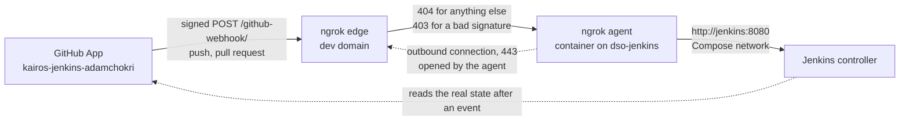

# Webhook: how GitHub reaches Jenkins

The rebuild guide for a third party (WP4.8, D-45, which supersedes D-06). GitHub tells Jenkins about a push or a pull request the moment it happens, through a tunnel that lets exactly one request through. Secrets are never written here: each is named, and its value is in OpenBao (`docs/runbooks/accounts.md`).

The agent opens the connection to ngrok itself, so nothing is opened on the router, and the agent publishes no port on `dso-jenkins`: port 8080 stays behind the `DOCKER-USER` allow-list (the Legion and the build agent only). The agent's own web interface and API have no authentication, so they are switched off (`web_addr: false`): measured from the Jenkins controller, a request to port 4040 of the agent answered 200 before and is refused now.

## 1. What lives where

| Piece | Where | Held by |
|---|---|---|
| The webhook (URL, secret, events) | GitHub → Settings → Developer settings → GitHub Apps → `kairos-jenkins-adamchokri` → General → Webhook | Active; URL `https://<dev domain>/github-webhook/`; events *Push* and *Pull request*; SSL verification on |
| The agent and its policy | `dso-jenkins`, `/opt/jenkins/compose.yaml` (service `ngrok`) and `/opt/jenkins/ngrok/ngrok.yml` | Rendered by `infra/ansible/roles/jenkins-controller` (`templates/ngrok.yml.j2`); the image is `image_ngrok` in `infra/ansible/group_vars/all/images.yml`, by digest |
| The authtoken, the dev domain and the webhook secret | OpenBao `kv/infra/ngrok`, fields `authtoken`, `domain`, `webhook_secret` | Read by Ansible with your own `bao` login; the rendered file is `root:ngrok-cfg`, mode 0640 |
| The secret as Jenkins checks it | Jenkins credential `github-webhook-secret` (kind *Secret text*), named under *Manage Jenkins → System → GitHub → Advanced → Shared secrets* | The same value as the one above |
| The periodic scan | Job `kairos` → *Scan Repository Triggers* (the heading in this Jenkins): *Periodically if not otherwise run* is **off**; the webhook is the only trigger | Jenkins |

## 2. Setup, in order

1. **ngrok:** a free account with two-factor sign-in; the account's *dev domain* (Dashboard → Domains: `<name>.ngrok-free.dev`, fixed for the account); an authtoken made for this agent alone (Dashboard → Authtokens).
2. **OpenBao:** `kv/infra/ngrok` with `domain`, `authtoken` and `webhook_secret`, written in one run of `infra/openbao/kv-put.sh`: the authtoken at its hidden prompt, the webhook secret generated on the spot (`openssl rand -hex 32`) and never displayed.
3. **The image:** `bash ci/tools/pin-images.sh image_ngrok`, review the diff, commit it.
4. **Ansible:** `bao login -no-print -method=userpass username=adam`, then `cd infra/ansible && ansible-playbook site.yml --tags jenkins`. A second run reports `changed=0`.
5. **GitHub App:** *Webhook* active, URL `https://<dev domain>/github-webhook/`, the secret (from the clipboard), events *Push* and *Pull request*.
6. **Jenkins (as `admin`):** the credential `github-webhook-secret`; the same credential under *System → GitHub → Advanced → Shared secrets*; **Manage hooks** off if a GitHub server is listed (Jenkins must not try to register its private address); on the job, the periodic scan switched off (*Periodically if not otherwise run* unticked; it was 2 minutes).

## 3. Checks

- `bash ci/tools/webhook-check.sh`: six lines `PASS`. Two kinds of request are refused at ngrok (anything but `POST /github-webhook/` gets 404, a POST without a valid signature gets 403), and Jenkins refuses an unsigned event itself.
- GitHub → the App → *Advanced* → *Recent Deliveries*: a delivery answered **200**. *Redeliver* repeats it.
- A push or a pull request: the build starts without waiting for a scan, and its cause line names an event (a push or a pull request), not *Branch indexing*, which is what a scan shows.
- Agent: `ssh -i ~/.ssh/kairos_admin adam@jenkins.kairos.lab 'sudo docker compose -f /opt/jenkins/compose.yaml ps ngrok'` shows it running; the same with `logs --tail 20 ngrok` ends with `started tunnel name=jenkins-webhook` (the agent logs its lifecycle at level `info`, not each request) and holds no line `starting web service`.
- The agent's API is closed to the other containers: `ssh -i ~/.ssh/kairos_admin adam@jenkins.kairos.lab 'sudo docker compose -f /opt/jenkins/compose.yaml exec -T jenkins curl -sS -m 5 -o /dev/null -w "%{http_code}\n" -H "Host: localhost:4040" http://ngrok:4040/api/status'` prints `000` (connection refused). With the interface on, it printed 200.

## 4. What the answers mean

| GitHub's Recent Deliveries shows | Cause |
|---|---|
| 200 | Jenkins accepted it |
| 404 from ngrok | The path or the method is not the route: check the URL ends in `/github-webhook/` with the slash |
| 403 | The signature does not match: the secret differs between GitHub, `kv/infra/ngrok` and the Jenkins credential |
| Timeout, or an ngrok error page | The agent is down, or the free plan's monthly cap is used up |

Nothing recovers a lost event by itself, because the periodic scan is off (D-45): in the App's *Recent Deliveries* press *Redeliver* on it, or press *Scan Repository Now* on the job in Jenkins, which asks GitHub for the real state of every branch and pull request. To close the route at once, stop the agent (on `dso-jenkins`: `sudo docker compose -f /opt/jenkins/compose.yaml stop ngrok`); Jenkins is not touched. To go back to polling (D-06), tick *Periodically if not otherwise run* on the job again (it was 2 minutes); the supervisor excluded it, so that is a decision, not a repair.

## 5. Rotation

- **Authtoken** (90 days, or on suspicion): make a new one in ngrok; `read -rsp 'authtoken: ' T && printf '%s' "$T" | bao kv patch kv/infra/ngrok authtoken=- ; unset T` (hidden prompt, nothing on a command line); rerun Ansible with `--tags jenkins`; then delete the old authtoken in ngrok.
- **Webhook secret** (90 days, or on suspicion): a new value in OpenBao (`openssl rand -hex 32 | tr -d '\n' | bao kv patch kv/infra/ngrok webhook_secret=-`), then Ansible (ngrok), then the Jenkins credential, then the GitHub App's secret (`bao kv get -field=webhook_secret kv/infra/ngrok | tr -d '\n' | clip.exe` puts it on the clipboard; clear the clipboard afterwards). Between the second and the last step deliveries are refused; once the three values agree, *Redeliver* the ones that matter (or press *Scan Repository Now* on the job).

## 6. Limits of the free plan (read in ngrok's documentation on 2026-11-12)

One dev domain; 3 endpoints; 1 GB of outbound data and about 20,000 HTTP requests a month; **500 webhook verifications a month**. What ngrok does with a request once the verification cap is used is not stated where this was read; either way a forged event cannot get in, because Jenkins checks the signature again, and a real one can be redelivered by hand once the route answers again. Each run of `webhook-check.sh` costs a few verifications.

Sources: ngrok, *Free plan limits*, *Verify Webhook action* and *GitHub to Jenkins* (ngrok.com/docs); Jenkins *GitHub plugin* and *GitHub Branch Source* (plugins.jenkins.io).
