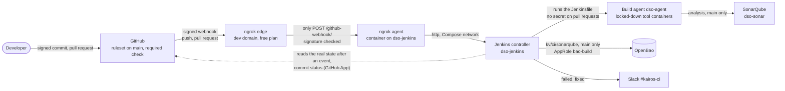

# Threat model (final state)

The second half of a before and after. `docs/as-is/threat-model.md` is the **before**: STRIDE per element on the original application and pipeline, threats T-01 to T-12, and T-13 to T-15 for Kairos Assist, written before its code. This file is the **after**: the same fifteen threats checked against what the repository holds now, and five new ones (T-16 to T-20) for the one thing added since, the webhook route of D-45. The webhook route was modelled first, its controls were built from that model, and each was tested (WP4.8). Nothing here is claimed that a file, a test or a build in the repository does not show; what is not built is marked **Open**, with its reason.

## Diagram 3: the delivery pipeline as built

Trust boundaries: GitHub, ngrok and Slack are outside the lab. The only way in from outside is the tunnel, which the agent opens itself (an outbound connection on 443; no port is published and the router is unchanged), and which carries one request: a signed `POST /github-webhook/`. The build agent is still where untrusted dependency code runs, and it holds no signing or deploy credential (D-05). The application's own diagram (browser, React, FastAPI, PostgreSQL) is unchanged from the before.

## T-01 to T-15 against the repository now

Status: **Mitigated** (the control is in place and the repository shows it) · **Open** (not mitigated: named, with its reason) · **Partly** · **Accepted** (a decision, with its reason).

| # | Threat | Status | What stands against it now | Shown by |
|---|---|---|---|---|
| T-01 | A malicious dependency or install script steals secrets (T, I) | **Mitigated** | `npm ci --ignore-scripts`; frozen lockfiles; Dependabot with a 7-day cooldown; the install runs in a locked-down tool container; pull-request builds receive no secret, and the build agent holds no signing or deploy credential (D-05) | `ci/scripts/build_test.sh`; the `Jenkinsfile` (`withVault` on `main` only) |
| T-02 | An unsigned or modified image is deployed (T) | **Open** | The pipeline builds and scans the images and ends there. The seven stages after `docker_scan` (`sbom`, `publish`, `sign`, `deploy_staging`, `dast`, `approve_production` and `deploy_production`) are placeholders on `main` that only print a line (D-46): nothing is published, signed or deployed, and a green box there is not evidence of a control. The `:latest` images on the as-is hosts come from the retired as-is job, which no longer polls GitHub. Digest-only deploys and signature checks do not exist | `Jenkinsfile`: the `ci` stage has eight, the last is `docker_scan`, then the seven placeholders; `docs/lab/services.md` (the as-is rows) |
| T-03 | A secret is committed (I) | **Mitigated** | Gitleaks in the pre-commit hook and in `secrets_scan` (enforce); GitHub push protection; the two seeded fake values are baselined by fingerprint (D-33) | `docs/evidence/EV-04-hook-blocks-secret.png`, `EV-24-*`; `MODE_SECRETS=enforce` |
| T-04 | A compromised scanner image (E) | **Mitigated** | Every tool image is pinned by digest in `ci/tools/tools.lock` (7-day rule, denylist, checked by `preflight`) and runs through `ci/scripts/run-tool.sh`: read-only root, no capabilities, no network unless the tool needs it, never the Docker socket | `ci/tools/check-tools-lock.sh`; `ci/scripts/run-tool.sh` |
| T-05 | Another user's task is read or changed, IDOR (E) | **Open** (SV-06) | Seeded on purpose and not fixed by this project: it stays as the baseline records it | `security/seeded-vulns.md` |
| T-06 | Injection: SQL, XSS, deserialization (T, E) | **Mitigated** | SV-02 to SV-04 fixed, each with a regression test written first (red build, then green); SAST in enforce mode: Semgrep with custom rules, Bandit, ESLint, SonarQube on `main`. No single tool caught all three (IDE-03), which is why there are four | pull-request builds; 76 backend and 31 frontend tests (`docs/time-log.md`) |
| T-07 | The pipeline definition is edited to skip gates (T) | **Mitigated**, with a residual | Ruleset on `main`: pull request, signed commits, required check `continuous-integration/jenkins/pr-merge`; fork pull requests are never built; thresholds live in `security/policy/gates.env` and change only through a pull request. Residual: a pull request can weaken its own Jenkinsfile, and a single maintainer reviews it; such a build holds no secret, and `main`'s own run applies the file as merged | `docs/evidence/EV-24-*`; red builds block the merge |
| T-08 | Host takeover through weak SSH or defaults (E) | **Open** (SV-11) | Not hardened (SV-11): the as-is deploy account takes a password on hosts with no firewall. Detection exists: Wazuh agents on both runtime hosts, the SSH brute-force rule (5712) reaching Slack, a measured CIS baseline of 47 % | `docs/evidence/EV-22-*`; Wazuh |
| T-09 | No record of who changed or approved what (R) | **Mitigated** | Jenkins Audit Trail (logins, configuration, runs), signed commits, the OpenBao audit device shipped to Wazuh; the webhook adds GitHub's delivery log and ngrok's Traffic Inspector. The pipeline deploys nothing, so there is no deployment approval to record | `docs/runbooks/jenkins.md` section 2; `EV-25-*` |
| T-10 | A secret leaks through logs or process arguments (I) | **Mitigated** | `withVault` masking; secrets only inside single-quoted `sh` (no Groovy interpolation); the Sonar token is passed by name (`--env SONAR_TOKEN`), never on a command line; pull requests bind none; the as-is job's Read & Write Docker Hub token was revoked (WP4.1) | `Jenkinsfile`; `ci/scripts/sast.sh`; `docs/runbooks/accounts.md` |
| T-11 | A stolen AppRole credential, or lost unseal shares (S, I, D) | **Mitigated** | AppRoles bound to `dso-jenkins`'s address, one least-privilege policy each, short Jenkins tokens, 90-day secret IDs, audit log into Wazuh; the only secret the pipeline reads is `kv/ci/sonarqube`. Two credentials no stage reads are carried for a decision (KEY-01) | `infra/openbao/test-approles.sh` (30 checks); `EV-27-*` |
| T-12 | A device on the lab LAN probes the lab (S, I) | **Partly** | The tool VMs publish only their ports, behind the `DOCKER-USER` allow-list (Jenkins 8080: the Legion and the build agent only), with IPv6 off. The as-is runtime hosts still answer on 22, 5173 and 8000 | `kairos-docker-allowlist --check` (Ansible role `docker`); SV-11 |
| T-13 | Hidden instructions in a task, or script in the answer (I, T) | **Mitigated** | SV-12 and SV-13 fixed with their tests first: context limited to the caller's own tasks, untrusted text delimited, the answer validated by a schema and rendered as text. Tested with a stub model; no call to the live provider has been made | regression tests; Semgrep rules `kairos.llm-context-unscoped` and the SV-03 rule |
| T-14 | Abuse of the assistant runs up the bill (D) | **Mitigated** | SV-14 fixed: non-thinking mode, `max_tokens` 400, a 20-second timeout, 5 calls a minute per user, `ASSIST_ENABLED` off by default | regression tests; Semgrep rule `kairos.llm-call-unbounded` |
| T-15 | Task text leaves the lab for another jurisdiction (I) | **Accepted** | By design, for lab data only: fake users' text, an opaque `user_id`, the feature off by default, and no provider key has been created yet | D-20; the opaque identifier is asserted by a test |

## T-16 to T-20: the webhook route (WP4.8, D-45)

Written before the route was built. Each control below was built because a row asked for it, and each has a check.

| # | Threat (STRIDE) | Status | What stands against it | Shown by |
|---|---|---|---|---|
| T-16 | A forged or replayed event makes Jenkins scan or build (S) | **Mitigated** | The GitHub signature is checked twice, at ngrok (`verify-webhook`) and again by Jenkins (shared secret, credential `github-webhook-secret`). An event only starts a scan, which asks GitHub for the real state, so a forged one cannot make Jenkins build code GitHub does not hold. GitHub signs the body without a timestamp, so a captured genuine delivery could be replayed: the effect is one extra scan | `ci/tools/webhook-check.sh`: unsigned and wrongly signed requests get 403 at ngrok, an unsigned request straight to Jenkins gets a 4xx; GitHub's *Redeliver* gets 200 |
| T-17 | A flood on the public address exhausts Jenkins or the free plan's caps (D) | **Accepted** | The edge drops everything except the route; scans are cheap and `disableConcurrentBuilds` is on. The free plan's monthly caps (500 webhook verifications, about 20,000 requests) can silence the route, and then no build starts until someone presses *Redeliver* in GitHub or *Scan Repository Now* in Jenkins: the periodic scan is off (D-45), so a lost event is a delay and not a lost change (GitHub keeps the commit), and with one developer the lab accepts it | `docs/runbooks/webhook.md` sections 4 and 6; the periodic scan is off on the job (`docs/runbooks/jenkins.md` section 6) |
| T-18 | Jenkins is reached through the tunnel beyond the route, or the agent is driven from inside the Compose network (I, E, T) | **Mitigated** | Any other path or method is answered 404 at the edge; the agent publishes no port; Jenkins gives *Anonymous* no right at all; the agent container has no capabilities, a read-only root, `no-new-privileges`, and memory and process limits; the agent's own web interface and API, which have no authentication, are switched off (`web_addr: false`), so no other container can stop or re-point the route | `ci/tools/webhook-check.sh`: `GET /login`, `GET /github-webhook/` and `POST /login` each get 404; from the controller, a request to port 4040 of the agent is refused (`docs/runbooks/webhook.md` section 3) |
| T-19 | The tunnel provider, or its account, is compromised (S, I, T) | **Accepted** | ngrok ends TLS, sees each delivery and holds the webhook secret in its policy. The repository is public, so the events carry nothing private; the authtoken is for this agent alone, is kept in OpenBao and in a `root:ngrok-cfg` 0640 file, and the ngrok account has two-factor sign-in. A compromise could silence the route or forge events, whose effect is bounded by T-16; rotation is 90 days or on suspicion | `docs/runbooks/accounts.md`; `docs/runbooks/webhook.md` section 5 |
| T-20 | A webhook-triggered build runs code it should not (T, E) | **Mitigated** | No new path: an event starts a scan, and what is built is decided by the rules that already held under polling: branches and pull requests of the origin only, no forks, no secret on a pull-request build, one read of `kv/ci/sonarqube` on `main` | `docs/runbooks/jenkins.md` section 6; the `Jenkinsfile` |

## Reading the result

- Twenty threats: **13 mitigated, 1 partly, 3 open, 3 accepted.**
- The three open threats (T-02, T-05, T-08) and the partly mitigated one (T-12) sit on the as-is side: the images it runs (T-02), another user's task (T-05, SV-06) and the hosts (T-08, T-12, SV-11). One more seeded weakness stays as the baseline records it and has no row of its own in this model: SV-08, the API's error pages, CORS and headers, and plain HTTP (the *before* notes that nothing is encrypted in transit); it is described in `security/seeded-vulns.md`. Each open item is named, in its row or here.
- The webhook adds one exposed route and nothing else. What it buys is builds that start when GitHub reports the change instead of after up to two minutes, and with no periodic scan left on the job a lost event is redelivered by hand (T-17); the trade was taken knowingly, with the model written first.
